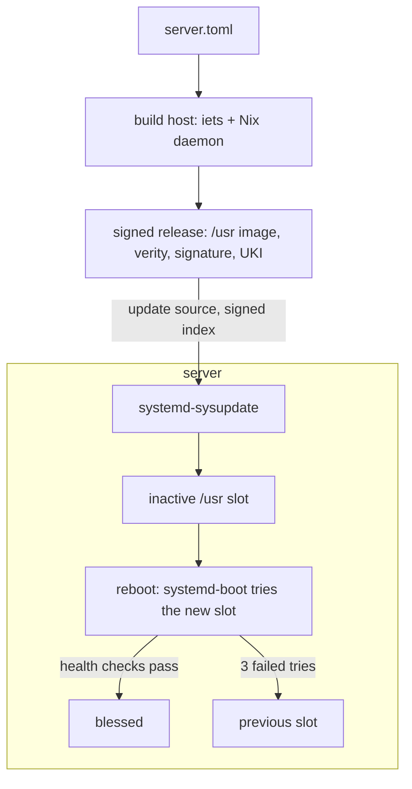

# Golconda

*Ceci n'est pas un NixOS.*

Golconda is a server operating system built with Nix, but without nixpkgs or NixOS. You describe a
machine in one TOML file. A build host turns that file into one signed disk image. The server boots
the image, checks every block it reads, and updates itself by swapping in the next image. systemd
does the work on the machine: boot, logging, networking and updates, with no second tool for any of
these jobs. Nix builds the image but is not installed on the machine.

It is for people who run Linux servers and appliances and want each one to be a copy of a known,
reproducible image: no drift, no package manager on the host, and a rollback that happens by itself.



A few words used below: a **UKI** (unified kernel image) is one signed file with the kernel, the
initrd and the kernel command line. **erofs** is a read-only file system, and **dm-verity** checks
each block of it against a signed hash. The [Glossary](docs/reference/glossary.md) has the rest.

## Features

Each feature has a page of its own: what it gives you, how it works, how far it is proven, and its
limits.

- **[One image for every machine](docs/features/one-image.md).** The image holds no host name, key
  or other per-machine value, so one build serves every machine of its kind. The Nix store lives
  inside the image at `/usr/nix/store`; the machine has no Nix.
- **[A read-only, verified `/usr`](docs/features/verified-usr.md).** `/usr` is erofs under dm-verity
  with a signed root hash. `/etc` starts as links into the image and an administrator's file wins;
  `/var` holds the state.
- **[Only signed code runs](docs/features/execution-policy.md).** The kernel's IPE policy lets a
  program run only from the verified `/usr`, so a binary copied to `/var` does not run.
- **[Secure Boot and measured boot](docs/features/measured-boot.md).** systemd-boot and each UKI are
  signed; the UKI is measured into the TPM. Hosts without Secure Boot, such as Hetzner Cloud, still
  check `/usr`.
- **[A/B updates with health-checked rollback](docs/features/updates.md).** systemd-sysupdate writes
  the next release to the other slot. The new entry is blessed only when the network is routable and
  sshd is up; after three failed boots the previous slot boots again.
- **[Reproducible, signed releases](docs/features/signed-releases.md).** The same inputs give the
  same image, the same root hash and the same file names. The machine installs only what the release
  key signed.
- **[Secrets as vars](docs/features/vars.md).** A secret never enters the image or the store. A
  *local* var, such as the ssh host key, is made on the machine at first boot and sealed with
  `systemd-creds` to the TPM. An *admin* var, such as a host certificate, is pushed by the
  administrator; the tool that pushes and seals it is *(planned)*. Services read vars as systemd
  credentials.
- **[Provisioning without cloud-init](docs/features/provisioning.md).** The host name and root's
  first ssh key arrive as systemd credentials, through SMBIOS, qemu fw_cfg or a file on the ESP.
- **[Certificate login, no local login](docs/features/ssh-login.md).** Operators log in as root with
  OpenSSH certificates from a CA outside the image. There are no passwords, no getty and no setuid
  binaries.
- **[Factory reset and recovery](docs/features/factory-reset.md).** One command wipes the state and
  keeps the slots. The other slot, the boot menu and a reflash are the other ways back.
- **[One of each](docs/features/one-of-each.md).** One libc, one toolchain (LLVM), one TLS stack,
  one CA store, one init, one logger, one network stack, one shell. Package features and lints
  enforce it; the one exception is listed.
- **[Typed modules, duplicates are errors](docs/features/typed-modules.md).** A module returns a
  typed fragment and the composer unions them. Two sources for one file are an error that names
  both: no priorities, no overrides.
- **[Configuration as data](docs/features/config-as-data.md).** The TOML file is checked against a
  JSON Schema of the module tree. The image carries its configuration, its module list and an SBOM
  (software bill of materials) in CycloneDX.
- **[Your own modules and packages](docs/features/extending.md).** Put `modules/` and `packages/`
  beside your TOML file. Replacing a Golconda package needs an explicit opt-in.

[Comparison](docs/design/comparison.md) says what Golconda takes from NixOS, ParticleOS, Flatcar and
others, and what you give up against NixOS.

## Status

The module tree, the composer, the `/usr` tree builder, the schema, the TOML loader, the image chain
and the update path exist and are tested. `scripts/boot-test` boots the image in QEMU with OVMF and
checks markers: Secure Boot, TPM sealing, ssh login, an A/B update over HTTP, the three-boot
fallback, a key rotation and a factory reset. [What is proven](docs/proven.md) is the one table of
what has run and what has not.

Not there yet: real hardware (only QEMU has run), aarch64, an encrypted state partition (LUKS2 with
TPM2 is after v1), and protection against booting an older signed image. The docs mark each designed
thing *(planned)* and each deferred one *(after v1)*; [Scope](docs/design/scope.md) says what is v1,
after v1, and out of scope.

## Quick start

You need Nix. Image builds also need a Nix daemon with `ca-derivations` and `dynamic-derivations`
([Build host](docs/reference/build-host.md)).

```sh
nix-shell                      # or: direnv allow
./scripts/lint                 # strict iets lint, module tests, sandboxed checks
scripts/docs serve             # the book (generates the module pages first)

# build the test image and boot it in QEMU (needs KVM and the daemon above)
nix-build -A packages.x86_64-linux.image-smoke-test
scripts/boot-test result/disk/disk.raw --keys result/keys --secure-boot --ssh-test
```

## Where to read next

1. [Features](docs/features/one-image.md): one page each, short.
1. [Walkthrough](docs/reference/walkthrough.md): from `examples/server.toml` to a booted machine.
1. [Principles](docs/design/principles.md), then the design pages in order: they say why.
1. The reference pages: they say what exists. [Making a release](docs/reference/release.md) and
   [Deploying to Hetzner Cloud](docs/reference/hetzner-cloud.md) are step-by-step guides.

Contributing: [CONTRIBUTING](CONTRIBUTING.md).

## License

GPL-3.0-or-later. See [LICENSE](LICENSE).
