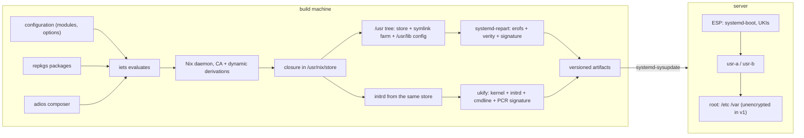

# Architecture

A Golconda system is a set of build-time tools that produce one signed image, and a small set of
systemd components that boot, verify and update it. The machine itself contains no build tooling.

## How the parts fit

- **repkgs** builds every package so that the output never names its own store path: libraries are
  found by `$ORIGIN`, the dynamic loader by a stub relative to the binary, scripts by `launch`
  records. That is what lets the store live at `/usr/nix/store` inside a read-only image with no Nix
  on the machine, and what makes the initrd simply the closure of systemd.
- **adios** types every module with korora and composes them by explicit function application: a
  module returns a fragment, the `/system` composer unions fragments and refuses duplicates. The
  result is one attribute set of units, files, users and packages, which the image builder renders.
  There is no global namespace and no evaluation-time magic, so iets can evaluate and lint it fast
  and a tool can read it as data.
- **iets** evaluates the configuration and the package set, runs the strict lints, and talks to the
  Nix daemon that builds. **npins** pins the inputs; `nix/sources.nix` reads them purely.
- **systemd** does the rest: repart makes the partitions, ukify the unified kernel image, sysupdate
  the A/B updates, systemd-boot the counting, veritysetup and cryptsetup the integrity and the
  unlock. Golconda adds configuration, never a second mechanism.

## Components

| component                      | role                                        | where                            |
| ------------------------------ | ------------------------------------------- | -------------------------------- |
| npins                          | pins repkgs, adios, flake-incompat, iets    | `npins/`                         |
| flake-incompat                 | output schema, per-system arguments         | `default.nix`, `nix/default.nix` |
| platform record                | repkgs' record, every tool reads it         | `nix/packages.nix`               |
| repkgs                         | packages, toolchain, relocatable outputs    | `nix/packages.nix`, `packages/`  |
| adios                          | typed module tree, fragments, the composer  | `modules/`                       |
| iets                           | evaluation and lints                        | `iets.toml`, `scripts/lint`      |
| systemd-repart                 | partition images, verity, signing           | image builder                    |
| ukify, systemd-measure         | the unified kernel image and its PCR policy | image builder                    |
| systemd-boot, stub, bless-boot | boot, counting, measurement                 | ESP                              |
| systemd-sysupdate              | A/B updates                                 | `/usr/lib/sysupdate.d`           |

See [Layout](layout.md) for the on-disk result and [Boot](boot.md) for the sequence.
