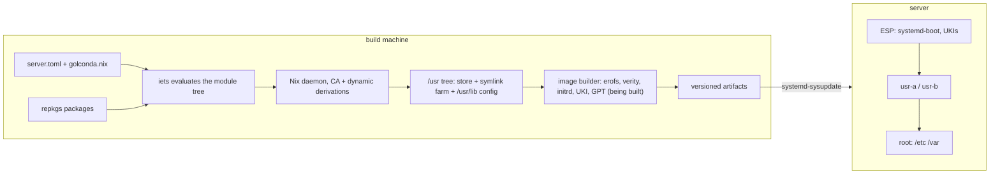

# Architecture

A Golconda system is a set of build-time tools that produce one signed image, and a small set of
systemd components that boot, verify and update it. The machine itself contains no build tooling.

## How the parts fit

- **repkgs** builds every package so that the output never names its own store path: libraries are
  found by `$ORIGIN`, the dynamic loader by a stub relative to the binary, scripts by `launch`
  records. That is what lets the store live at `/usr/nix/store` inside a read-only image with no Nix
  on the machine, and what makes the initrd a second, smaller `/usr` tree from the same store.
- **adios** types every module with korora and composes them by explicit function application: a
  module returns a fragment, the `/system` composer unions fragments and refuses duplicates. The
  result is one attribute set of units, files, users, tmpfiles, packages and symlinks, which the
  `/usr` tree builder renders. There is no global namespace and no evaluation-time magic, so iets
  can evaluate and lint it fast and a tool can read it as data.
- **iets** evaluates the configuration and the package set, runs the strict lints, and talks to the
  Nix daemon that builds. **npins** pins the inputs; `nix/sources.nix` reads them purely.
- **systemd** does the rest: repart makes the partitions, ukify the unified kernel image, sysupdate
  the A/B updates, systemd-boot the counting, veritysetup and cryptsetup the integrity and the
  unlock. Golconda adds configuration, never a second mechanism.

## What every image contains

The `/base` module is implicit: the composer merges it first, and a configuration cannot leave it
out. It brings systemd, dbus-broker, dash (as `/usr/bin/sh`), uutils coreutils and the kernel; the
units for networkd, resolved, timesyncd and the D-Bus socket; `C.UTF-8` as the only locale; the
timesyncd pool and the journal size. `/network` is implicit too: DHCP on every wired link unless the
document says otherwise. Everything else is a module the document names
([Configuration](config.md)).

## Components

| component                      | role                                                 | where                              |
| ------------------------------ | ---------------------------------------------------- | ---------------------------------- |
| npins                          | pins repkgs, adios, flake-incompat, iets, pele       | `npins/`                           |
| flake-incompat                 | output schema, per-system arguments                  | `default.nix`, `nix/default.nix`   |
| platform record                | repkgs' record, every tool reads it                  | `nix/packages.nix`                 |
| repkgs                         | packages, toolchain, relocatable outputs             | `nix/packages.nix`, `packages/`    |
| adios                          | typed module tree, fragments, the composer           | `modules/`                         |
| iets                           | evaluation and lints                                 | `iets.toml`, `scripts/lint`        |
| schema, TOML loader            | JSON Schema of the tree; document → options          | `lib/schema.nix`, `lib/config.nix` |
| entry point                    | `mkSystem`: document → composed system → `/usr` tree | `lib/system.nix`, `golconda.nix`   |
| usr tree                       | closure + symlinks + config → directory for erofs    | `lib/usr-tree.nix`                 |
| image definitions              | repart, sysupdate, UKI, erofs, os-release as data    | `image/*.nix`                      |
| image builder *(being built)*  | erofs, verity, initrd, UKI, GPT from the `/usr` tree | `lib/image/`                       |
| systemd-boot, stub, bless-boot | boot, counting, measurement                          | ESP                                |
| systemd-sysupdate              | A/B updates                                          | `/usr/lib/sysupdate.d`             |

See [Layout](layout.md) for the on-disk result and [Boot](boot.md) for the sequence.
