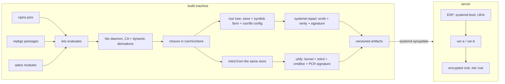

# Architecture

A Golconda system is a set of build-time tools that produce one signed image, and a small set of
systemd components that boot, verify and update it. The machine itself contains no build tooling.

## Components

| component                      | role                                        | where                            |
| ------------------------------ | ------------------------------------------- | -------------------------------- |
| npins                          | pins repkgs, adios, flake-incompat, iets    | `npins/`                         |
| flake-incompat                 | output schema, per-system arguments         | `default.nix`, `nix/default.nix` |
| system.nix                     | the platform record every tool reads        | `nix/system.nix`                 |
| repkgs                         | packages, toolchain, relocatable outputs    | `nix/packages.nix`, `packages/`  |
| adios                          | typed module tree, fragments, the composer  | `modules/`                       |
| iets                           | evaluation and lints                        | `iets.toml`, `scripts/lint`      |
| systemd-repart                 | partition images, verity, signing           | image builder                    |
| ukify, systemd-measure         | the unified kernel image and its PCR policy | image builder                    |
| systemd-boot, stub, bless-boot | boot, counting, measurement                 | ESP                              |
| systemd-sysupdate              | A/B updates                                 | `/usr/lib/sysupdate.d`           |

See [Layout](layout.md) for the on-disk result and [Boot](boot.md) for the sequence.
