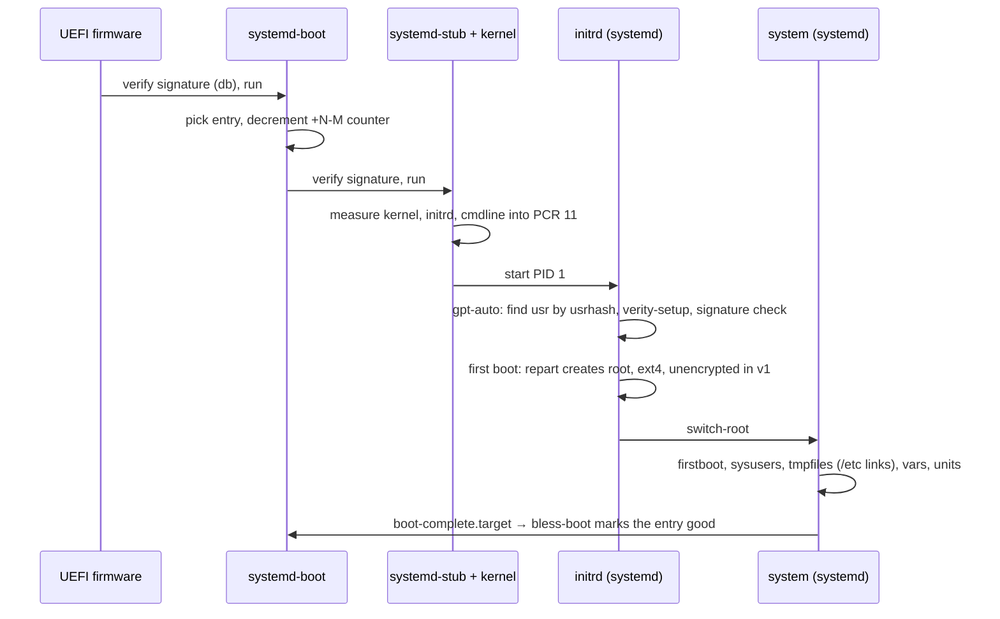

# Boot

Boot is a chain of signed and measured steps from firmware to `boot-complete.target`, all of them
systemd's. Each UKI carries the `usrhash=` of its `/usr` slot, which is how A and B differ. The UKI
and the initrd are built (`lib/image/`); Secure Boot and measured boot are signed but not yet
enforced or tested *(planned)*.

## The initrd

The initrd is a second `/usr` tree from the same store (`lib/image/initrd.nix`): `/base` plus lvm2
and cryptsetup, minus the kernel, as a zstd cpio. systemd is PID 1 (`/init` points at it), udev runs
with systemd's rules and lvm2's device-mapper rules (`10-dm`, `13-dm-disk`, `95-dm-notify`, with
`{prefix}` replaced by `/usr`) and `dmsetup`; `blkid` must be there too, or `13-dm-disk` cannot
probe the verity device and systemd keeps it at `SYSTEMD_READY=0`. Around `/usr` sit
`/etc/initrd-release` (a link to `os-release`, how systemd knows it is in an initrd), the merged-usr
links `/bin` `/sbin` `/lib`, and the empty mount points. There is no machine-id, no shadow, no
getty, no static init. It needs no root partition to find `/usr`: `usrhash=` on the cmdline names
the verity root hash, the generators derive the two DPS partition UUIDs from it, veritysetup
attaches `/dev/mapper/usr`, and repart makes the root partition from
`/usr/lib/repart.d/30-root.conf` on first boot. The cmdline also carries
`rdinit=/usr/nix/store/<systemd>/lib/systemd/systemd`: a repkgs binary maps its dynamic linker
relative to its own path, which before `/proc` exists is the path the kernel execs, so the kernel
must be told the real file, not the `/init` link. The kernel's configuration is in
[Kernel](kernel.md).

## Boot counting and A/B

The UKI is installed as `EFI/Linux/<id>_<version>+3-0.efi`. systemd-boot decrements the counter on
each attempt; `systemd-bless-boot` renames it to good when `boot-complete.target` is reached. After
three failures systemd-boot falls back to the other entry, which is the other `/usr` slot. See
[Updates](updates.md).

## Kernel command line

# The cmdline is fixed in the UKI and measured with it: \<<\<<\<<< HEAD `usrhash=<hash> console=tty0 console=ttyS0,115200 rdinit=<systemd>` (`image/uki.nix`, plus `rdinit=` from the builder). No administrator edits: `loader.conf` edits are off, and nothing adds `rw`, `ro` or `systemd.volatile=` (`/` is the state partition, which gpt-auto mounts writable when nothing says `ro`; `/usr` is verity). A debug image with more is a separate build *(after v1)*. ||||||| parent of 697f012 (kernel: LSM phase 1 with IPE, lockdown and Yama) `usrhash=<hash> console=tty0 console=ttyS0,115200`. No administrator edits: `loader.conf` edits are off, and nothing adds `rw` or `systemd.volatile=` (`/` is the state partition, mounted writable by systemd; `/usr` is verity). The template in `image/uki.nix` still carries `ro systemd.volatile=no` until the image builder lands *(being built)*. A debug image with more is a separate build *(after v1)*.

`usrhash=<hash> lsm=lockdown,yama,ipe,bpf lockdown=integrity ipe.enforce=0 console=tty0 console=ttyS0,115200`.
The LSM parameters enable kernel-side trust enforcement; see [Kernel](kernel.md) for the policy. No
administrator edits: `loader.conf` edits are off, and nothing adds `rw` or `systemd.volatile=` (`/`
is the state partition, mounted writable by systemd; `/usr` is verity). A debug image with different
parameters is a separate build *(after v1)*.

> > > > > > > 697f012 (kernel: LSM phase 1 with IPE, lockdown and Yama)

## Serial console

`console=ttyS0` gives output on the serial line, `console=tty0` on the local display. No getty runs
on either: there is no local login path in v1 ([Trust: Identity](trust.md#identity)). Recovery from
a machine that no longer answers over ssh is the other slot (boot counting, or a manual choice in
the systemd-boot menu) or a reflash.

## Bootstrap credentials

A few values are neither in the image nor generated on the machine: they arrive as systemd
credentials at first boot. This is Golconda's provisioning path; there is no cloud-init.

| credential        | read by           | what it sets                                                 |
| ----------------- | ----------------- | ------------------------------------------------------------ |
| `system.hostname` | systemd-firstboot | `/etc/hostname`; without it, DHCP's host name or `localhost` |

Delivery, in the order systemd-stub and PID 1 look:

- **SMBIOS** (`io.systemd.credential:<name>=<value>` in DMI type 11 OEM strings): on qemu
  `-smbios type=11,value=io.systemd.credential:system.hostname=web1`; on a cloud, whatever the
  provider exposes as OEM strings.
- **qemu fw_cfg**: `-fw_cfg name=opt/io.systemd.credentials/system.hostname,string=web1`.
- **ESP**: `loader/credentials/*.cred` files; systemd-stub passes them to the initrd.

The ESP is not encrypted, and SMBIOS strings are readable by every process: a bootstrap credential
carries no secret. Secrets are vars ([Trust: Secrets and vars](trust.md#secrets-and-vars)).

## First boot

What happens once, on the first boot of a disk:

1. repart creates the root partition from `/usr/lib/repart.d/30-root.conf` (`GrowFileSystem=`,
   `FactoryReset=`), with `/etc`, `/var`, `/home`, `/root` inside.
1. PID 1 writes `/etc/machine-id`; systemd-firstboot writes `/etc/hostname` from the credential.
1. systemd-sysusers writes `passwd`, `group`, `shadow` from `/usr/lib/sysusers.d`.
1. systemd-tmpfiles links each factory file into `/etc` and makes the state directories.
1. The var units generate the machine-local secrets and seal them to the TPM
   ([reference: /vars](../reference/modules/generated/vars.md)).
1. The services start; `boot-complete.target` blesses the entry.

Every later boot runs the same units; `ConditionNeedsUpdate=` and the vars' `done` markers make them
no-ops ([Updates: Versions](updates.md#versions)).

## Measured boot *(planned)*

systemd-stub measures the UKI's parts into PCR 11. `systemd-measure` precomputes those values at
build time and signs them; the signature travels in the UKI (`.pcrsig`). Credentials are sealed to
the signing key, not to a PCR value, so a new signed image unseals them without re-enrolment.
Firmware PCRs (0–7) are policy-locked with `systemd-pcrlock`.

## Secure Boot *(planned)*

Keys are generated once per deployment with `ukify genkey`; UKIs and systemd-boot are signed at
build time. Enrolment is systemd-boot's automatic enrolment from `loader/keys/auto` in setup mode,
or `sbctl` where firmware needs it. Key hierarchy in [Trust](trust.md).
