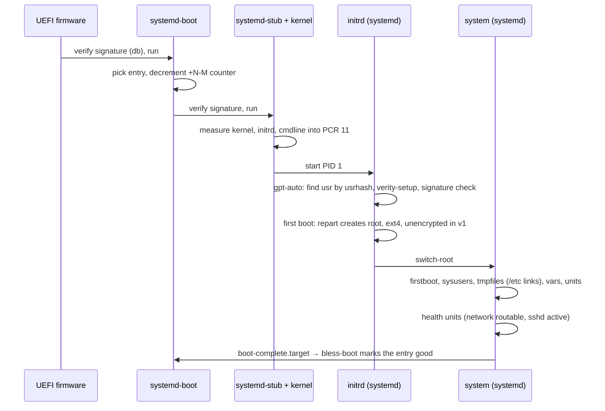

# Boot

Boot is a chain of signed and measured steps from firmware to `boot-complete.target`, all of them
systemd's. Each UKI carries the `usrhash=` of its `/usr` slot, which is how A and B differ. What the
test harness has run, and what it has not, is in [What is proven](#what-is-proven).

## The initrd

The initrd is a second `/usr` tree from the same store (`lib/image/initrd.nix`): `/base` plus lvm2
and cryptsetup, minus the kernel, as a zstd cpio. systemd is PID 1 (`/init` points at it), udev runs
with systemd's rules and lvm2's device-mapper rules (`10-dm`, `13-dm-disk`, `95-dm-notify`, with
`{prefix}` replaced by `/usr`) and `dmsetup`; `blkid` must be there too, or `13-dm-disk` cannot
probe the verity device and systemd keeps it at `SYSTEMD_READY=0`. Around `/usr` sit
`/etc/initrd-release` (a link to `os-release`, how systemd knows it is in an initrd), the merged-usr
links `/bin` `/sbin` `/lib`, and the empty mount points. There is no machine-id, no shadow, no
getty, no static init. It needs no root partition to find `/usr`: `usrhash=` on the cmdline names
the verity root hash, the generators derive the two DPS partition UUIDs from it, veritysetup
attaches `/dev/mapper/usr`, and repart makes the root partition from
`/usr/lib/repart.d/30-root.conf` on first boot. The cmdline also carries `rdinit=/init`: a repkgs
binary maps its dynamic linker relative to its own path, which before `/proc` exists is the path the
kernel execs; the fork's crt-interp and glibc follow the `/init` link to the real file without
`/proc`. The kernel's configuration is in [Kernel](kernel.md).

## Boot counting and A/B

The UKI is installed as `EFI/Linux/<id>_<version>+3-0.efi`. systemd-boot decrements the counter on
each attempt; `systemd-bless-boot` renames it to good when `boot-complete.target` is reached. After
three failures systemd-boot falls back to the other entry, which is the other `/usr` slot. See
[Updates](updates.md).

### Boot health

Reaching `boot-complete.target` is the whole condition for blessing. systemd's own target requires
only `sysinit.target`, so a candidate that boots but cannot be reached would be blessed. Golconda
adds two small predicates, one in each module that knows the fact:

| module           | unit                              | passes when                                                                           |
| ---------------- | --------------------------------- | ------------------------------------------------------------------------------------- |
| `/base`          | `golconda-health-network.service` | `systemd-networkd-wait-online --any --operational-state=routable --timeout=60` passes |
| `/services/sshd` | `golconda-health-sshd.service`    | `systemctl is-active sshd.service`                                                    |

"Routable" is networkctl's state: the link has carrier and a routable address, so DHCP finished and
there is a route to the network. Each unit is `Before=boot-complete.target` and is pulled into the
target by a `boot-complete.target.requires/` link, the same shape as systemd's own
`systemd-boot-check-no-failures.service`. A failed predicate fails the target's start job;
`systemd-bless-boot.service` requires the target and is ordered after it, so it does not run. The
counter stays and one attempt is lost. systemd's own bless-boot ordering is not changed and no
orchestrator is added.

What the predicate leaves out, on purpose: DNS and resolved, a default route to the administrator's
network, reachability from outside the machine (firewall, NAT, the client side), and every step of a
login (authentication, the host key credential, `/etc/pam.d/sshd`, the listening socket).
`is-active` proves that the sshd process runs, not that a login would succeed.

What happens after a failure: the machine stays up but is not blessed, and nothing in v1 reboots it,
so the counter falls only at the next boot. systemd-boot counts down `+3-0` → `+2-1` → `+1-2`; at
`+0-3` the entry is bad and is no longer preferred. A second deployment entry on the ESP (the other
`/usr` slot) is selected instead, which is the point of boot counting. Before the first update the
image carries one slot only: there systemd-boot still boots the exhausted entry, and a failed health
check leaves the machine unblessed until it is repaired or the other slot is filled. The health
units run only on a counted boot: `systemd-bless-boot-generator` adds `boot-complete.target` only
when the entry has a counter, so a blessed entry boots without them.

systemd-sysupdate tells the slots apart by GPT label: an installed slot carries its version
(`usr_20261031.1`, `usr-verity_…`, `usr-verity-sig_…`), a free one `_empty`, which gpt-auto also
skips. The builder labels slot A this way and leaves B `_empty`; an update relabels the slot it
writes ([Image artifacts](../reference/image.md#a-release)). It also gives the slot the partition
UUIDs in the release file names, the two halves of the new root hash, so the new UKI's `usrhash=`
finds its own slot and the old UKI still finds the old one. The UKI goes to `EFI/Linux` on the ESP
(`PathRelativeTo=boot`), which gpt-auto mounts at `/boot`.

## Kernel command line

The cmdline is fixed in the UKI and measured with it. The one authoritative copy is in
[Image artifacts: the kernel command line](../reference/image.md#the-kernel-command-line); the LSM
parameters are described in [Kernel](kernel.md). No administrator edits: the ESP carries
`loader/loader.conf` with `editor no` (the editor would let anyone at the console change the
cmdline) and `timeout 0` (the menu does not wait); see [Boot loader](bootloader.md). The UKI under
`EFI/Linux` needs no entry line. This is menu policy, not protection: an offline disk writer can
change the unsigned configuration ([Trust](trust.md)). The cmdline carries `rw` and neither `ro` nor
`systemd.volatile=` (`/` is the state partition; the initrd mounts it read-only unless the cmdline
says `rw`, and gpt-auto's remount-rw drop-in takes effect only when `systemd-remount-fs.service`
runs, late in boot). A debug image with other parameters is a separate build *(after v1)*.

The ssh host key var unit seals its key in `/etc/credstore.encrypted` before
`systemd-remount-fs.service` runs, so without `rw` it fails and sshd starts without a host key. `rw`
is an ordinary kernel parameter, and the test image boots the same cmdline. Libraries need no such
flag: the fork's RUNPATH reaches every dlopen soname.

gpt-auto-generator mounts the root partition (writable), the ESP and `/usr` by `usrhash=`. systemd
finds the libraries it dlopens through the RUNPATH the fork gives it. IPE enforces from the first
boot: `/usr` runs only if the kernel verified the verity signature, so the signer must be in the
firmware `db` ([Kernel: IPE](kernel.md#ipe-integrity-policy-enforcement)).

## Serial console

`console=ttyS0` gives output on the serial line, `console=tty0` on the local display. No getty runs
on either: there is no local login path in v1 ([Trust: Identity](trust.md#identity)). Recovery from
a machine that no longer answers over ssh is the other slot (boot counting, or a manual choice in
the systemd-boot menu) or a reflash; [Recovery](recovery.md) states what each path can and cannot
do, and [Boot loader: Recovery](bootloader.md#recovery) gives the loader steps.

## Bootstrap credentials

A few values are neither in the image nor generated on the machine: they arrive as systemd
credentials at first boot. This is Golconda's provisioning path; there is no cloud-init.

| credential        | read by | what it sets                                                        |
| ----------------- | ------- | ------------------------------------------------------------------- |
| `system.hostname` | PID 1   | the hostname, at every boot; nothing writes `/etc/hostname` from it |

PID 1 takes the hostname from the first of: `systemd.hostname=` on the kernel command line,
`/etc/hostname`, the `system.hostname` credential, the fallback `golconda` compiled into systemd
(repkgs `fallback-hostname`). No factory file and no tmpfiles line writes `/etc/hostname`, so the
credential wins until an admin writes one. PID 1 reads SMBIOS strings from
`/sys/firmware/dmi/entries` and fw_cfg from `/sys/firmware/qemu_fw_cfg`: the kernel needs
`CONFIG_DMI_SYSFS=y` and `CONFIG_FW_CFG_SYSFS=y` (built in).

Delivery, in the order systemd-stub and PID 1 look:

- **SMBIOS** (`io.systemd.credential:<name>=<value>` in DMI type 11 OEM strings): on qemu
  `-smbios type=11,value=io.systemd.credential:system.hostname=web1`; on a cloud, whatever the
  provider exposes as OEM strings.
- **qemu fw_cfg**: `-fw_cfg name=opt/io.systemd.credentials/system.hostname,string=web1`.
- **ESP**: `loader/credentials/*.cred` files; systemd-stub passes them to the initrd.

The ESP is not encrypted, and SMBIOS strings are readable by every process: a bootstrap credential
carries no secret. Secrets are vars ([Trust: Secrets and vars](trust.md#secrets-and-vars)).

## First boot

What happens once, on the first boot of a disk:

1. repart creates the root partition from `/usr/lib/repart.d/30-root.conf` (`GrowFileSystem=`,
   `FactoryReset=`), with `/etc`, `/var`, `/home`, `/root` inside.
1. PID 1 writes `/etc/machine-id` and sets the hostname from the credential. A drop-in runs
   `systemd-firstboot --mute-console=yes`, so firstboot never prompts: there is no local login.
1. systemd-sysusers writes `passwd`, `group`, `shadow` from `/usr/lib/sysusers.d`.
1. systemd-tmpfiles links each factory file into `/etc` and makes the state directories.
1. The var units generate the machine-local secrets and seal them to the TPM
   ([reference: /vars](../reference/modules/generated/vars.md)).
1. The services start; the health units must pass before `boot-complete.target` blesses the entry.

Every later boot runs the same units; `ConditionNeedsUpdate=` and the vars' `done` markers make them
no-ops ([Updates: Versions](updates.md#versions)).

## Measured boot

systemd-stub measures the UKI's parts into PCR 11. `systemd-measure` precomputes those values at
build time and signs them; the signature travels in the UKI (`.pcrsig`). Credentials are sealed to
the signing key, not to a PCR value, so a new signed image unseals them without re-enrolment.
Firmware PCRs (0–7) are policy-locked with `systemd-pcrlock`.

## Secure Boot

Keys are generated once per deployment with `ukify genkey`. The UKI (`lib/image/uki.nu`) and
systemd-boot (`lib/image/loader.nu`, `systemd-sbsign`) are signed at build time with the same db key
and certificate, so one enrolled certificate covers the loader and the image it starts. The signed
loader ships in `/usr`, and a machine installs it on the ESP after a good boot; the loader update,
the key rotation and the recovery paths are in [Boot loader](bootloader.md). Firmware starts nothing
else: with only this certificate enrolled, firmware refuses an unsigned loader.

The image does not enrol the key: nothing writes `loader/keys/auto`, and a release step does not do
it either. Enrolment is manual, on the variable store (`virt-fw-vars`) or with `sbctl` where
firmware needs it. Key hierarchy in [Trust](trust.md).

## What is proven

This is the one place that says how far the work has got; the design pages above say why. Each row
is a marker of `scripts/boot-test`, which runs the image in QEMU with OVMF; the flags are in
[Image artifacts: the boot test](../reference/image.md#boot-test-scriptsboot-test). The image
enforces IPE, so every run uses `--secure-boot`; the last column lists the flags on top of it.

| claim                                                                                 | marker                                                                                                   | flags              |
| ------------------------------------------------------------------------------------- | -------------------------------------------------------------------------------------------------------- | ------------------ |
| boots to `multi-user.target` and `boot-complete.target`                               | `multi-user-reached`, `boot-complete`                                                                    | none               |
| sshd is active; the host key var finished; firstboot finished without a prompt        | `sshd-active`, `var-sshd-hostkey`, `no-firstboot-prompt`                                                 | none               |
| root login by ssh, host name from the SMBIOS credential                               | `ssh-login`, `hostname`                                                                                  | `--ssh-test`       |
| no failed unit; varlink answers                                                       | `no-failed-units`, `varlinkctl-list-interfaces`                                                          | `--ssh-test`       |
| firmware enforces Secure Boot                                                         | `secure-boot-enabled`                                                                                    | `--secure-boot`    |
| the kernel accepts the verity signature and IPE enforces                              | no marker of its own: the boot reaches `multi-user.target` with `ipe.enforce=1`                          | `--secure-boot`    |
| the host key is sealed to the TPM and unseals after reboot                            | `hostkey-sealed-with-tpm2`, `ssh-after-reboot`, `hostkey-unchanged`                                      | `--ssh-test --tpm` |
| the ESP loader is the one in `/usr`, and `loader.conf` is read                        | `loader-matches-usr`, `loader-conf-in-effect`, `boot-update-off`                                         | `--ssh-test`       |
| the loader updates after a good boot, not after a blessed one                         | `loader-update-ran`, `loader-update-not-run`                                                             | `--ssh-test`       |
| the release directory is well formed; sysupdate installs it; it boots; no failed unit | `release-index`, `sysupdate-installed`, `boots-next`, `etc-links-stable`, `no-failed-units-after-update` | `--next`           |
| the recovery commands in [Boot loader](bootloader.md#recovery) work                   | `loader-reinstall`, `set-oneshot-other-slot`, `set-default-other-slot`, `reboot-to-firmware`             | `--next`           |
| a `db` rotation works; the old disk is refused                                        | `boots-after-rotation`, `kernel-db-rotated`, `old-loader-refused`                                        | `--next --rotate`  |

Not proven:

- **Fallback after three failed boots.** The harness cannot fail a candidate. The steps are manual
  ([Image artifacts: the update test](../reference/image.md#the-update-test)), and no run is
  recorded here.
- **The HTTP fetch.** `--next` installs from a copy in the guest (a `regular-file` source), not from
  the update server.
- **Enrolment on real firmware.** The harness enrols keys offline in the variable store.
- **Hardware.** Only QEMU with OVMF on x86_64 has run. No bootable aarch64 image is built.
- **A state reset.** No run has started `factory-reset.target`.
- **Loader recovery by hand.** A loader that no longer starts, a lost ESP and a lost `db` key
  ([Boot loader: Recovery](bootloader.md#recovery)) have no marker. The rotation run has two
  releases, so it leaves out step 4 of the rotation.
- **A boot without the `db` enrolled.** It stops at switch-root; the harness has no marker for it.
