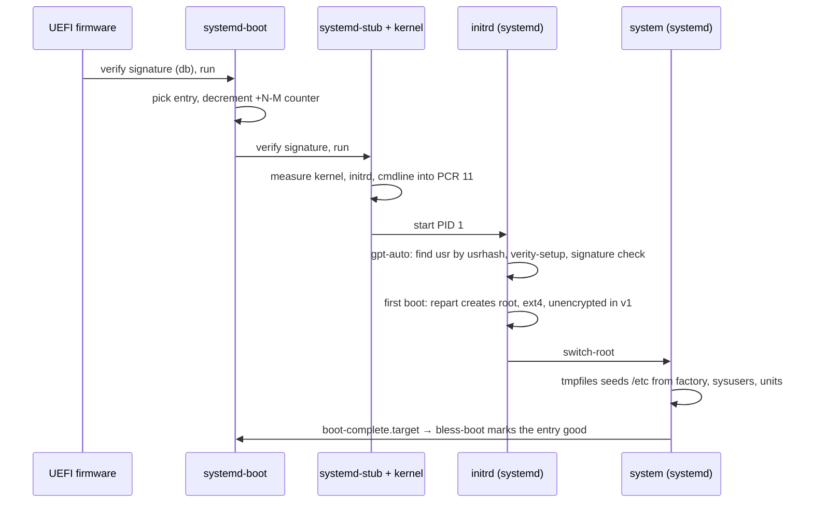

# Boot

*(Planned.)* This page describes the target boot sequence. The image builder and UKI generation are
not implemented.

Boot is a chain of signed and measured steps from firmware to `boot-complete.target`, all of them
systemd's. Each UKI carries the `usrhash=` of its `/usr` slot, which is how A and B differ.

## Boot counting and A/B

The UKI is installed as `EFI/Linux/<id>_<version>+3-0.efi`. systemd-boot decrements the counter on
each attempt; `systemd-bless-boot` renames it to good when `boot-complete.target` is reached. After
three failures systemd-boot falls back to the other entry, which is the other `/usr` slot. See
[Updates](updates.md).

## Bootstrap credentials

A few values are neither in the image nor generated on the machine: they come from the firmware or
the ESP at first boot. systemd-firstboot and systemd-sysusers read them from the credential store.

| credential         | source     | what it sets                                             |
| ------------------ | ---------- | -------------------------------------------------------- |
| `system.hostname`  | ESP/SMBIOS | `/etc/hostname`, via systemd-firstboot (see systemd 262) |
| `firstboot.locale` | ESP/SMBIOS | `/etc/locale.conf`, if ever needed                       |

Delivery paths:

- **SMBIOS**: qemu fw_cfg, the DMI Type 11 OEM Strings (`-smbios type=11,value=...`). The kernel
  makes them readable in `/sys/firmware/dmi/entries/11-*/raw`; systemd-importd decodes them.
- **ESP**: `loader/credentials/*.cred` files on the EFI System Partition. systemd-stub passes them
  to the initrd, and systemd-firstboot reads them.

Never put real secrets in a bootstrap credential: the ESP is not encrypted.

## Serial console

The kernel cmdline includes `console=ttyS0` for serial output. No getty runs on the serial console
in v1: there is no local login path (see [Trust: Identity](trust.md#identity)). Recovery is the
other slot or a reflash.

## Measured boot

systemd-stub measures the UKI's parts into PCR 11. `systemd-measure` precomputes those values at
build time and signs them; the signature travels in the UKI (`.pcrsig`). The root partition is
enrolled against the signing key, not against a PCR value, so a new signed image unlocks the disk
without re-enrolment. Firmware PCRs (0–7) are policy-locked with `systemd-pcrlock`.

## Secure Boot

Keys are generated once per deployment with `ukify genkey`; UKIs and systemd-boot are signed at
build time. Enrolment is systemd-boot's automatic enrolment from `loader/keys/auto` in setup mode,
or `sbctl` where firmware needs it. Key hierarchy in [Trust](trust.md).
