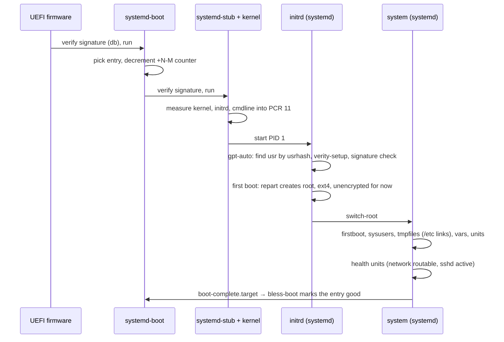
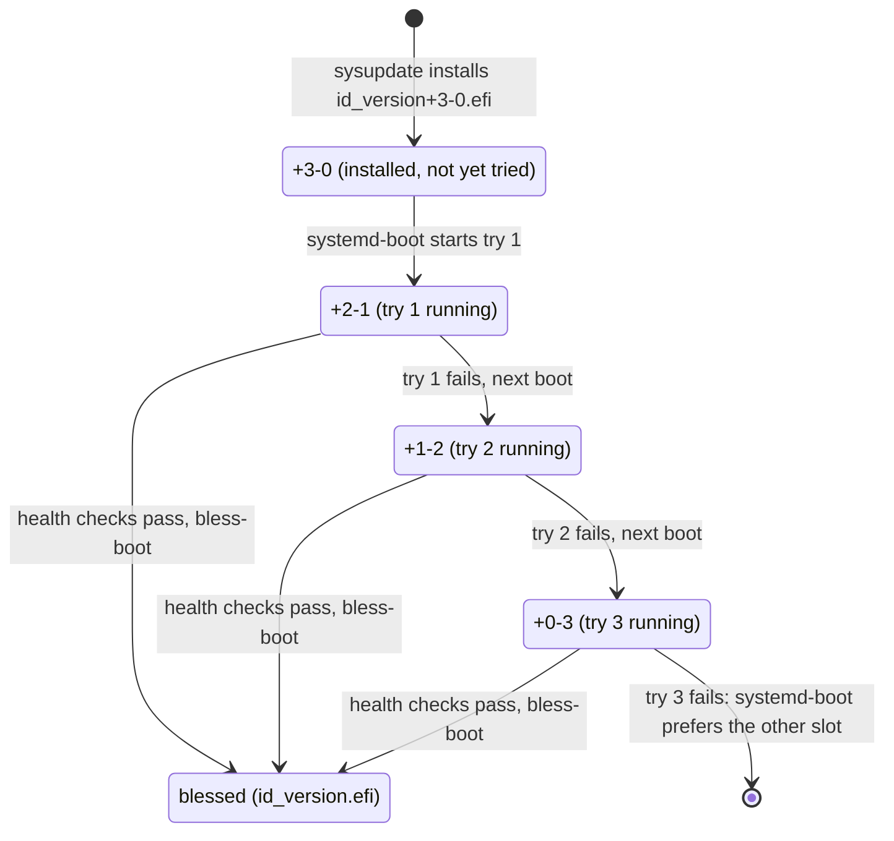

# Boot

Boot is a chain of signed and measured steps from firmware to `boot-complete.target`, all of them
systemd's. Each UKI carries the `usrhash=` of its `/usr` slot, which is how A and B differ. What the
test harness has run, and what it has not, is in [What is proven](../proven.md).

## The initrd

The initrd is a second `/usr` tree from the same store (`lib/image/initrd.nix`): `/base` plus lvm2
and cryptsetup, minus the kernel, as a zstd cpio. systemd is PID 1 (`/init` points at it), udev runs
with systemd's rules and lvm2's device-mapper rules (`10-dm`, `13-dm-disk`, `95-dm-notify`; lvm2 is
a farm package, so they exec `/usr/bin/dmsetup`) and `dmsetup`; `blkid` must be there too, or
`13-dm-disk` cannot probe the verity device and systemd keeps it at `SYSTEMD_READY=0`. lvm2 is built
without `udev_sync`: libdevmapper would link libudev, which is systemd's, and systemd → cryptsetup →
lvm2 → libudev is a cycle; libdevmapper does not wait on udev cookies, and systemd's device units do
the waiting. Around `/usr` sit `/etc/initrd-release` (a link to `os-release`, how systemd knows it
is in an initrd), the merged-usr links `/bin` `/sbin` `/lib`, and the empty mount points. There is
no machine-id, no shadow, no getty, no static init. It needs no root partition to find `/usr`:
`usrhash=` on the cmdline names the verity root hash, the generators derive the two DPS partition
UUIDs from it, veritysetup attaches `/dev/mapper/usr`, and repart makes the root partition from
`/usr/lib/repart.d/30-root.conf` on first boot. The cmdline also carries `rdinit=/init`: a repkgs
binary maps its dynamic linker relative to its own path, which before `/proc` exists is the path the
kernel execs; the fork's crt-interp and glibc follow the `/init` link to the real file without
`/proc`. The kernel's configuration is in [Kernel](kernel.md).

## Boot counting and A/B

The UKI is installed as `EFI/Linux/<id>_<version>+3-0.efi`. systemd-boot decrements the counter on
each attempt; `systemd-bless-boot` renames it to good when `boot-complete.target` is reached. After
three failures systemd-boot falls back to the other entry, which is the other `/usr` slot. See
[Updates](updates.md).

### Boot health

Reaching `boot-complete.target` is the whole condition for blessing. systemd's own target requires
only `sysinit.target`, so a candidate that boots but cannot be reached would be blessed. Golconda
adds two small predicates, one in each module that knows the fact:

| module           | unit                              | passes when                                                                           |
| ---------------- | --------------------------------- | ------------------------------------------------------------------------------------- |
| `/base`          | `golconda-health-network.service` | `systemd-networkd-wait-online --any --operational-state=routable --timeout=60` passes |
| `/services/sshd` | `golconda-health-sshd.service`    | `systemctl is-active sshd.service`                                                    |

"Routable" is networkctl's state: the link has carrier and a routable address, so DHCP finished and
there is a route to the network. Each unit is `Before=boot-complete.target` and is pulled into the
target by a `boot-complete.target.requires/` link, the same shape as systemd's own
`systemd-boot-check-no-failures.service`. A failed predicate fails the target's start job;
`systemd-bless-boot.service` requires the target and is ordered after it, so it does not run. The
counter stays and one attempt is lost. systemd's own bless-boot ordering is not changed and no
orchestrator is added.

What the predicate leaves out, on purpose: DNS and resolved, a default route to the administrator's
network, reachability from outside the machine (firewall, NAT, the client side), and every step of a
login (authentication, the host key credential, `/etc/pam.d/sshd`, the listening socket).
`is-active` proves that the sshd process runs, not that a login would succeed.

What happens after a failure is the [trial boot](#trial-boot) policy: on a counted boot that had a
try left, the machine reboots, and systemd-boot counts down `+3-0` → `+2-1` → `+1-2`. At `+0-3` the
entry is bad, and systemd-boot selects a second deployment entry on the ESP (the other `/usr` slot)
instead, which is the point of boot counting. Before the first update the image carries one slot
only: there systemd-boot still boots the exhausted entry, and a failed health check leaves it up and
unblessed until it is repaired or the other slot is filled. The health units run only on a counted
boot: `systemd-bless-boot-generator` adds `boot-complete.target` only when the entry has a counter,
so a blessed entry boots without them. Masking a health unit turns the gate off: the target's job is
then never queued, so the boot is neither blessed nor rebooted.

### Trial boot

A trial boot is a counted boot whose entry had a try left before systemd-boot started it. Boot
counting needs a reboot to count, so `/base` reboots a boot that fails
(`modules/base/parts/trial-boot.nix`), except where a reboot cannot help:

| failure                                                                     | what reboots it                                                                                                                                                            | when              |
| --------------------------------------------------------------------------- | -------------------------------------------------------------------------------------------------------------------------------------------------------------------------- | ----------------- |
| a kernel panic                                                              | `panic=10` on the UKI cmdline: the kernel reboots after 10 s                                                                                                               | every boot        |
| PID 1 crashes, or cannot execute the host's (IPE denies an unsigned `/usr`) | `CrashAction=reboot` (`system.conf.d/golconda-crash.conf`): PID 1 reboots after 10 s                                                                                       | every boot        |
| the initrd fails (a unit fails into `emergency.target`)                     | `golconda-initrd-failed.service`, wanted by `emergency.target`, runs only in the initrd: `SuccessAction=reboot`                                                            | every boot        |
| the initrd hangs                                                            | `initrd.target`: `JobTimeoutSec=10min`, `JobTimeoutAction=reboot`                                                                                                          | every boot        |
| the kernel hangs: a soft or hard lockup, a task blocked for 120 s           | `softlockup_panic=1 nmi_watchdog=panic hung_task_panic=1` on the UKI cmdline: the kernel's detectors panic, and `panic=10` reboots                                         | every boot        |
| PID 1 or the kernel stops for 30 s, also a hang no detector sees            | the hardware watchdog, which PID 1 runs (`system.conf.d/golconda-watchdog.conf`: `RuntimeWatchdogSec=30s`, `RebootWatchdogSec=10min` for a reboot)                         | every boot        |
| a health unit fails, or `boot-complete.target` is not reached in time       | the generator's drop-in for `boot-complete.target`: `JobTimeoutSec=` (`/base.trialBootDeadline`, 15 min) and `OnFailure=golconda-trial-boot-failed.service`, which reboots | a trial boot only |

The first six rows end a boot that nobody can reach: no getty runs, and sshd is not up. On a counted
entry the reboot is the next try; on a blessed one it is a retry that may succeed (a disk that was
slow to appear). A failure at every boot, also of a blessed entry, is the
[failed-boot counter](#failed-boots)'s.

The last row judges a machine that may answer ssh, so it reboots only when that moves the counter.
`golconda-trial-boot-generator` (`/usr/lib/systemd/system-generators/`) reads `LoaderBootCountPath`
at every boot: the EFI variable in which systemd-boot names the file it has just renamed
(`<id>_<version>+L-D.efi`). It links the drop-in only when the variable is set and `L + D` is at
most the tries a release starts with (3, `image/boot-counting.nix`). systemd-boot renames an entry
that had no try left from `+0-3` to `+0-4`, so a sum above 3 means it started an exhausted entry
because nothing better was left. On a blessed entry, and on an exhausted one, a failed health check
leaves the machine up and unblessed for its operator, with no reboot loop. The generator logs its
verdict to the kernel log (`golconda-trial-boot: <entry> is on trial`, or `had no try left`), so it
is on the serial console and in the journal.

`OnFailure=` of `boot-complete.target` fires both for a job that failed on a dependency and for one
that timed out (systemd's `job.c`), so one unit covers both. The deadline counts from the start of
the host's PID 1; the initrd has its own.

The kernel carries the watchdog drivers built in ([Kernel](kernel.md#hangs-and-watchdogs)): QEMU's
i6300esb, Intel's and AMD's TCO, and softdog, a kernel timer, where no hardware one is found.
softdog catches a PID 1 that stops, not a kernel that hangs. The watchdog runs from the initrd's PID
1 on: firmware that never starts the loader, and a kernel that hangs before PID 1, are not covered.

In QEMU, with no reboot from the harness, `--next --fail-health` proves the health row and
`--next --fail-initrd` the initrd failure row ([What is proven](../proven.md)). The panic, crash and
initrd hang rows have no test of their own *(being built)*. Of the two hang rows, every `--ssh-test`
boot proves the settings (`hang-panic-sysctls`, `watchdog-armed`); no test hangs the kernel or lets
the watchdog expire *(being built)*.

### Failed boots

Boot counting counts only an entry with a counter, and a blessed entry has none. `/base` counts
every boot itself (`modules/base/parts/failed-boots.nix`). Early in the initrd,
`golconda-failed-boots.service` adds one to the EFI variable
`GolcondaFailedBoots-d1b3416f-c0f9-44e8-8b5a-cbb64676bdef`, and
`golconda-failed-boots-complete.service` removes it once the boot completed: on a counted boot when
`boot-complete.target` is active, on an uncounted one, which has no `boot-complete.target`, at
`multi-user.target`. An EFI variable, not a file: PID 1 mounts efivarfs before any unit, so the
count waits for no disk and no file system, which may be what fails.

After `/base.failedBootsFallback` boots in a row that did not complete (3), the next boot starts the
other slot: the third sets systemd-boot's one-shot entry (`bootctl set-oneshot`) to the image's
other entry and records its own in `GolcondaFailedEntry-<the same guid>`. When the other entry's
boot completes, the counter renames the failed entry's UKI on the ESP to the name systemd-boot gives
an entry with no try left (`<id>_<version>+0-3.efi`). systemd-boot sorts it after every good entry,
so later boots keep to the release that works, and `golconda-update-pending` finds nothing for the
update reboot timer to activate. A newer release that sysupdate installs sorts first and is tried as
usual. No default entry is set. When the failed entry's own boot completes, it is not marked, and
its one-shot goes. After `/base.failedBootsHalt` (6), a boot reboots on no failure: the counter sets
`kernel.panic=0` and, in `/run`, `CrashAction=freeze`, no watchdog and no deadline for
`initrd.target` (PID 1 reads them at once and again after switch-root), and the two reboot units of
the trial boot policy skip themselves. The console keeps the last messages. Each step is a line in
the kernel log (`golconda-failed-boots: …`). `--next --fail-blessed` proves both on a blessed entry
whose PID 1 crashes at every boot ([What is proven](../proven.md)).

Limits:

- A failure before the initrd's PID 1 runs (firmware, loader, early kernel) is not counted.
- The failed release stays on the ESP and its slot until sysupdate replaces it;
  `bootctl set-oneshot` starts it by hand.
- A halted machine stays down until someone resets it, and its next boot is halted again, until a
  boot completes.
- Each boot writes the variable to the firmware's non-volatile store, and a complete one removes it.

systemd-sysupdate tells the slots apart by GPT label: an installed slot carries its version
(`usr_20261031.1`, `usr-verity_…`, `usr-verity-sig_…`), a free one `_empty`, which gpt-auto also
skips. The builder labels slot A this way and leaves B `_empty`; an update relabels the slot it
writes ([Image artifacts](../reference/image.md#a-release)). It also gives the slot the partition
UUIDs in the release file names, the two halves of the new root hash, so the new UKI's `usrhash=`
finds its own slot and the old UKI still finds the old one. The UKI goes to `EFI/Linux` on the ESP
(`PathRelativeTo=boot`), which gpt-auto mounts at `/boot`.

## Kernel command line

The cmdline is fixed in the UKI and measured with it. The one authoritative copy is in
[Image artifacts: the kernel command line](../reference/image.md#the-kernel-command-line); the LSM
parameters are described in [Kernel](kernel.md). No administrator edits: the ESP carries
`loader/loader.conf` with `editor no` (the editor would let anyone at the console change the
cmdline) and `timeout 0` (the menu does not wait); see [Boot loader](bootloader.md). The UKI under
`EFI/Linux` needs no entry line. This is menu policy, not protection: an offline disk writer can
change the unsigned configuration ([Trust](trust.md)). The cmdline carries `rw` and neither `ro` nor
`systemd.volatile=` (`/` is the state partition; the initrd mounts it read-only unless the cmdline
says `rw`, and gpt-auto's remount-rw drop-in takes effect only when `systemd-remount-fs.service`
runs, after switch-root). A debug image with other parameters is a separate build *(later)*.

PID 1 needs the root writable before that: on the first boot `/etc` is empty, and on a read-only
root it cannot write `/etc/machine-id` ("System cannot boot: Missing /etc/machine-id and /etc/ is
read-only"). On a measured boot `systemd-pcrmachine.service` then fails to measure the machine ID,
and its `FailureAction=reboot-force` reboots the machine at every boot
([What is proven](../proven.md)). `rw` is an ordinary kernel parameter, and the test image boots the
same cmdline. Libraries need no such flag: the fork's RUNPATH reaches every dlopen soname.

gpt-auto-generator mounts the root partition (writable), the ESP and `/usr` by `usrhash=`. systemd
finds the libraries it dlopens through the RUNPATH the fork gives it. IPE enforces from the first
boot: `/usr` runs only if the kernel verified the verity signature, so the signer must be in the
firmware `db` ([Kernel: IPE](kernel.md#ipe-integrity-policy-enforcement)).

## Serial console

`console=ttyS0` gives output on the serial line, `console=tty0` on the local display. No getty runs
on either: there is no local login path ([Trust: Identity](trust.md#identity)). Recovery from a
machine that no longer answers over ssh is the other slot (boot counting, or a manual choice in the
systemd-boot menu) or a reflash; [Recovery](recovery.md) states what each path can and cannot do,
and [Boot loader: Recovery](bootloader.md#recovery) gives the loader steps.

## Bootstrap credentials

A few values are neither in the image nor generated on the machine: they arrive as systemd
credentials at first boot. This is Golconda's provisioning path; there is no cloud-init.

| credential                 | read by                | what it sets                                                                                                                   |
| -------------------------- | ---------------------- | ------------------------------------------------------------------------------------------------------------------------------ |
| `system.hostname`          | PID 1                  | the hostname, at every boot; nothing writes `/etc/hostname` from it                                                            |
| `ssh.authorized_keys.root` | systemd-tmpfiles-setup | `/root/.ssh/authorized_keys`, written by systemd's `tmpfiles.d/provision.conf`; sshd reads it through its `AuthorizedKeysFile` |

PID 1 takes the hostname from the first of: `systemd.hostname=` on the kernel command line,
`/etc/hostname`, the `system.hostname` credential, the fallback `golconda` compiled into systemd
(repkgs `fallback-hostname`). No factory file and no tmpfiles line writes `/etc/hostname`, so the
credential wins until an admin writes one, or until systemd-firstboot writes the host name that
`/imds` imported
([Provisioning: From cloud metadata](../features/provisioning.md#from-cloud-metadata-imds)). PID 1
reads SMBIOS strings from `/sys/firmware/dmi/entries` and fw_cfg from `/sys/firmware/qemu_fw_cfg`:
the kernel needs `CONFIG_DMI_SYSFS=y` and `CONFIG_FW_CFG_SYSFS=y` (built in).

Delivery, in the order systemd-stub and PID 1 look:

- **SMBIOS** (`io.systemd.credential:<name>=<value>` in DMI type 11 OEM strings): on qemu
  `-smbios type=11,value=io.systemd.credential:system.hostname=web1`; on a cloud, whatever the
  provider exposes as OEM strings.
- **qemu fw_cfg**: `-fw_cfg name=opt/io.systemd.credentials/system.hostname,string=web1`.
- **ESP**: `loader/credentials/*.cred` files; systemd-stub passes them to the initrd.

An ESP credential must be in the systemd-creds envelope; plain text is not accepted. systemd-stub
puts the files in the initrd, and PID 1 imports them into `/run/credentials/@encrypted`, not
`@system`; it decrypts on read, which is how it reads `system.hostname`. A machine has no host key
before its first boot, so the file is encrypted with the null key
(`systemd-creds encrypt --with-key=null --name=<name>`); `scripts/provision-esp` does this for a
disk image. The policy `systemd.credentials_boot_policy=relaxed`, the default, accepts a null-key
credential when Secure Boot is off or the machine has no TPM2. With Secure Boot on and a TPM2
present, PID 1 refuses it: anyone who can write the ESP could otherwise plant a credential that the
measured boot chain never vouched for. On such a machine use SMBIOS or fw_cfg.

The ESP is not encrypted, and SMBIOS strings are readable by every process: a bootstrap credential
carries no secret. Secrets are vars ([Trust: Secrets and vars](trust.md#secrets-and-vars)).

An ESP credential holds for one boot. systemd-stub passes every `loader/credentials/*.cred` (and
every `*.cred` in a UKI's `.extra.d/`) at every boot, so a file left there would grant its value
again: root's ssh key after a factory reset, or on a machine whose pushed configuration refuses
plain keys. `golconda-esp-credentials.service` (`/base`, wanted by `multi-user.target`) runs at
every boot after `systemd-firstboot`, `systemd-sysusers` and `systemd-tmpfiles-setup`, the units
that apply the first boot's credentials. It removes every such file and logs a journal line for
each. A first boot that crashes before them keeps the files for its next try. What must outlast the
boot is then on the state partition: `/root/.ssh/authorized_keys`, and `/etc/hostname`, which
systemd-firstboot writes from `firstboot.hostname` (`scripts/provision-esp --hostname` writes that
credential beside `system.hostname`). A credential that applies at every boot, such as `network.*`,
holds for the first boot only when it comes from the ESP; give a lasting one by SMBIOS or in the
image. After a factory reset the machine has no ESP credential, so it boots with the fallback host
name and no plain root key: it needs provisioning again, or a certificate login.

Removal does not make the ESP trusted. Where PID 1 accepts a null-key credential, whoever can write
the ESP can still plant one for the next boot; removal makes that a single, logged use
([Trust: The ESP](trust.md#the-esp)).

## First boot

What happens once, on the first boot of a disk:

1. repart creates the root partition from `/usr/lib/repart.d/30-root.conf` (`GrowFileSystem=`,
   `FactoryReset=`), with `/etc`, `/var`, `/home`, `/root` inside.
1. PID 1 writes `/etc/machine-id` and sets the hostname from the credential. A drop-in runs
   `systemd-firstboot --mute-console=yes`, so firstboot never prompts: there is no local login.
1. systemd-sysusers writes `passwd`, `group`, `shadow` from `/usr/lib/sysusers.d`.
1. systemd-tmpfiles links each factory file into `/etc` and makes the state directories.
1. The var units generate the machine-local secrets and seal them to the TPM
   ([Trust: Secrets and vars](trust.md#secrets-and-vars)).
1. The services start; the health units must pass before `boot-complete.target` blesses the entry.
   `golconda-esp-credentials.service` removes the ESP's bootstrap credentials.

Every later boot runs the same units; `ConditionNeedsUpdate=` and the vars' `done` markers make them
no-ops ([Updates: Versions](updates.md#versions)).

## Measured boot

systemd-stub measures the UKI's parts into PCR 11. `systemd-measure` precomputes those values at
build time and signs them; the signature travels in the UKI (`.pcrsig`). Credentials are sealed to
the signing key, not to a PCR value, so a new signed image unseals them without re-enrolment.
Firmware PCRs (0–7) are not part of the policy; locking them with `systemd-pcrlock` is *(later)*
([Trust: Rollback weakness](trust.md#rollback-weakness)).

## Secure Boot

Keys are generated once per deployment with `ukify genkey`. The UKI (`lib/image/uki.nu`) and
systemd-boot (`lib/image/loader.nu`, `systemd-sbsign`) are signed at build time with the same db key
and certificate, so one enrolled certificate covers the loader and the image it starts. The signed
loader ships in `/usr`, and a machine installs it on the ESP after a good boot; the loader update,
the key rotation and the recovery paths are in [Boot loader](bootloader.md). Firmware starts nothing
else: with only this certificate enrolled, firmware refuses an unsigned loader.

The signer copies the key set's signed Secure Boot variables (the deployment's PK, KEK and `db`, and
by default Microsoft's KEK, UEFI CAs and `dbx`) to `loader/keys/auto` on the ESP. In Setup Mode
systemd-boot enrols them and resets, on hardware after a 15-second warning; firmware that already
has keys ignores them. Only the new disk's `loader.conf` enrols: the first good boot replaces it
with `/usr`'s, which enrols nothing, and removes the files once Secure Boot is on
([Boot loader: Enrolment](bootloader.md#enrolment)). Key hierarchy in [Trust](trust.md).
