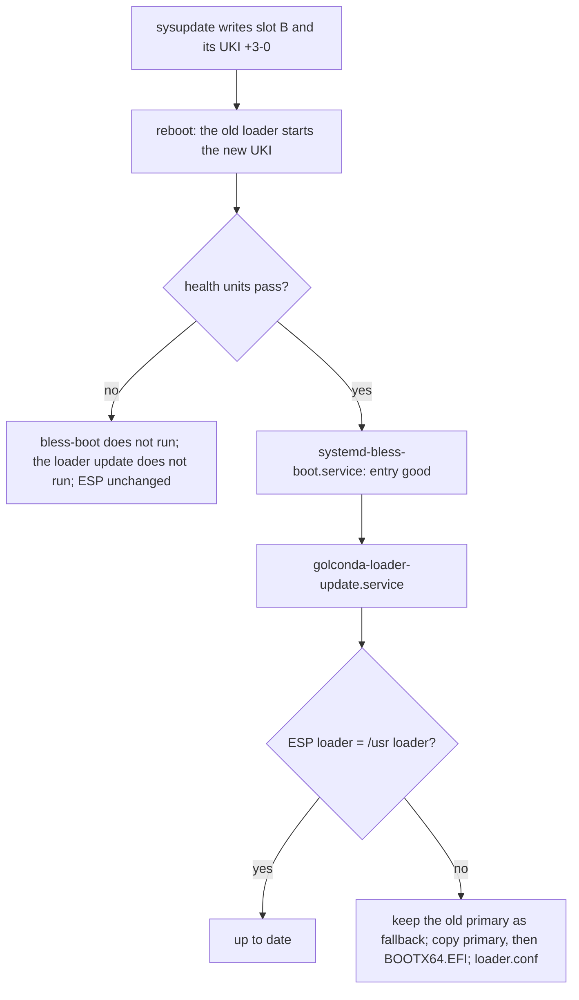
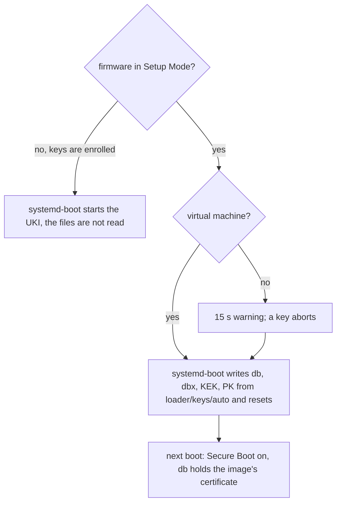

# Boot loader

One systemd-boot on the ESP starts both `/usr` slots. It is signed with the Secure Boot `db` key, it
ships inside the signed `/usr` of each release, and a machine copies it to the ESP only after that
release has booted and passed its health gate. The loader has no A/B of its own, so this page also
covers what changes it, how the `db` key is rotated, and how a machine is recovered when the loader
or a key goes wrong. The boot chain itself is in [Boot](boot.md), the keys in [Trust](trust.md).

## The loader in the image

The signer (`lib/image/loader.nu`, [Trust: Signing outside Nix](trust.md#signing-outside-nix)) signs
systemd's `systemd-boot<arch>.efi` with `systemd-sbsign`, with the same `db` key and certificate as
the UKI and the verity root hash. The result is used twice:

- **in `/usr`**, at `/usr/lib/systemd/boot/efi/systemd-boot<arch>.efi.signed`, beside the unsigned
  file the systemd farm links. The signer puts the file into its copy of the `/usr` tree before it
  makes the erofs image; the tree Nix builds has nothing at that path. The name is the one bootctl
  prefers to the unsigned file.
- **on the ESP**, the same file, written by the signer's disk step (`lib/image/disk.nu`). The signer
  fails unless the tree's `/usr/lib/golconda/loader.conf` is the disk's `loader.conf`. A fresh disk
  is therefore already in the state the machine keeps.

The ESP has the layout `bootctl install` makes:

| path on the ESP                            | what                                                                                                                               |
| ------------------------------------------ | ---------------------------------------------------------------------------------------------------------------------------------- |
| `EFI/BOOT/BOOTX64.EFI`                     | the signed loader on the removable-media path                                                                                      |
| `EFI/systemd/systemd-bootx64.efi`          | the same file, the primary copy                                                                                                    |
| `EFI/systemd/systemd-boot-fallbackx64.efi` | the loader before the last update (after one update)                                                                               |
| `loader/loader.conf`                       | `timeout 0`, `editor no`, `secure-boot-enroll force` (`image/loader.nix`)                                                          |
| `loader/keys/auto/{PK,KEK,db,dbx}.auth`    | the Secure Boot variables systemd-boot enrols in Setup Mode ([Enrolment](#enrolment)); only on a disk of an image with Secure Boot |
| `EFI/Linux/<id>_<version>[+N-M].efi`       | one UKI per slot                                                                                                                   |

Firmware starts `EFI/BOOT/BOOTX64.EFI`: Golconda writes no `Boot####` variable, and OVMF falls back
to the removable-media path. `aa64` and `riscv64` use their own names (`removableMediaName`).

`loader.conf` is at the root of the ESP because systemd-boot reads `\loader\loader.conf` and nothing
else (`src/boot/boot.c`, systemd 262.1). A file at `EFI/loader/loader.conf` is never read:
`bootctl status` says `config: /boot//loader/loader.conf: No such file or directory`, and the menu
runs with systemd-boot's defaults, the editor on. With the file in place `bootctl status` says
`config: /boot//loader/loader.conf`.

## The loader on a running machine

`golconda-loader-update.service` (`/base`) runs `/usr/lib/golconda/golconda-loader-update`. The
program compares the running `/usr`'s signed loader and `loader.conf` with the ESP's files by
SHA-256 and copies what differs. Each copy goes beside its destination, is flushed, and is renamed
over it. A replaced primary copy is first kept as `EFI/systemd/systemd-boot-fallback<arch>.efi`, the
name `bootctl update` uses too. `EFI/BOOT/BOOTX64.EFI`, the file firmware starts, is written last.



The unit is wanted by `systemd-bless-boot.service` (a link in its `.wants/`), ordered `After=` it,
and `Requisite=` it. `systemd-bless-boot-generator` pulls bless-boot in only on a counted boot, and
bless-boot runs only when `boot-complete.target` is reached
([Boot: Boot health](boot.md#boot-health)). So:

- a release installs its loader once, on its first good boot;
- a release that fails its health gate never touches the loader;
- a boot of an older blessed entry (fallback, `bootctl set-oneshot`, `set-default`) installs
  nothing, and the ESP keeps the newer loader. systemd-boot starts any UKI that firmware accepts, so
  a newer loader starts the older release.

The copy is safe for Secure Boot without a check on the machine: firmware has just accepted the
running UKI under the current `db` and `dbx`, and the image builder signs that release's loader with
the same key. A loader written by this unit is one this firmware starts, as long as `db` and `dbx`
do not change before the next boot.

**Why not `systemd-boot-update.service`.** systemd's unit runs `bootctl --graceful update`. That is
wrong for Golconda in three ways:

- It compares version strings, so it skips a loader signed again with a new key: the version is the
  same and the bytes differ.
- It runs before `sysinit.target`, so a candidate would install its loader before its health gate.
- It does nothing unless `EFI/systemd/` exists, and the image does not create that directory.

A drop-in turns it off (`ConditionPathExists=!/usr/lib/golconda/golconda-loader-update`), so the ESP
has one writer.

## Enrolment

Firmware must hold the `db` certificate before a Secure Boot image runs: it checks the loader and
the UKI against `db`, and the kernel checks the `/usr` signature against the `db` in its platform
keyring ([Trust: Verity key](trust.md#2-verity-key)). A machine in Setup Mode (no PK enrolled) gets
it from the disk on its first boot; a machine that already has keys gets it in firmware setup.

**The files.** `scripts/make-keys` writes the Secure Boot variables into the key set once, signed by
its PK and KEK keys (`secureboot/auth/`, `lib/image/enrol.nu`). They depend on the certificates
only, not on an image, so no release needs the PK or KEK key. There are two sets:

| set                                            | PK   | KEK                                                     | db                                                                                                  | dbx                                  |
| ---------------------------------------------- | ---- | ------------------------------------------------------- | --------------------------------------------------------------------------------------------------- | ------------------------------------ |
| `microsoft` (the default)                      | ours | ours, Microsoft Corporation KEK CA 2011, KEK 2K CA 2023 | ours, Microsoft Corporation UEFI CA 2011, Microsoft UEFI CA 2023, Microsoft Option ROM UEFI CA 2023 | Microsoft's revocation list (x86_64) |
| `golconda` (`secureBootMicrosoftKeys = false`) | ours | ours                                                    | ours                                                                                                | none                                 |

Our PK signs `PK.auth` and `KEK.auth`, our KEK signs `db.auth` and `dbx.auth`. Microsoft's
certificates and revocation list come from `microsoft/secureboot_objects`, pinned by tag and hash
(`packages/secureboot-objects`); Microsoft signs its own dbx update with its KEK, and Golconda takes
the signature lists from it and signs them with ours. The signer copies the set that
`/system.secureBootMicrosoftKeys` names to `loader/keys/auto/` on the ESP. It first checks every
file against the set's `PK.crt` and `KEK.crt`, and that `PK`, `KEK` and `db` enrol those
certificates and the image's `db` certificate first: a set for another key fails the release, not
the boot.

**On the machine.** systemd-boot looks at `loader/keys/` only when the firmware is in Setup Mode or
Audit Mode. With `secure-boot-enroll force` in `loader.conf` it enrols the set named `auto`: it
writes `db`, `dbx`, `KEK` and `PK`, in that order, and resets the machine. Writing PK ends Setup
Mode, so the next boot runs with Secure Boot on, and systemd-boot never reads the files again
(`src/boot/secure-boot.c`, systemd 262.1). In a virtual machine it does this at once; on hardware it
first prints "Enrolling custom Secure Boot keys might soft-brick your machine!" and counts down 15
seconds, during which a key aborts.



A machine that is not in Setup Mode (keys already enrolled, the usual state of a machine from a
vendor) ignores the files. To use the automatic path there, clear the keys in firmware setup (most
firmware calls it "Reset to Setup Mode" or "Clear Secure Boot keys"); otherwise add the `db`
certificate beside the vendor's keys in firmware setup
([Making a release](../reference/release.md#4-enrol-the-certificate-in-the-firmware)).

The files are copied only for an image with `/system.secureBoot` (the manifest's `loader.enrol`). An
image for a host without Secure Boot carries the certificate in its kernel; enrolling it would make
the firmware check every later loader against a key the operator did not mean to enrol. A key set
without `secureboot/auth` (made before `scripts/make-keys` wrote it) is refused for a Secure Boot
image: make a new set, or run `golconda-enrol-auth --keys DIR` with its PK and KEK keys.

**Microsoft keys, and why they are the default.** On hardware a graphics card, network card or
storage controller often carries an option ROM signed by the Microsoft UEFI CA (2011, and the Option
ROM UEFI CA 2023 for newer cards). Firmware whose `db` lacks that CA refuses the ROM: no display, no
network boot, perhaps no disk, and on some machines no way back into the firmware menu (a soft
brick; loader.conf(5) warns of it). With `force`, enrolment on hardware happens without a person, so
the default set keeps Microsoft's CAs. The cost: every loader the Microsoft UEFI CA signs (shim, and
with it other distributions) also boots on the machine. That is why `dbx` comes with them:
Microsoft's revocation list holds the hashes of the shims and loaders it has withdrawn (BlackLotus
and its kind), and without it `db` would trust them. Microsoft's KEKs are there so that Microsoft's
own `dbx` updates (signed by its KEK, applied by `fwupdmgr` or the vendor) can be applied later;
Golconda applies none. The Windows CAs (Windows Production PCA 2011, Windows UEFI CA 2023) start
only Windows' boot manager, which a Golconda machine does not run, so they stay out: every
certificate in `db` is a loader that boots. `secureBootMicrosoftKeys = false` gives the deployment's
keys alone, for a virtual machine or for hardware known to need no signed option ROM.

**Keys.** The PK and the KEK are the deployment's own, made by `scripts/make-keys` beside the `db`
key ([Trust: Deployment keys](trust.md#deployment-keys)). The PK and KEK keys are needed again only
for a new set of enrolment files: a `db` rotation (`make-keys --reuse-pk-kek OLD`, below) or a newer
`dbx`. In Setup Mode OVMF (EDK II) writes `db`, `dbx` and `KEK` without checking their signatures,
and `PK` too unless the build sets `PcdRequireSelfSignedPk`, so a boot alone would not find a wrong
signature; `make-keys` and the signer check each one. Enrolment changes PCR 7; Golconda's
credentials are sealed to the PCR 11 signing key, not to PCR 7, so nothing sealed is lost.

The ESP keeps `loader/keys/auto` from the disk it was written from: an update does not change it,
and `golconda-loader-update` copies only the loader and `loader.conf`. After a `db` rotation the
files on an installed machine still hold the old certificate; they matter only if its firmware is
put back into Setup Mode.

The boot test runs the virtual machine path with both sets: `--secure-boot --auto-enrol` starts OVMF
with its empty variable store and checks that systemd-boot enrolled the set and reset
(`auto-enrolled`), that `PK`, `KEK`, `db` and `dbx` hold what the table says (`pk-enrolled`,
`kek-enrolled`, `db-enrolled`, `dbx-enrolled`; with `--no-microsoft-keys` on
`image-smoke-test-own-keys`, none of Microsoft's), that firmware enforces Secure Boot
(`secure-boot-enabled`), then the whole ssh battery ([What is proven](../proven.md)). Hardware is
*(being built)*: no run has shown the 15-second warning on a real console, a real firmware accepting
the files, or option ROMs running after the enrolment.

## Key rotation

A `db` key rotation signs the loader, the UKI and the verity root hash with a new key; they are one
key ([Trust](trust.md#2-verity-key)). The PCR policy key is a separate key and does not change.

1. Make the new key pair and keep the old one, with `scripts/make-keys --reuse-pk-kek OLD NEW`. The
   new set keeps the old PK and KEK (copies of their certificates, no keys), and its enrolment files
   enrol the new `db` certificate, signed by the old KEK: a machine installed later enrols the same
   PK and KEK as the fleet, so one KEK still signs every `db` and `dbx` update. Without
   `--reuse-pk-kek` the set gets a PK and a KEK of its own; `make-keys` cannot tell a rotation from
   a new deployment, so the rotation names the old set.

1. Add the new certificate to `db`, beside the old one. A release signed with a key that is not in
   `db` is refused: firmware rejects its UKI, each attempt counts down, and after three the older
   slot boots.

1. Build the next release with the new key and install it as usual:

   ```sh
   golconda release build -f server.toml --keys /srv/golconda-keys-2 \
     --pcr-keys /srv/golconda-keys --index-keys /srv/golconda-keys
   ```

   `--keys` is the new `db` key, in a new directory; the old directory keeps the PCR key and the
   release key, which the running image trusts. The layout is in
   [Trust: Deployment keys](trust.md#deployment-keys). The old loader starts the new UKI, because
   both certificates are in `db`. At the first good boot `golconda-loader-update.service` installs
   the new loader: the systemd-boot version is the same and the bytes are not. The old loader stays
   as the fallback copy.

1. Install one more release signed with the new key, so the other slot holds no UKI signed with the
   old key. Clear any loader variable that names an old entry: `bootctl set-default ''`.

1. Replace `db` with the new certificate alone and add the old certificate to `dbx`.

How the variables are written depends on the machine. Firmware setup can enrol a certificate; with
the KEK's private key, an authenticated `db` append or `dbx` update can be written from the running
system, but the image has no tool for it. The boot test writes the variable store offline with
`virt-fw-vars`: `--add-db` for step 2, `--delete db --add-db <new> --add-dbx-cert <old>` for step 5.

Step 4 is there because of what happens without it. In a test run that left `bootctl set-default` on
the old entry, the boot after step 5 stopped: systemd-boot logged
`Error loading EFI binary \EFI\Linux\boot-test_20261031.1.efi: Access denied` and returned to
firmware, which found no other bootable option. A blessed entry has no counter, so systemd-boot does
not fall back from it by itself.

## Recovery

| situation                                          | path                                                                                                                                                                                                                                                               |
| -------------------------------------------------- | ------------------------------------------------------------------------------------------------------------------------------------------------------------------------------------------------------------------------------------------------------------------ |
| a new release fails its health gate                | boot counting: three attempts, then the other slot ([Boot](boot.md#boot-health))                                                                                                                                                                                   |
| see what is on the ESP                             | `bootctl list` (both slots, counters, cmdlines), `bootctl status` (loader, `config:` line)                                                                                                                                                                         |
| boot the other slot once                           | `bootctl set-oneshot <id>_<version>.efi`, reboot; the next boot returns to the default                                                                                                                                                                             |
| boot the other slot until told otherwise           | `bootctl set-default <id>_<version>.efi`; undo with `bootctl set-default ''`                                                                                                                                                                                       |
| the loader on the ESP is damaged, the machine runs | `/usr/lib/golconda/golconda-loader-update` puts the running release's loader back                                                                                                                                                                                  |
| reach the firmware menu from a running machine     | `bootctl reboot-to-firmware true`, reboot. The systemd-boot entry "Reboot Into Firmware Interface" does the same at the console; the menu shows after `bootctl set-timeout-oneshot 10`                                                                             |
| the loader does not start any more                 | at the console, the firmware's boot menu: start `EFI/systemd/systemd-boot-fallbackx64.efi`, or a UKI under `EFI/Linux` as a file; then run `golconda-loader-update` or install a release                                                                           |
| the ESP is lost                                    | write the ESP partition of the release's `disk.raw` again, from another machine; it carries the loader, `loader.conf` and that release's UKI                                                                                                                       |
| the `db` key leaks                                 | rotate it, with the old certificate in `dbx` (above)                                                                                                                                                                                                               |
| the `db` private key is lost                       | running machines keep booting: the signatures they hold stay valid. No new release can be signed for them. Enrol a new key with the KEK (an authenticated write) or in firmware setup, then install a release signed with it (a rotation without step 3's overlap) |
| certificate login is broken                        | after enrolment no plain key logs in ([Trust: Enrolment](trust.md#enrolment)). At the console, boot the other slot if its release has `hostCertificate` off; else reflash the disk: the state partition and its sealed vars go, and the machine enrols again       |

The firmware path needs the console.

The boot test runs the one-shot and default entries, the loader reinstall and the firmware reboot
(`set-oneshot-other-slot`, `set-default-other-slot`, `loader-reinstall`, `reboot-to-firmware`), and
a rotation with the old certificate in `dbx` (`--rotate`). The rows for a loader that does not
start, a lost ESP, a lost `db` private key and a broken certificate login are *(being built)*: they
use what is on `main`, but no test runs them ([What is proven](../proven.md#not-proven)).

## What is not possible

- **No second loader.** Both slots share one ESP and one `BOOTX64.EFI`. A loader that firmware
  starts but that fails later stops every boot, and boot counting cannot help: counting is the
  loader's job. Installing only after a good boot and keeping the fallback copy make this rare, not
  impossible.
- **No unattended recovery from a refused default entry or a refused loader.** It takes the firmware
  menu at a console or a reflash. There is no local login and no rescue shell
  ([Boot: Serial console](boot.md#serial-console)).
- **The machine cannot change `db` or `dbx` by itself.** The image has no tool for authenticated
  variable writes, and systemd-boot enrols keys from `loader/keys/` only in Setup Mode, once: the PK
  it writes ends Setup Mode ([Enrolment](#enrolment)).
- **No enrolment outside Setup Mode.** A machine with a vendor's PK ignores `loader/keys/auto`;
  someone clears the keys or adds the `db` certificate in firmware setup ([Enrolment](#enrolment)).
- **No signature check before the copy.** The program trusts the build: the loader in `/usr` is
  signed with the key of the UKI that booted. A `/usr` built with two different keys would break
  that rule; the image chain gives both steps the same `sbKeys`.
- **The copy is not atomic on FAT.** A rename over an existing file on vfat is not a journalled
  operation. A power loss during the copy can damage one file; the removable-media copy is written
  last and the fallback copy stays.
- **`loader.conf` is not signed.** Someone who can write the disk offline can change it; it is menu
  policy, not protection ([Boot: Kernel command line](boot.md#kernel-command-line)).
- **A UKI signed with a key in `dbx` stays on the ESP** until an update replaces its slot. Choosing
  it fails as above.
- **PCR policy key rotation is not covered.** A credential sealed to the old PCR key does not unseal
  under a UKI signed with a new one ([Trust: Rollback weakness](trust.md#rollback-weakness)).
