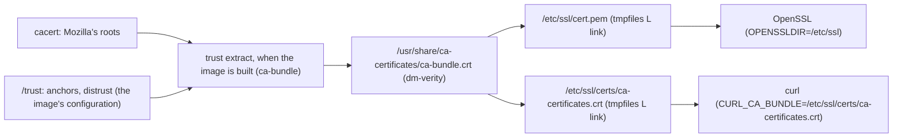

# CA store

The CA store decides whom the machine talks to: one CA bundle for every TLS client. It is one of the
three trust roots ([Trust](trust.md)).



The image ships one CA file, `/usr/share/ca-certificates/ca-bundle.crt`. It holds cacert's Mozilla
roots, plus the operator's `anchors`, minus the `distrust` list. The configuration names them
(`/trust`, [reference](../reference/modules/README.md)). An `anchors` entry is the text of one PEM
certificate, which is public data. A `distrust` entry is the SHA-256 fingerprint of a certificate's
DER form, which is how a CA is named in a report or by `openssl x509 -noout -fingerprint -sha256`; a
fingerprint is the only form, so the list does not carry a certificate that the bundle must drop:

```toml
["/trust"]
anchors = ["""
-----BEGIN CERTIFICATE-----
MIIB…
-----END CERTIFICATE-----
"""]
# 64 hex digits; colons between the bytes are optional and the case does not matter
distrust = ["17:93:92:7A:06:14:54:97:89:AD:CE:2F:8F:34:F7:F0:B6:6D:0F:3A:E3:A3:B8:4D:21:EC:15:DB:BA:4F:AD:C7"]
```

The module keeps one form (64 lower-case hex digits), so two spellings of one fingerprint are a
duplicate. An entry that is not a fingerprint fails when the configuration is read.

A certificate in both lists is distrusted. Distrusting a Mozilla root removes that root and keeps
the others. A fingerprint that matches no certificate of cacert or of the anchors fails the build,
so a typo does not pass in silence (and neither does a root that a cacert update dropped). A
duplicate entry is an error, as every duplicate is
([Principles](principles.md#duplicates-are-errors)).

**Built when the image is built.** The `ca-bundle` package (`packages/ca-bundle`) runs p11-kit's
`trust extract` over the roots and the two lists and writes the bundle. The roots and the anchors go
to the trust module's `anchors/`, each certificate whose fingerprint is listed to its `blocklist/`,
and the module writes every anchor that is not blocklisted, for the purpose `server-auth` as plain
PEM. The build then compares the file with (roots + anchors) − the distrusted certificates as sets
and fails on any difference, since `trust` skips a file it cannot parse without a word. The bundle
is read-only, covered by dm-verity like the rest of `/usr`, and signed with the release, and an
update replaces it whole. No unit runs on the machine, nothing writes the bundle, and the image has
no `trust` binary and no module configuration for p11-kit's trust module, so nothing there reads
`anchors` or `blocklist` directories.

Why not a unit on the machine that runs `trust extract` over `/etc/ssl/anchors` into `/etc` or
`/var`: the bundle would be a writable file that decides whom every TLS client trusts, so any root
process could change that without a signed image; a unit must order itself before every client,
`sysupdate` among them; and the image would carry the trust tool and its module. What it would buy
is an anchor added without a release. The image already updates by a release, which is minutes of
work and one signed index, and the operator's CA certificates are public, fleet-wide data, not
per-machine values. A secret does not belong in a CA store, so the vars
([Secrets and vars](trust.md#secrets-and-vars)) have no part in it. An operator who must change
trust on one machine at once can put a file at `/etc/ssl/cert.pem` or
`/etc/ssl/certs/ca-certificates.crt`: the `L` lines do not replace an existing file. That is a hand
repair, outside the image. A run-time anchor directory is out of scope
([Scope](scope.md#out-of-scope-by-design)): a new release is the way.

Two tmpfiles lines make the paths the image's TLS clients read by default: `L /etc/ssl/cert.pem`,
which OpenSSL reads because `openssl version -d` says `OPENSSLDIR=/etc/ssl`, and
`L /etc/ssl/certs/ca-certificates.crt`, which libcurl reads because it is built with
`CURL_CA_BUNDLE` set to that path. Both are links to the one file in `/usr`, so `/etc` holds no copy
to go stale. These are the readers in the image: the systemd tools that open an HTTPS URL
(`systemd-pull`, `systemd-sysupdate`, the IMDS import) through libcurl, and OpenSSL in systemd
(`systemd-resolved`'s DNS over TLS, when it is on). libcurl and OpenSSL also search the directory
`/etc/ssl/certs` by hash, and it holds no hashed link. No package ships `certifi` or its own bundle;
there is no Java, so no keystore.

Proven by build checks and by boot ([What is proven](../proven.md)). No test server holds the key of
a Mozilla root, so no fetch to one runs.

Leaf revocation is not unified: OpenSSL, rustls and Go do not share a mechanism. Golconda's own PKI
uses short-lived certificates instead.
