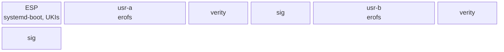

# Layout

The disk follows the Discoverable Partitions Specification so that systemd-gpt-auto-generator mounts
it without an fstab. `/usr` is the operating system; `/` is a thin, encrypted state partition
created on first boot.



## `/usr`

- `/usr/nix/store/<hash>-<name>`: the closure. Relocatable by construction, so the hash in the name
  is only an identity. Stock Nix would see this as the chroot store `--store /usr`.
- `/usr/bin`, `/usr/lib`, `/usr/share`: a symlink farm into the store for what systemd and scripts
  address by absolute path. `/usr/sbin` is a symlink to `bin`.
- `/usr/lib/systemd/system`, `sysusers.d`, `tmpfiles.d`, `repart.d`, `sysupdate.d`,
  `/usr/lib/os-release`: the system's configuration, written by the composer.
- `/usr/share/factory/etc`: the seed for `/etc`, written by `/factory`: `hostname`, `shells`, a
  minimal `pam.d` (account and session only) and the empty trust directories. It holds no `passwd`,
  `group` or `shadow` (systemd-sysusers writes them on first boot) and no `machine-id` (PID 1 does).
- `/usr/lib/golconda/etc.manifest`: type, mode, owner and sha256 for each factory path. The seed
  records the applied manifest in `/etc/.golconda-factory-id`, so drift is auditable; a later
  `etc-sync` may use it.

### Farm specification

`/usr/bin` and friends exist because systemd, PAM, sshd and `dlopen` address programs and libraries
by name; the store path is only an identity. The composer outputs every symlink of `/usr` as one
map, path → `{ target; kind; }`, for the image builder:

- **`package`**: `/usr/bin/<name>`, one symlink per entry in a package's `bin` list; the composer
  derives these from `packages`.
- **`dlopen`**: `/usr/lib/<soname>` for a library systemd (or other code) opens by name:
  `"/usr/lib/libtss2-esys.so.0" = { target = "${tpm2-tss}/lib/libtss2-esys.so.0"; kind = "dlopen"; }`.
  The image builder checks that it resolves.
- **`farm`**: a directory the image builder links file by file, for a package built with
  `prefix = "/usr"`:
  `"/usr/lib/udev/rules.d" = { target = "${systemd}/lib/udev/rules.d"; kind = "farm"; }`.
- **`explicit`**: anything else, such as the `.wants` symlinks of static enablement (see
  [unit enablement](#unit-enablement) below).

One check covers the map: a path with two sources is an error naming both, whatever their kinds. A
link path and a file at the same path is an error. Everything else stays reachable only through
`/usr/nix/store`.

### Unit enablement

Units are enabled by static `.wants` symlinks, not by presets:

```
/usr/lib/systemd/system/multi-user.target.wants/sshd.service -> ../sshd.service
```

The composer generates these from each unit's `wantedBy` list. The `[Install]` section remains in
the unit text so `systemctl enable/disable` still works for admin overrides in `/etc`.

**Why not presets?** Presets need a first-boot step (`systemctl preset-all`). Static `.wants` links
work without any first-boot action and also work in the initrd.

## State

| path             | partition               | how it comes to be                                                                                                                                                                                               |
| ---------------- | ----------------------- | ---------------------------------------------------------------------------------------------------------------------------------------------------------------------------------------------------------------- |
| `/etc`           | root                    | seeded from `/usr/share/factory/etc` by tmpfiles `C+` (PID 1 has filled `/etc` with `machine-id` before tmpfiles runs, and a plain `C` skips a non-empty directory); nothing is replaced, so admin edits persist |
| `/var`           | root                    | `StateDirectory=`, tmpfiles                                                                                                                                                                                      |
| `/home`, `/root` | root                    | tmpfiles                                                                                                                                                                                                         |
| `/tmp`, `/run`   | tmpfs                   | systemd                                                                                                                                                                                                          |
| `/var/lib/<app>` | optional data partition | repart definition in the image; service state always lives under `/var/lib`, never `/srv`                                                                                                                        |

The reference list of partitions, type GUIDs and flags is in
[reference/layout](../reference/layout.md).
