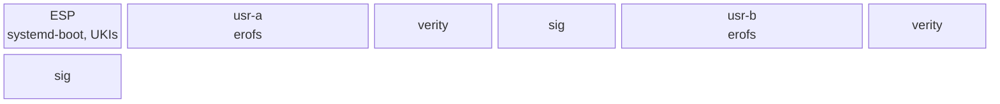

# Layout

The disk follows the Discoverable Partitions Specification so that systemd-gpt-auto-generator mounts
it without an fstab. `/usr` is the operating system, twice (the A/B slots); `/` is one state
partition, created on first boot and grown to the disk. The exact partitions, sizes and the owner of
every path are in [reference/layout](../reference/layout.md).



## `/usr`

`/usr/nix/store/<hash>-<name>` is the closure. Every output is relocatable, so the hash is only an
identity; stock Nix would see the tree as the chroot store `--store /usr`. Around the store sits
what systemd, PAM, sshd and `dlopen` address by absolute path:

- `/usr/bin`, `/usr/lib`, `/usr/share`: symlinks into the store (the **symlink farm**); `/usr/sbin`
  is a symlink to `bin`.
- `/usr/lib/systemd/system`, `sysusers.d`, `tmpfiles.d`, `systemd/network`, `sysupdate.d`,
  `/usr/lib/<service>/`: the system's configuration, from the composer's `units` and `files`.
- `/usr/lib/os-release`: the image identity and version.
- `/usr/share/factory/etc`: the seed for `/etc`, from `/factory`.

### The symlink map

The composer outputs the symlinks of `/usr` as one map, path → `{ target; kind; }`, and the `/usr`
tree builder makes them:

- **`farm`**: a directory expanded file by file, for a package compiled with `prefix = "/usr"`
  ([Packaging](packaging.md#prefixed-packages)):
  `"/usr/lib/udev/rules.d" = { target = "${systemd}/lib/udev/rules.d"; kind = "farm"; }`.
- **`dlopen`**: `/usr/lib/<soname>` for a library systemd opens by name; the builder checks that it
  resolves.
- **`explicit`**: anything else, such as `/usr/bin/sh` → dash and the `.wants` links below.

One rule covers the map: a path with two sources is an error naming both, whatever their kinds, and
a link and a file at one path is an error too.

`/usr/bin/<name>` for a package's executables is not in the map, because evaluation cannot see what
a build installs. The builder reads each package's `exports.json` and links every name in its `bin`
(what `bin/` holds after the build). A package that declares `bin` in its `package.nix` gets only
those names, and each must be in `exports.json`. The same rule holds there: a name from two
packages, or from a package and a link of the map, stops the build, and the message names the path
and both sources. Everything else stays reachable only through `/usr/nix/store`.

### Unit enablement

Units are enabled by static `.wants` symlinks, not by presets:

```
/usr/lib/systemd/system/multi-user.target.wants/sshd.service -> ../sshd.service
```

The service renderer writes these from `wantedBy`; `[Install]` stays in the unit text so
`systemctl enable/disable` still works for an administrator's overrides in `/etc`. Static links work
without a first-boot step, also in the initrd.

No preset enables a unit. PID 1 runs `preset-all` on the first boot, when `/etc` is empty, and the
first line that matches a unit wins, in the order of the file names. `/base` ships
`/usr/lib/systemd/system-preset/00-golconda.preset`, which says `disable *`, so systemd's own
`90-systemd.preset` and its default, `enable`, never apply, and the first boot writes no link under
`/etc/systemd/system`. Before, they enabled every unit with an `[Install]` section that the image
ships, among them `systemd-sysext.service`, `systemd-tpm2-clear.service`, the pcrlock and report
units and `systemd-sysupdate-reboot.timer`. The boot test's `units-composed-only` checks that no
link is in `/etc/systemd/system` and that every enabled unit has a static link in `/usr`.

Two units that systemd's preset enabled are needed, so `/base` links them:

| unit                                   | link                          | why                                                                                                                       |
| -------------------------------------- | ----------------------------- | ------------------------------------------------------------------------------------------------------------------------- |
| `systemd-network-generator.service`    | `sysinit.target.wants`        | it turns `network.*` credentials into networkd files before networkd starts ([Provisioning](../features/provisioning.md)) |
| `systemd-networkd-wait-online.service` | `network-online.target.wants` | `network-online.target` waits for a configured network; `systemd-imds-import.service` orders after it                     |

The other units that `systemctl enable systemd-networkd.service` would add are not linked: networkd
and resolved open their varlink sockets themselves, and they own their D-Bus names while they run.

`golconda-etc-links.service` rewrites an administrator's enable links, which name a store path, to
`/usr/lib/systemd/system/<unit>` after `/sysroot/usr` is mounted and before switch-root, so a
systemd store path change in an update leaves no dangling link
([Updates](updates.md#enable-links-and-systemds-store-path)).

## State

| path             | where | how it comes to be                                                                                                                                                                                                                                                                                                                       |
| ---------------- | ----- | ---------------------------------------------------------------------------------------------------------------------------------------------------------------------------------------------------------------------------------------------------------------------------------------------------------------------------------------- |
| `/etc`           | root  | tmpfiles `L` lines link each factory file to `/usr/share/factory/etc/<path>`; `L` (not `L+`) creates only what is missing, so an administrator's regular file at the same path wins and stays. PID 1 writes `machine-id` and reads the host name from a credential, sysusers write `passwd`/`group`/`shadow`; nothing writes `hostname`. |
| `/var`           | root  | `StateDirectory=`, tmpfiles; vars under `/var/lib/golconda/vars`                                                                                                                                                                                                                                                                         |
| `/home`, `/root` | root  | `MakeDirectories=` of the root partition                                                                                                                                                                                                                                                                                                 |
| `/tmp`, `/run`   | tmpfs | systemd                                                                                                                                                                                                                                                                                                                                  |
| `/var/lib/<app>` | root  | service state always lives under `/var/lib`; there is no `/srv`                                                                                                                                                                                                                                                                          |

The `/etc` rule has three consequences: a vendor change reaches every unmodified file on the next
boot with no tool, `find /etc -type f` lists the administrator's changes, and a file a program
rewrites in place (such as the CA bundle) must be a directory of its own, not a link.
