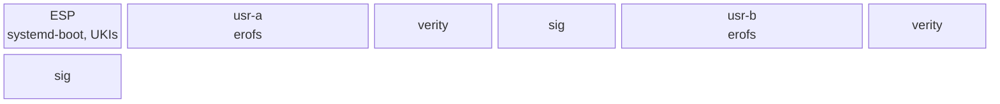

# Layout

The disk follows the Discoverable Partitions Specification so that systemd-gpt-auto-generator mounts
it without an fstab. `/usr` is the operating system, twice (the A/B slots); `/` is one state
partition, created on first boot and grown to the disk. `/etc` is part of the image and read-only
([The read-only /etc](#the-read-only-etc)). The exact partitions, sizes and the owner of every path
are in [reference/layout](../reference/layout.md).



## `/usr`

`/usr/nix/store/<hash>-<name>` is the closure. Every output is relocatable, so the hash is only an
identity; stock Nix would see the tree as the chroot store `--store /usr`. Around the store sits
what systemd, PAM, sshd and `dlopen` address by absolute path:

- `/usr/bin`, `/usr/lib`, `/usr/share`: symlinks into the store (the **symlink farm**); `/usr/sbin`
  is a symlink to `bin`.
- `/usr/lib/systemd/system`, `sysusers.d`, `tmpfiles.d`, `systemd/network`, `sysupdate.d`,
  `/usr/lib/<service>/`: the system's configuration, from the composer's `units` and `files`.
- `/usr/lib/os-release`: the image identity and version.
- `/usr/share/factory/etc`: the files `/etc` links to, from `/factory`.
- `/usr/lib/confexts/golconda`: the read-only `/etc`, a directory confext built by `lib/etc.nix`.

### The symlink map

The composer outputs every symlink of `/usr` as one map, path → `{ target; kind; }`, and the `/usr`
tree builder makes them:

- **`package`**: `/usr/bin/<name>`, one per entry in a package's `bin` list; derived from
  `packages`.
- **`farm`**: a directory expanded file by file, for a package compiled with `prefix = "/usr"`
  ([Packaging](packaging.md#prefixed-packages)):
  `"/usr/lib/udev/rules.d" = { target = "${systemd}/lib/udev/rules.d"; kind = "farm"; }`.
- **`dlopen`**: `/usr/lib/<soname>` for a library systemd opens by name; the builder checks that it
  resolves.
- **`explicit`**: anything else, such as `/usr/bin/sh` → dash and the `.wants` links below.

One rule covers the map: a path with two sources is an error naming both, whatever their kinds, and
a link and a file at one path is an error too. Everything else stays reachable only through
`/usr/nix/store`.

### Unit enablement

Units are enabled by static `.wants` symlinks, not by presets:

```
/usr/lib/systemd/system/multi-user.target.wants/sshd.service -> ../sshd.service
```

The service renderer writes these from `wantedBy`; `[Install]` stays in the unit text, but `/etc` is
read-only, so `systemctl enable`, `mask` and `edit` work only with `--runtime`. Static links work
without a first-boot step, also in the initrd. No boot is a first boot
([The read-only /etc](#the-read-only-etc)), so PID 1 runs no presets and `/etc/systemd/system` has
no enable links. A unit that systemd enables only by preset gets a static link too:
`systemd-network-generator.service` in `sysinit.target.wants`. The initrd unit
`golconda-etc-links.service` still runs and finds nothing to rewrite
([Updates](updates.md#enable-links-and-systemds-store-path)).

## State

| path             | where  | how it comes to be                                                                                                                 |
| ---------------- | ------ | ---------------------------------------------------------------------------------------------------------------------------------- |
| `/etc`           | `/usr` | the confext `/usr/lib/confexts/golconda`, merged read-only by the initrd ([The read-only /etc](#the-read-only-etc))                |
| `/var`           | root   | `StateDirectory=`, tmpfiles; vars under `/var/lib/golconda/vars`, sealed credentials under `/var/lib/golconda/credstore.encrypted` |
| `/home`, `/root` | root   | `MakeDirectories=` of the root partition                                                                                           |
| `/tmp`, `/run`   | tmpfs  | systemd                                                                                                                            |
| `/var/lib/<app>` | root   | service state always lives under `/var/lib`; there is no `/srv`                                                                    |

## The read-only /etc

`/etc` is a directory confext in the image. `lib/etc.nix` builds it: it runs `systemd-sysusers`,
then `systemd-tmpfiles --create --boot --prefix=/etc`, over the image's own configuration and
against an empty root that holds only the factory (`/usr/share/factory/etc`). The result is what a
first boot wrote before: the factory links, `passwd`, `group`, `shadow` and `gshadow`, the CA links,
`localtime` and `os-release`. `mkSystem` links it at `/usr/lib/confexts/golconda`. Its
`etc/extension-release.d/extension-release.golconda` has `ID=<image id>` and `VERSION_ID=<version>`,
so it belongs to the `/usr` it came with.

In the initrd, `systemd-confext-sysroot.service` (a static link in `initrd.target.wants`, from
`/base`) merges it onto `/sysroot/etc` before switch-root. The mount is overlayfs, read-only,
`nosuid`, `nodev` and `noexec`, with no upper layer. The kernel has `CONFIG_OVERLAY_FS=y` for this
use only ([Kernel: overlayfs](kernel.md#overlayfs)). An update brings a new `/etc` with the new
`/usr`, and a fallback to the other slot brings the old `/etc` back.

The consequences:

- **The machine id.** `/etc/machine-id` is an empty file. PID 1 takes the id from the SMBIOS/DMI
  product UUID on KVM, QEMU, Xen, Amazon and bhyve, else from the `system.machine_id` credential,
  else at random, and mounts it over the file (machine-id(5)). The id must be stable: the host
  secret of `systemd-creds` is bound to it, so with a new id at every boot a sealed var does not
  open after a reboot. VMs and clouds give a UUID.
- **No first boot.** An empty `machine-id` file means no boot is a first boot. `systemd-firstboot`
  is skipped and no first-boot presets run; units are enabled by static links
  ([Unit enablement](#unit-enablement)).
- **Users.** `passwd`, `group`, `shadow` and `gshadow` come from sysusers at build time. A drop-in
  gives `systemd-sysusers.service` `ConditionPathIsReadWrite=/etc`, because sysusers opens
  `/etc/.pwd.lock` for writing first. The Nix store makes every file 0444 and every directory 0555,
  so `/etc/shadow` is world-readable. It holds no password: Golconda has none.
- **tmpfiles.** The `/etc` lines ran at build time. The confext ships `etc/tmpfiles.d/<name>.conf`
  for each configuration that has `/etc` lines, with those lines dropped: a `d` line whose mode
  differs would chmod the read-only `/etc` and fail with `EROFS`. So a credential that tmpfiles
  writes into `/etc` has no effect: `network.hosts` (`/etc/hosts`), `login.motd` and `login.issue`.
- **Sealed credentials** live in `/var/lib/golconda/credstore.encrypted`, and units load them by
  absolute path: systemd searches no credstore under `/var`.
- **No administrator changes.** An administrator cannot change `/etc`. A change is a new image.
  `systemctl enable`, `mask` and `edit` work only with `--runtime`.

Open:

- **The machine id on bare metal.** PID 1 reads the SMBIOS UUID by itself only in a VM. On bare
  metal it needs the `system.machine_id` credential, or `systemd.machine_id=firmware` to use the
  board's UUID (which not every board sets uniquely). Neither is built.
- **tmpfiles credentials into `/etc`.** `network.hosts`, `login.motd` and `login.issue` do nothing
  now. Nothing replaces them yet.
- **An administrator route.** Signed confexts in `/var/lib/confexts` could carry a machine's own
  `/etc` files. This is not designed.
