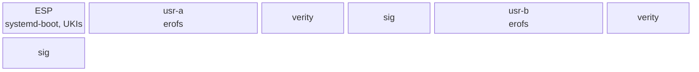

# Layout

The disk follows the Discoverable Partitions Specification so that systemd-gpt-auto-generator mounts
it without an fstab. `/usr` is the operating system; `/` is a thin, encrypted state partition
created on first boot.

## `/usr`

- `/usr/nix/store/<hash>-<name>`: the closure. Relocatable by construction, so the hash in the name
  is only an identity. Stock Nix would see this as the chroot store `--store /usr`.
- `/usr/bin`, `/usr/lib`, `/usr/share`: a symlink farm into the store for what systemd and scripts
  address by absolute path. `/usr/sbin` is a symlink to `bin`.
- `/usr/lib/systemd/system`, `sysusers.d`, `tmpfiles.d`, `repart.d`, `sysupdate.d`,
  `/usr/lib/os-release`: the system's configuration, written by the composer.
- `/usr/share/factory/etc`: the seed for `/etc`.
- `/usr/lib/golconda/etc.manifest`: type, mode, owner and sha256 for each factory path. The seed
  records the applied manifest in `/etc/.golconda-factory-id`, so drift is auditable; a later
  `etc-sync` may use it.

## State

| path                       | partition               | how it comes to be                                                                        |
| -------------------------- | ----------------------- | ----------------------------------------------------------------------------------------- |
| `/etc`                     | root                    | seeded from `/usr/share/factory/etc` on first boot (tmpfiles `C`); admin edits afterwards |
| `/var`                     | root                    | `StateDirectory=`, tmpfiles                                                               |
| `/home`, `/root`           | root                    | tmpfiles                                                                                  |
| `/tmp`, `/run`             | tmpfs                   | systemd                                                                                   |
| `/srv` or `/var/lib/<app>` | optional data partition | repart definition in the image                                                            |

The reference list of partitions, type GUIDs and flags is in
[reference/layout](../reference/layout.md).
