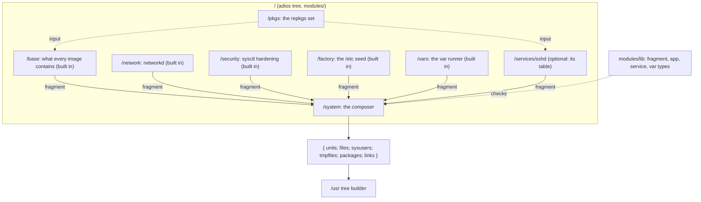

# Modules

A Golconda system is a list of typed fragments composed by one function. A module returns a
fragment; the `/system` composer unions them. There is no global namespace to merge, so there are no
priorities, and a duplicate definition is an error instead of a silent override. The types,
renderers and their fields are in [reference/modules](../reference/modules/README.md); this page
says why they have the shape they have.



The tree has one service module. A second service is a new directory under `modules/services/`.

## A fragment

A fragment is what a module returns: `units`, `files`, `sysusers`, `tmpfiles`, `packages`, `links`
and an optional `name` (the module's path, for the package origins). Every field is optional and
typed (korora, `modules/lib/fragment.nix`); an unknown field is a type error. The fields are exactly
what the `/usr` tree builder installs, and nothing is interpreted on the way:

- a unit is text under `/usr/lib/systemd/system/`;
- a file is text with a mode under `/usr`;
- a sysusers or tmpfiles line is a line;
- a package is a closure root;
- a link is a symlink of `/usr` ([Layout: The symlink map](layout.md#the-symlink-map)).

A unit stays text with a typed name (a stem and one of the seven suffixes) and at least one section
header. A typed INI model would add a second place where systemd's semantics are spelled out; the
renderers produce the text and the tests read it.

## How packages enter the tree

The repkgs sets enter the tree once, as the options of `/pkgs`:

- `target` is the set of the platform the image runs on (`nix/default.nix` passes it from
  `nix/packages.nix`);
- `build` is the build host's set, for tools that run on the builder. It defaults to the target's
  `buildPkgs`, which is the same set when the build is not a cross build.

`/pkgs` returns `{ target; build; pkgs; }`. A module that needs a package declares
`inputs.pkgs.path = "/pkgs"` and reads `results.pkgs.pkgs.openssh`. A package-valued option defaults
from there, so a configuration can replace the package but never has to pass one.

This is adios' own mechanism: a module declares its inputs and receives their results. It carries
one rule. A module never imports repkgs and never reads a set it did not declare; a second kind of
set is a second module path, never a second argument. No option takes a function, so the schema
stays platform-independent. `/pkgs.target` is the one option that is not configuration data, and the
TOML loader refuses it.

The composer records which fragment brought each package (`packageOrigins`: a component's module
path such as `/base` or `/services/sshd`, another fragment's own `name`, or its index), and the
`/usr` tree writes it as `/usr/lib/golconda/packages.json`, so "why is this here" has an answer
without a second declaration.

## Which modules a system has

Every module has one role, and one function decides which modules enter a system
(`lib/components.nix`):

| role      | what it is                                        | in the system                    |
| --------- | ------------------------------------------------- | -------------------------------- |
| component | returns a fragment for the image                  | built in, or when it has a table |
| provider  | gives data to the modules that read it (`/pkgs`)  | never: it has no fragment        |
| composer  | `/system`, which unions the components' fragments | always                           |
| group     | holds children and has no `impl` (`/services`)    | never: its children may be       |

A built-in component (`/base`, `/network`, `/security`, `/factory`, `/vars`) is in every system; its
table only configures it. An optional component (`/services/sshd`) is in the system when the
document has its table, and an empty table selects it with its defaults:

```toml
["/services/sshd"]
```

There is no `enable` option and no second list: removing the table removes the component.

An input (`inputs.pkgs.path = "/pkgs"`) is a different edge. It says whose result a module reads,
and it never selects anything: reading `/pkgs` installs nothing, and `/system` reads no module at
all. `mkSystem` evaluates each selected component once and passes the fragments to `/system` as
`components`, each named by its module path, so the attribution names the module and never an index.
`/usr/lib/golconda/modules.json` records the result: every module's role and inputs, for a component
whether it is included and why (`builtin` or `config`), and the names of the build's own fragments
(the loader and the update index of a signed image). The image is those components plus those
fragments, nothing else: `/system` has no other list, and a downstream repository adds a module
under `/local`, never a bare fragment.

## The base system

`/base`, `/network` and `/security` are built in, and composed first. A system with no table still
boots with:

- systemd;
- D-Bus;
- a shell;
- coreutils;
- the kernel;
- DHCP on every wired link;
- time sync;
- a bounded journal
  ([Architecture: What every image contains](architecture.md#what-every-image-contains)).

They have options (`/base.ntp`, `/base.journalMaxUse`, `/network.networks`, `/network.dns`,
`/network.defaultDhcp`; `/security` has none) but no switch: there is nothing to turn off.

## `app` and `service`

A `service` is a typed value: an `app` (package, program, argv, env, files: the part that has
nothing to do with systemd) plus what only a unit has (credentials, state directories, sandbox tier,
user, ordering). There is one renderer, `render service`, and one place for a service's
configuration:

- The app's files go to `/usr/lib/<name>/<file>`. The unit says
  `ExecStart=/usr/bin/<program> <argv…>`, and a config path in `argv` is that literal path.
- A secret is a typed reference in `argv`, `{ credential = "n"; }`, rendered as `%d/n` and checked
  against the service's `credentials`. The credential reaches the program from
  `LoadCredentialEncrypted=`, never from a file in the image.
- `systemctl cat <name>` therefore shows the whole command; nothing is baked into a binary and
  nothing is interpolated at run time.

Why not wrap the program into a launcher that carries its configuration? That was tried; it bought
nothing the plain `ExecStart=` does not, and it cost a second renderer, a `/wrap` module, an
exception to the duplicate rule and a unit that hid its arguments. repkgs keeps `wrap` for developer
shells and tools shipped to other hosts, not for services.

An `app` file must not carry a per-machine value: one image serves every machine, so a credential
path or a key marker in its text is a type error that names the file.

The `service` type grows a field when two services would need it and it has one meaning (`killMode`,
`runtimeDirectory`, `scope`); everything else a program needs is its own configuration, which the
module writes into the app's files (sshd's `Subsystem sftp internal-sftp` is `sshd_config` content,
not a unit field). There is no generic escape hatch into the unit text: a module that needs a
directive the type lacks adds the field, with its type, or does without.

### Sandbox tiers

A service names one of three tiers, `strict`, `default` or `trusted`, each a fixed set of
`systemd.exec` hardening directives ([reference](../reference/modules/README.md#sandbox-tiers)).

- `default` is what a new service takes unless it has a reason.
- `strict` is for a daemon that needs no capability and no device.
- `trusted` adds no directive and needs its reason in the module's doc comment (sshd: it spawns user
  sessions that must see the real system).

The tiers are not a free-form `systemd.exec` surface on purpose: a hardening line that is right for
one service and wrong for another is a new tier, not an option.

### User services

`service.scope = "user"` renders the same unit for `systemd --user`, under `/usr/lib/systemd/user/`.
`user` and `credentials` are refused: the unit runs as whoever's manager starts it, and Golconda
seals credentials for the system manager only (a per-user credstore would need
`systemd-creds encrypt --user`).

### Vars

A var is a fragment too ([Trust: Secrets and vars](trust.md#secrets-and-vars)). `render var` returns
a oneshot unit and the manifest that names the credential; the unit generates the secret on first
boot and seals it to the TPM. `admin adminVar` returns the manifest only. A service that consumes a
var names its credential id in `credentials` and orders itself after the var's unit.

## The composer

`/system` takes `name`, `version` and `updateSource`, and from `mkSystem` the selected components'
fragments and the build's own as `components`, each named
([Which modules a system has](#which-modules-a-system-has)). It merges them, then the sysupdate
definitions it renders from `updateSource`. The merge follows four rules:

- Attribute-set fields are unioned, and a key that appears twice throws with the key's name.
- List fields are concatenated.
- `packages` is one list with each package once, and `packageOrigins` says which fragments brought
  it.
- The fragments' links are one map, and one duplicate check covers the whole map.

A module that returns several fragments unions them with the same `merge`, so a duplicate inside one
module is the same error as one between modules. The output is the only thing the `/usr` tree
builder reads.

A service is on when the document has its table; there is no `enable` flag. How a TOML document
becomes an image is in [Configuration](config.md#from-document-to-image).

## `/factory`

`/factory` is the one module that may write under `/etc`, and it does so only as the seed in
`/usr/share/factory/etc` plus the tmpfiles `L` lines that link it
([Layout: State](layout.md#state)). It knows no service: a module that needs a file under `/etc`
(sshd's `pam.d/sshd`) has it in the factory because `/etc` content lives there, while the module's
own user and directories are in the module's fragment.

## Why not the NixOS module system

NixOS merges every module into one global configuration through a fixpoint, which is why `mkForce`
exists and why evaluation is heavy. adios modules declare their inputs, are checked lazily, and
compose by explicit function application. A module that wants to change another's output calls it
and transforms the result; nothing acts at a distance.
