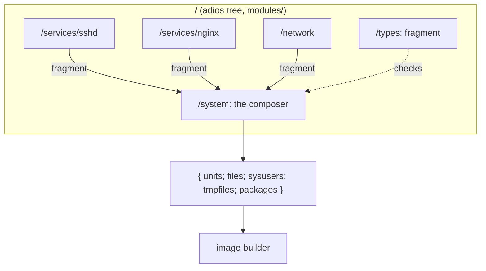

# Modules

A Golconda configuration is a list of typed fragments composed by one function. There is no global
namespace to merge, so there are no priorities, and a duplicate definition is an error instead of a
silent override.



## A fragment

```nix
{
  units."sshd.service" = "...";          # /usr/lib/systemd/system
  files."/usr/lib/sysusers.d/sshd.conf" = "u sshd - ...";
  sysusers = [ "u sshd - \"SSH daemon\"" ];
  tmpfiles = [ "d /var/lib/sshd 0700 root root -" ];
  packages = [ pkgs.openssh ];
}
```

Every field is optional and typed by `/types.fragment` (korora). A module's `impl` returns one.

## The composer

`/system` takes `name`, `version` and `fragments`. Attribute-set fields are unioned and a key that
appears twice throws with the key's name; list fields are concatenated. The result is the only thing
the image builder reads.

## Why not the NixOS module system

NixOS merges every module into one global configuration through a fixpoint, which is why `mkForce`
exists and why evaluation is heavy. adios modules declare their inputs, are checked lazily, and
compose by explicit function application. A module that wants to change another's output calls it
and transforms the result; nothing acts at a distance.
