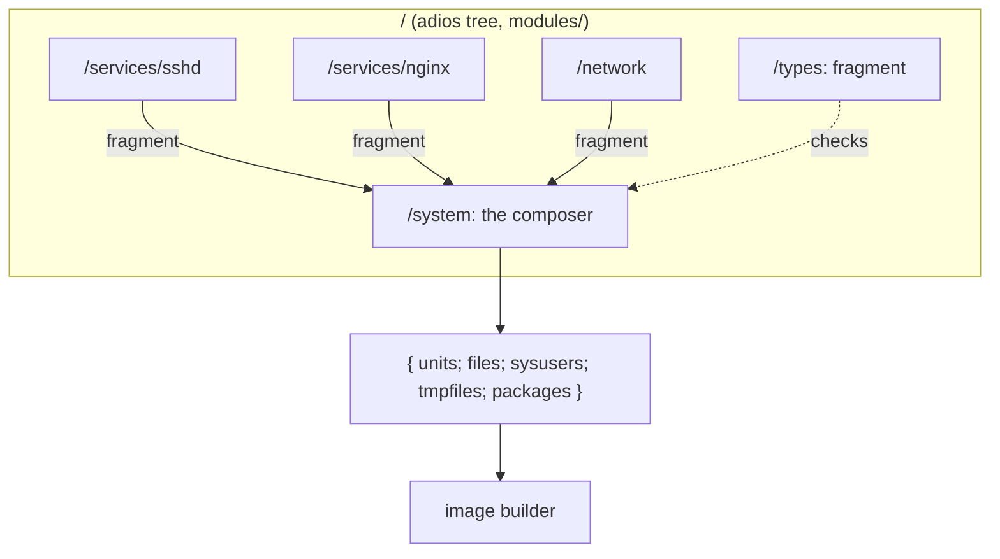

# Modules

A Golconda configuration is a list of typed fragments composed by one function. There is no global
namespace to merge, so there are no priorities, and a duplicate definition is an error instead of a
silent override.



## A fragment

```nix
{
  units."sshd.service" = "...";          # /usr/lib/systemd/system
  files."/usr/lib/sysusers.d/sshd.conf" = "u sshd - ...";
  sysusers = [ "u sshd - \"SSH daemon\"" ];
  tmpfiles = [ "d /var/lib/sshd 0700 root root -" ];
  packages = [ pkgs.openssh ];
}
```

Every field is optional and typed by `/types.fragment` (korora). A module's `impl` returns one.

## `app` and `service`

Above the fragment sits a typed `app`: package, argv, env and files. A `service` embeds an `app` and
adds `extraArgv` (which may hold credential refs), state directories, credentials, sandbox profile
and user. Credential refs are refused inside `app` because it has no credentials directory.

Renderers turn these values into fragments:

- **Wrapped relocatable binary.** The repkgs `launch` record bakes argv and env into the output; a
  future `wrap` package shape will add config files. *(planned)*
- **systemd unit.** `ExecStart=` points at the wrapped binary; `LoadCredentialEncrypted=` names
  credentials; `StateDirectory=` names state.
- **User unit.** The same, for `systemd --user`. *(planned)*

Config goes to `/usr/lib/<name>/` or into the wrapper, never to `/etc`. The image holds no
per-machine values. A program that insists on `/etc` gets a tmpfiles `L` symlink.

## The composer

`/system` takes `name`, `version` and `fragments`. Attribute-set fields are unioned and a key that
appears twice throws with the key's name; list fields are concatenated. The result is the only thing
the image builder reads.

## Services, apps and vars

A service is a typed value, not an `enable` flag: a module returns `render service`, which is a
fragment, and a service in `fragments` is on. The value is an `app` (package, argv, env, config
files; nothing systemd-specific, so the same value can later become a wrapped binary) plus what only
a unit has: credentials, state, user, sandbox profile, ordering. Config files go to
`/usr/lib/<name>/`, so they update with the image. A secret never enters a file or the store: it is
a `{ credential = "n"; }` reference, accepted only in the unit's `extraArgv` and rendered as `%d/n`
from `LoadCredentialEncrypted=`. A var is a fragment too: a oneshot unit that generates the secret
on the machine on first boot and seals it to the TPM. A module that returns several fragments unions
them with the composer's own `merge`, so a duplicate inside one module is the same error as one
between modules. Types and renderers: [reference/modules](../reference/modules/README.md).

## Why not the NixOS module system

NixOS merges every module into one global configuration through a fixpoint, which is why `mkForce`
exists and why evaluation is heavy. adios modules declare their inputs, are checked lazily, and
compose by explicit function application. A module that wants to change another's output calls it
and transforms the result; nothing acts at a distance.
