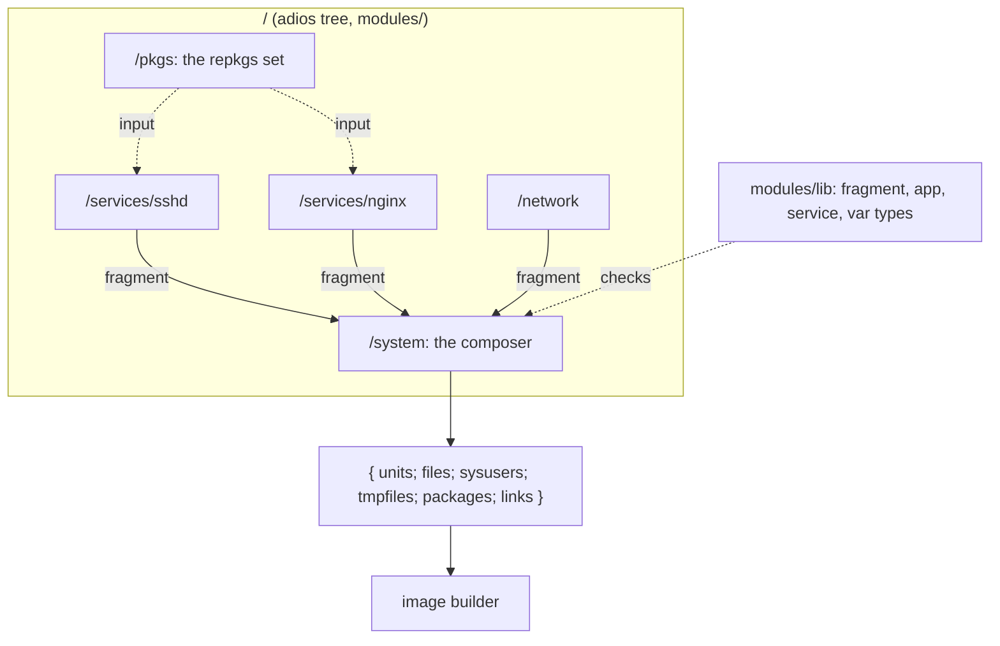

# Modules

A Golconda configuration is a list of typed fragments composed by one function. There is no global
namespace to merge, so there are no priorities, and a duplicate definition is an error instead of a
silent override.



## A fragment

```nix
{
  units."sshd.service" = "...";          # /usr/lib/systemd/system; typed name, text with a section
  files."/usr/lib/sysusers.d/sshd.conf" = "u sshd - ...";   # text: mode 0644
  files."/usr/lib/golconda/run" = { text = "#!/bin/sh ..."; mode = "0755"; };
  sysusers = [ "u sshd - \"SSH daemon\"" ];
  tmpfiles = [ "d /var/lib/sshd 0700 root root -" ];
  packages = [ pkgs.openssh ];            # closure roots; their `bin` lists become /usr/bin links
  links = {                               # the other symlinks of /usr, by path
    "/usr/lib/systemd/system/multi-user.target.wants/sshd.service" =
      { target = "../sshd.service"; kind = "explicit"; };
    "/usr/lib/udev/rules.d" = { target = "${pkgs.systemd}/lib/udev/rules.d"; kind = "farm"; };
    "/usr/lib/libtss2-esys.so.0" = { target = "${pkgs.tpm2-tss}/lib/libtss2-esys.so.0"; kind = "dlopen"; };
  };
}
```

Every field is optional and typed by `fragment` in `modules/lib/fragment.nix` (korora); an unknown
field is a type error. A module's `impl` returns one. A unit is a typed name (a stem and one of
`.service`, `.target`, `.socket`, `.timer`, `.path`, `.mount`, `.slice`) whose value is the rendered
text; the text must carry a section header. The value stays text because the renderers produce text;
a typed INI model is not wanted.

## How packages enter the tree

The repkgs set enters the tree once, as the option `set` of `/pkgs`: the configuration passes it
(`tree { options."/pkgs".set = set; }`, which `nix/default.nix` does from `nix/packages.nix`), and
`/pkgs` returns `{ set; pkgs; }`. A module that needs a package declares
`inputs.pkgs.path = "/pkgs"` and reads `results.pkgs.pkgs.openssh`; a package-valued option defaults
from there with `defaultFunc = { results }: ...`, so a configuration can still replace the package
but never has to pass one. This is adios' own mechanism (a module declares its inputs and receives
their results), so no module imports repkgs, no option takes a function, and the schema stays
platform-independent: `/pkgs.set` is the one option that is not configuration data, and the TOML
loader refuses it.

## `app` and `service`

Above the fragment sits a typed `app`: package, program, argv, env and files, the part of a service
that has nothing to do with systemd. A `service` embeds an `app` and adds what only a unit has:
credentials, state directories, sandbox profile, user and ordering. There is one renderer:

- **systemd unit.** `render service` writes the app's files to `/usr/lib/<name>/<file>` and the unit
  with `ExecStart=/usr/bin/<program> <argv…>`. A config path in `argv` is the literal
  `/usr/lib/<name>/<file>` (`filesDir name` gives the directory); a credential is a typed reference,
  `{ credential = "n"; }`, rendered as `%d/n` in the same argv and checked against `credentials`.
  `systemctl cat` shows the whole command; nothing is baked into a binary. sshd renders to
  `ExecStart=/usr/bin/sshd -D -e -f /usr/lib/sshd/sshd_config -h %d/hostkey …`.
- **User unit.** `service.scope = "user"` renders the same unit for `systemd --user`: the file goes
  to `/usr/lib/systemd/user/<name>.service` (a `files` entry, so the composer's duplicate check
  covers it), its `.wants` links under `/usr/lib/systemd/user/<target>.wants/`, and `wantedBy`
  defaults to `default.target`. `user` is refused: the unit runs as whoever's manager starts it.
  `credentials` are refused too: Golconda seals a credential for the system manager into
  `/etc/credstore.encrypted`, and the per-user manager searches only the user's own credstore and
  needs `systemd-creds encrypt --user` (systemd.exec(5), Credentials), so a reference could never
  resolve. The sandbox profiles are the same text; which directives the user manager honours is
  verified on a running system.

Config goes to `/usr/lib/<name>/`, never to `/etc`. The image holds no per-machine values. A program
that insists on `/etc` gets a tmpfiles `L` symlink.

An `app` file must not carry a per-machine value: one image serves every machine, so a credential
path (`%d/`, `$CREDENTIALS_DIRECTORY`) or a key (`-----BEGIN`, `PRIVATE KEY`) in its text is a type
error that names the file. A secret is a credential, referenced from `argv` and read from the
credentials directory at run time.

The `service` type grows a field when two services would need it and it has one meaning (`killMode`,
`runtimeDirectory`); everything else a program needs is its own configuration, which the module
writes into the app's files (sshd's `Subsystem sftp internal-sftp` is `sshd_config` content, not a
unit field). There is no generic escape hatch into the unit text: a module that needs a directive
the type lacks adds the field, with its type, or does without.

A service is on when its fragment is in `fragments`; there is no `enable` flag. A secret is a
`{ credential = "n"; }` reference in `argv`, rendered as `%d/n` from `LoadCredentialEncrypted=`. A
var is a fragment too: a oneshot unit that generates the secret on the machine on first boot and
seals it to the TPM. A module that returns several fragments unions them with the composer's own
`merge`, so a duplicate inside one module is the same error as one between modules. Types and
renderers: [reference/modules](../reference/modules/README.md).

## The composer

`/system` takes `name`, `version` and `fragments`. Attribute-set fields are unioned and a key that
appears twice throws with the key's name; list fields are concatenated. Every file comes out as
`{ text; mode; }`, so the image builder reads one shape. The result is the only thing the image
builder reads.

The composer output:

| field      | shape                           | description                                                 |
| ---------- | ------------------------------- | ----------------------------------------------------------- |
| `units`    | `{ name = text; }`              | `/usr/lib/systemd/system/<name>`; user units are `files`    |
| `files`    | `{ path = { text; mode; }; }`   | Files under `/usr`                                          |
| `sysusers` | `[ line ]`                      | Concatenated to one `.conf`                                 |
| `tmpfiles` | `[ line ]`                      | Concatenated to one `.conf`                                 |
| `packages` | `[ drv ]`                       | Closures for `/usr/nix/store`, each once                    |
| `links`    | `{ path = { target; kind; }; }` | Every symlink of `/usr`: `/usr/bin`, farm, dlopen, `.wants` |

The symlinks are one map, so one rule covers them: the composer derives `/usr/bin/<name>` for every
name in a package's `bin` list (kind `package`) into the same map as the fragments' own links, and a
path with two sources throws, naming both, whatever their kinds. A link and a file at one path is
also an error. The kinds tell the image builder what to do: `farm` names a directory it links file
by file, `dlopen` a soname it checks resolves, `explicit` anything else.

## Why not the NixOS module system

NixOS merges every module into one global configuration through a fixpoint, which is why `mkForce`
exists and why evaluation is heavy. adios modules declare their inputs, are checked lazily, and
compose by explicit function application. A module that wants to change another's output calls it
and transforms the result; nothing acts at a distance.
