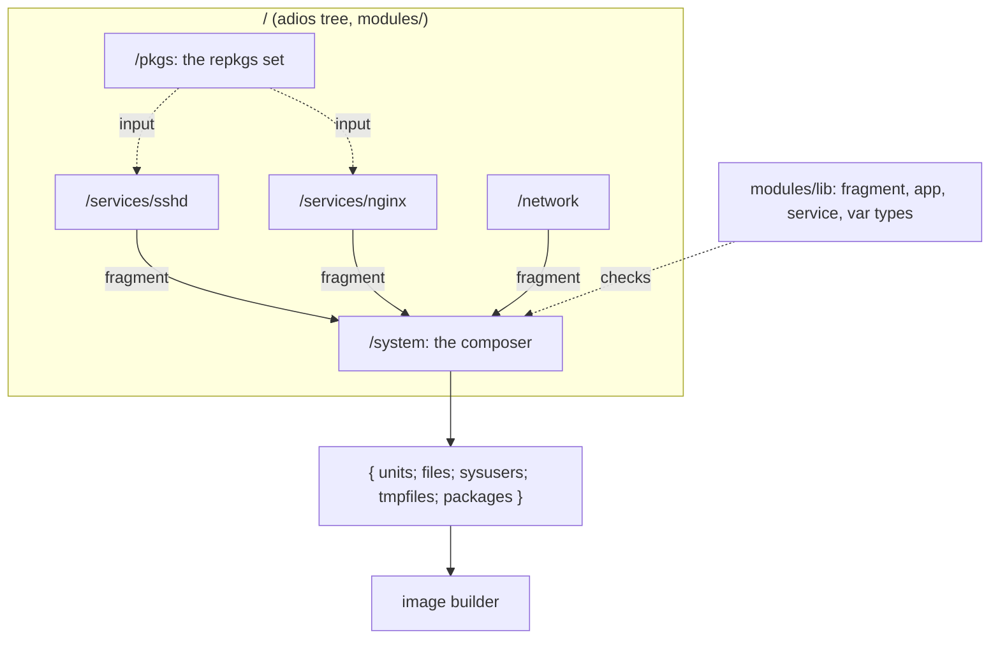

# Modules

A Golconda configuration is a list of typed fragments composed by one function. There is no global
namespace to merge, so there are no priorities, and a duplicate definition is an error instead of a
silent override.



## A fragment

```nix
{
  units."sshd.service" = "...";          # /usr/lib/systemd/system
  files."/usr/lib/sysusers.d/sshd.conf" = "u sshd - ...";   # text: mode 0644
  files."/usr/lib/golconda/run" = { text = "#!/bin/sh ..."; mode = "0755"; };
  sysusers = [ "u sshd - \"SSH daemon\"" ];
  tmpfiles = [ "d /var/lib/sshd 0700 root root -" ];
  packages = [ pkgs.openssh ];
  links = [                               # symlinks in /usr, including .wants
    { path = "/usr/lib/systemd/system/multi-user.target.wants/sshd.service";
      target = "../sshd.service"; }
  ];
  farm."systemd" = [ "lib/udev/rules.d" ];  # subdirs linked file by file
  dlopen."tpm2-tss" = [ "libtss2-esys.so.0" ];  # sonames for /usr/lib
}
```

Every field is optional and typed by `fragment` in `modules/lib/fragment.nix` (korora). A module's
`impl` returns one.

## How packages enter the tree

The repkgs set enters the tree once, as the option `set` of `/pkgs`: the configuration passes it
(`tree { options."/pkgs".set = set; }`, which `nix/default.nix` does from `nix/packages.nix`), and
`/pkgs` returns `{ set; pkgs; wrap; }`. A module that needs a package declares
`inputs.pkgs.path = "/pkgs"` and reads `results.pkgs.pkgs.openssh` or `results.pkgs.wrap`; a
package-valued option defaults from there with `defaultFunc = { results }: ...`, so a configuration
can still replace the package but never has to pass one. This is adios' own mechanism (a module
declares its inputs and receives their results), so no module imports repkgs, no option takes a
function, and the schema stays platform-independent: `/pkgs.set` is the one option that is not
configuration data, and the TOML loader refuses it.

## `app` and `service`

Above the fragment sits a typed `app`: package, argv, env and files. A `service` embeds an `app` and
adds `extraArgv` (which may hold credential refs), state directories, credentials, sandbox profile
and user. Credential refs are refused inside `app` because it has no credentials directory.

Renderers turn these values into fragments:

- **Wrapped relocatable binary.** `wrapApp wrap app` creates a derivation using repkgs' `wrap`. The
  `launch` record bakes argv, env and files into the output; the wrapped binary is relocatable.
- **systemd unit.** `render` writes config files to `/usr/lib/<name>/` and puts argv on
  `ExecStart=`. `renderWrapped wrap` uses the wrapped binary: config files live in the wrapped
  output's `share/wrap/<pkgname>/`, and only `extraArgv` (credential refs) stays on ExecStart. The
  farm links `/usr/bin/<program>` to the launcher in place of the plain package's own; sshd is
  rendered this way.
- **User unit.** The same, for `systemd --user`. *(planned)*

Config goes to `/usr/lib/<name>/` or into the wrapper, never to `/etc`. The image holds no
per-machine values. A program that insists on `/etc` gets a tmpfiles `L` symlink.

An `app` file must not carry a per-machine value: one image serves every machine, so a credential
path (`%d/`, `$CREDENTIALS_DIRECTORY`) or a key (`-----BEGIN`, `PRIVATE KEY`) in its text is a type
error that names the file. A secret is a credential, named in the unit's `extraArgv` and read from
the credentials directory at run time.

A service is on when its fragment is in `fragments`; there is no `enable` flag. A secret is a
`{ credential = "n"; }` reference, accepted only in the unit's `extraArgv` and rendered as `%d/n`
from `LoadCredentialEncrypted=`. A var is a fragment too: a oneshot unit that generates the secret
on the machine on first boot and seals it to the TPM. A module that returns several fragments unions
them with the composer's own `merge`, so a duplicate inside one module is the same error as one
between modules. Types and renderers: [reference/modules](../reference/modules/README.md).

## The composer

`/system` takes `name`, `version` and `fragments`. Attribute-set fields are unioned and a key that
appears twice throws with the key's name; list fields are concatenated. Every file comes out as
`{ text; mode; }`, so the image builder reads one shape. The result is the only thing the image
builder reads.

The composer output:

| field      | shape                         | description                            |
| ---------- | ----------------------------- | -------------------------------------- |
| `units`    | `{ name = text; }`            | `/usr/lib/systemd/system/<name>`       |
| `files`    | `{ path = { text; mode; }; }` | Files under `/usr`                     |
| `sysusers` | `[ line ]`                    | Concatenated to one `.conf`            |
| `tmpfiles` | `[ line ]`                    | Concatenated to one `.conf`            |
| `packages` | `[ drv ]`                     | Closures for `/usr/nix/store`          |
| `links`    | `[ { path; target; } ]`       | Symlinks: `/usr/bin`, dlopen, `.wants` |
| `farmDirs` | `[ { path; target; } ]`       | Directories to expand file by file     |

The `packages` list is checked: two packages that install the same `/usr/bin` name throw, because
the image builder links them into one directory. A link path and a file at the same path is also an
error.

## Why not the NixOS module system

NixOS merges every module into one global configuration through a fixpoint, which is why `mkForce`
exists and why evaluation is heavy. adios modules declare their inputs, are checked lazily, and
compose by explicit function application. A module that wants to change another's output calls it
and transforms the result; nothing acts at a distance.
