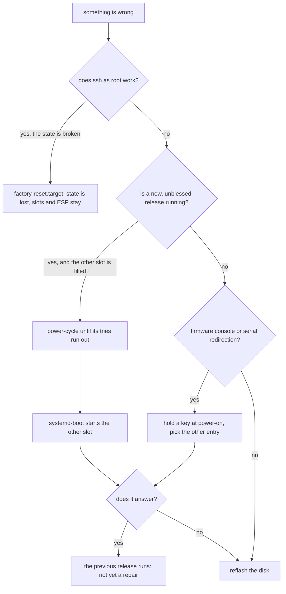

# Recovery

There are four paths back, in the order to try them: reboot and let boot counting pick the other
slot, choose an entry in the systemd-boot menu, reset the state partition, or reflash the disk. The
first two need no login and keep the state. A state reset loses the state and needs a working ssh
login. A reflash loses everything and needs physical access. What does not exist is in
[What is missing](#what-is-missing).

## What the machine does by itself

On a counted boot, one whose entry still has tries left, `boot-complete.target` is reached only when
the health units pass: `golconda-health-network.service` needs a routable link and
`golconda-health-sshd.service` needs `sshd.service` active
([Boot: Boot health](boot.md#boot-health)). `systemd-bless-boot-generator` adds the target only when
the entry has a counter, so a blessed entry boots without them. A candidate that fails one of the
health units is not blessed: `systemd-bless-boot.service` requires the target and never runs, the
boot-counting suffix stays, and one of the three tries is used. Nothing in v1 reboots a machine
whose health check failed, so the counter falls only at the next boot, and that boot is the
operator's decision, not the system's.

systemd-boot decrements `+3-0` → `+2-1` → `+1-2` on each attempt. At `+0-3` the entry has no tries
left and systemd-boot prefers another entry that has. This is the fallback that boot counting exists
for ([Updates](updates.md)).

## The other slot

An update writes its four artifacts to the inactive slot and installs the UKI on the ESP as
`EFI/Linux/<id>_<version>+3-0.efi` ([Updates: Transfers](updates.md#transfers)). The previous slot
and its UKI are untouched, so after three failed attempts systemd-boot starts the previous UKI,
which carries the previous `usrhash=` and finds the previous `/usr` slot. A successful boot of that
older image is a machine that works, not a repair: the new version is not running and nothing yet
reports why the candidate failed.

A freshly written disk carries one slot only (`image/repart.nix` leaves B `_empty`). There
systemd-boot still boots the exhausted entry, because no other entry can boot; a failed health check
therefore leaves the machine up but unblessed until it is repaired or the other slot is filled. A
machine after its first update has both slots filled and gets the fallback above.

## Manual choice in the systemd-boot menu

The ESP's `loader/loader.conf` (at the root of the ESP) sets `timeout 0` and `editor no`
([Boot: Kernel command line](boot.md#kernel-command-line), `lib/image/disk.nix`). systemd-boot
therefore does not wait at power-on, but it still opens its menu when a key is held down during
firmware start. The menu lists the UKIs under `EFI/Linux`, with their boot-counting suffixes, and
one can be chosen with the arrow keys and Enter. Choosing the older entry is the same fallback as
above, by hand and before the three tries run out. The menu draws on the firmware console; the image
sets no serial console for the loader, so a headless machine needs serial redirection in its
firmware to use it. The boot test does not exercise the menu.

## State reset

`FactoryReset=yes` on the root partition makes systemd-repart delete it at the next boot, and first
boot runs again. The request is `systemctl start factory-reset.target`, which sets the
`FactoryResetRequest` EFI variable and reboots ([Updates: Factory reset](updates.md#factory-reset)).
The ESP and the `/usr` slots stay, so this path repairs a broken state partition, not a broken
image. All state is lost. It needs a working ssh login, because there is no console login; a machine
without one is reflashed.

`scripts/boot-test … --factory-reset --ssh-test` checks this path on the test image. It writes a
marker in `/etc` and reads `/etc/machine-id`, requests the reset, and waits for the reset boot. It
checks that the marker is gone (`state-gone`), the machine id changed (`machine-id-new`), first boot
ran again and `multi-user.target` was reached (`first-boot-rerun`, `multi-user-after-reset`), and
that `bootctl list` shows the same entries and the same running version (`slots-kept`). An ssh
failure cannot pass `state-gone`: the guest must print `absent`. The mode prints the last 100 lines
of the reset boot's serial log
([The factory reset test](../reference/image.md#the-factory-reset-test)).

Still manual: a reset on a machine with an update installed (two `/usr` slots), the TPM clear and
sealed credentials, a reset on real firmware, and the case where ssh is down. The test image has one
slot and the boot test runs in QEMU.

## Reflash

Writing a fresh disk image is the last resort. It replaces the ESP, both slots and the root
partition, so it loses all state and any credential sealed to the old machine. It needs physical
access to the disk and to the firmware menu when enrolment must change
([Deployment keys](trust.md#deployment-keys)). There is no installer and no network install: the
image is written to the disk directly ([Image artifacts](../reference/image.md)).

## What is missing

| not available                   | consequence                                                                                                                                               |
| ------------------------------- | --------------------------------------------------------------------------------------------------------------------------------------------------------- |
| local login, rescue shell       | no getty, no password; a machine without working ssh has no console session                                                                               |
| automatic reboot of a candidate | a failed health check leaves the machine up; an operator must reboot it                                                                                   |
| a remote recovery channel       | no out-of-band agent; if sshd or the network is the failing unit, ssh cannot be used                                                                      |
| loader repair without a boot    | the loader is updated after a good boot; one that no longer starts needs the firmware menu or a reflash ([Boot loader: Recovery](bootloader.md#recovery)) |
| LUKS recovery                   | no encrypted state in v1, so no unlock prompt to recover                                                                                                  |

Recovery that needs the machine to answer is designed around the one channel that exists, ssh as
root with a certificate ([Identity](trust.md#identity)). Everything else is local or a reflash.
