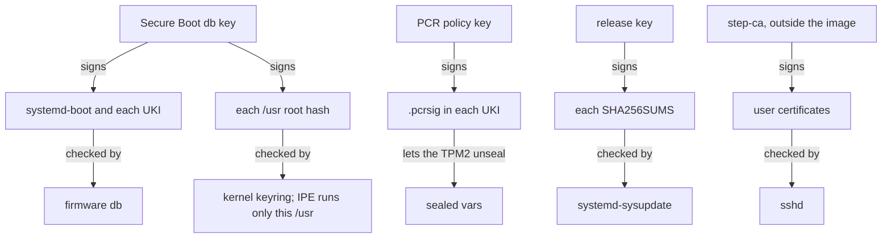
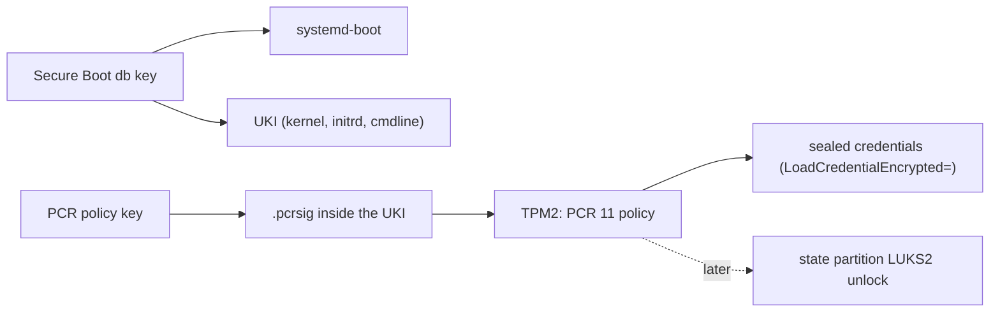
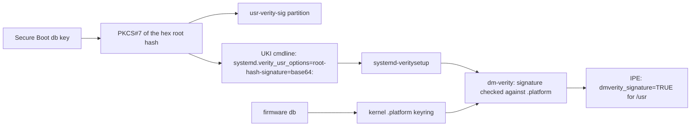
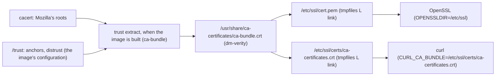
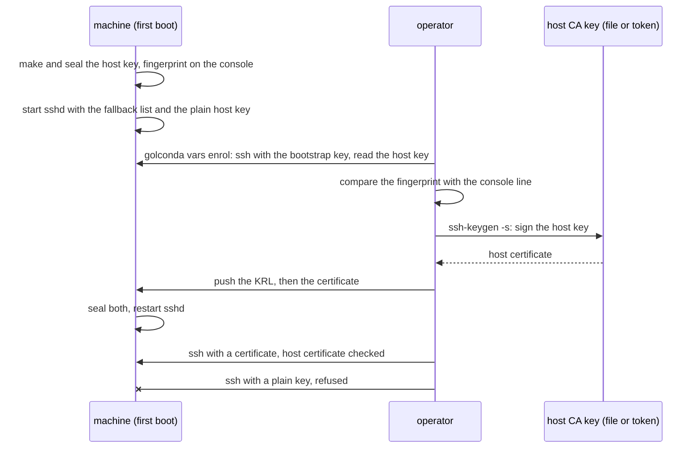

# Trust

There are three trust roots on a Golconda machine. Each is one key hierarchy, and nothing ships its
own copy of any of them:

1. **Secure Boot and measured boot keys** decide *what runs*: the Secure Boot `db` key signs
   systemd-boot and every UKI; the PCR policy key signs the expected PCR 11 values and is what
   TPM2-sealed credentials are bound to. Signed by the signer outside Nix (the test images use
   throwaway keys) and proven in a boot test with `--secure-boot`, where firmware enforces Secure
   Boot (`secure-boot-enabled`) and refuses a loader whose key is in `dbx` (`old-loader-refused`). A
   machine in Setup Mode enrols the deployment's PK, KEK, `db` and `dbx` from the ESP on its first
   boot, with Microsoft's keys or without (`auto-enrolled`, `db-enrolled`, `dbx-enrolled`; proven in
   a virtual machine, hardware *(being built)*: [Boot loader: Enrolment](bootloader.md#enrolment)).
1. **The verity signing key** decides *what is read*: it signs the root hash of every `/usr` image.
   Today it is the Secure Boot `db` key, and the kernel checks the signature against the firmware
   `db` at every boot; without Secure Boot, against the same certificate built into the kernel
   ([status](#2-verity-key)).
1. **The CA store** decides *whom the machine talks to*: one bundle for every TLS client, made when
   the image is built from cacert's Mozilla roots, the administrator's anchors and a distrust list
   ([status](#3-ca-store)).

A fourth thing, who may log in, is decided outside the image ([Identity](#identity)).

The release key signs each release's index. sysupdate checks it when an update is downloaded, on
every image: every transfer has `Verify=yes`, with or without Secure Boot
([Updates: What an update authenticates](updates.md#what-an-update-authenticates)).



## Downstream packages

A downstream repository can replace any package by name, including the kernel, systemd, the loader
and the tools that sign the image. Such a replacement is trusted code. It can drop the IPE policy,
the verity key the kernel carries, or the boot checks. Golconda therefore takes a replacement only
when the document lists its name in `[golconda] replaces`, and refuses a name collision that the
list does not name. The list must be exact: a stale entry is an error, so it cannot silently allow a
later replacement. `modules.json` and the SBOM record each replacement. Golconda does not check what
a replacement does; whoever lists it owns that review
([reference/config](../reference/config.md#your-own-packages)).

### 1. Boot keys



### 2. Verity key



The image builder signs the hex root hash (the string the kernel gets in the verity table) with the
Secure Boot `db` key, as PKCS#7 without certificates (`lib/image/verity.nu`). The signature goes to
two places: the `usr-verity-sig` partition, systemd's JSON, for tools that dissect the disk; and the
UKI cmdline as `systemd.verity_usr_options=root-hash-signature=base64:<sig>` (`image/uki.nix`). The
generator passes the option to `systemd-veritysetup@usr.service`, which activates `/usr` with
`crypt_activate_by_signed_key`; dm-verity checks the signature against the secondary keyring and
then the platform keyring, which the kernel fills from the firmware `db` (`CONFIG_LOAD_UEFI_KEYS`,
`CONFIG_DM_VERITY_VERIFY_ROOTHASH_SIG_PLATFORM_KEYRING`). IPE's `dmverity_signature` is true only
for a volume whose signature the kernel verified.

Why the cmdline and not the partition: systemd reads the partition's signature only on the gpt-auto
path (`root-hash-signature=auto`, from the udev property `ID_DISSECT_PART_ROOTHASH_SIG` that the
`dissect_image` builtin sets on the boot disk). Golconda finds `/usr` by `usrhash=` through the
veritysetup generator, which takes no signature unless an option names one. The cmdline is in the
signed UKI and measured into PCR 11, so it is as trusted as `usrhash=` itself. The signature is
about 550 base64 characters; the cmdline is about 1250 bytes of the kernel's 2048
(`COMMAND_LINE_SIZE`), and `lib/image/uki.nu` fails the build at 2048.

Why the `db` key: the platform keyring holds the firmware `db` and nothing else, so no import step
is needed, and a second key would add nothing: whoever holds the `db` key can already sign a UKI
with any `usrhash=`. A rotated `db` key needs new images, as it does for the UKI
([Boot loader: Key rotation](bootloader.md#key-rotation)).

A signature that does not verify does not stop `systemd-veritysetup`: it logs "Unable to activate
verity device ... with root hash signature ..., retrying without" at info level and activates `/usr`
unsigned. The boot then stops at switch-root, where IPE denies PID 1's re-exec from `/usr`
([Execution policy](#execution-policy)). So `lib/image/uki.nu` checks the signature against the
UKI's own signing certificate at build time and fails on a mismatch. On the machine, the firmware
`db` must hold that certificate; the boot test enrols it only with `--secure-boot`.

**Without Secure Boot** (`/system.secureBoot = false`, for a host whose firmware has none, such as
Hetzner Cloud): no firmware fills the platform keyring, so the kernel carries the certificate
itself. `lib.mkImage` passes the `db` certificate of its `publicKeys` to `mkSystem`. The kernel
build copies it to a fixed path in the kernel tree, `certs/golconda-verity.pem`, and
`CONFIG_SYSTEM_TRUSTED_KEYS` names that path (`packages/kernel/kbuild.nu`, `GOLCONDA_KERNEL_FILES`);
the kernel loads it into `.builtin_trusted_keys`, which the secondary keyring that dm-verity checks
first includes. The kernel of the set changes, so `/usr` and the UKI carry the same one, and each
key set builds its own kernel. What is lost is the check before the kernel: no firmware verifies the
loader or the UKI, so whoever can write the ESP can boot a kernel that trusts another key. IPE and
the `/usr` signature still hold against a changed `/usr`, and the vars still seal (to the host key
alone, without a TPM). The bootstrap credentials on the ESP are accepted there because Secure Boot
is off ([Boot: Bootstrap credentials](boot.md#bootstrap-credentials)).

The certificate is an input of the kernel derivation, but not of its config: every key set has the
same config, so a new certificate compiles only the certificate object and the compressed kernel's
wrapper again, relinks, and takes the rest from jig's compile cache. A store path in the config
would change `include/generated/autoconf.h`, which every object includes. jig's cache does not see
an `.incbin` input (clang's depfile leaves it out): without more, a second certificate got the first
one's cached `certs/system_certificates.o`, and the kernel trusted the old key while its record
named the new one. So the build puts the digest of the certificate file on that object's command
line, and the digest of `vmlinux` on that of `arch/x86/boot/compressed/piggy.o`. jig itself now
refuses to cache a compile that names `.incbin` or `.include` (repkgs, llvm/llvm-project#54996); the
digests stay as a second guard, because a stale certificate object would be a trust failure, not a
slow build. A missing file fails the build (the copy, then make, which has no rule for it), and so
does an empty one (`extract-cert` needs at least one certificate): the keyring is never silently
empty. The kernel package installs the certificate as `lib/modules/<version>/trusted-keys.pem`, so
`/usr` records which key its kernel trusts; the config names only the path.

**Status.** Proven by boot with `--secure-boot`: the kernel loads the `db` certificate into the
platform keyring, and with `/sys/kernel/security/ipe/success_audit` on, IPE logs
`rule="op=EXECUTE dmverity_signature=TRUE action=ALLOW"` for files on `/usr` (`dm-0`). With
`ipe.enforce=1` the boot passes every check and logs no IPE denial; the same image without the `db`
enrolled stops at switch-root.

Without Secure Boot, proven by boot on OVMF with neither Secure Boot nor a TPM:
`image-smoke-test-nosb` logs `Secure boot disabled` and
`Loaded X.509 cert 'Golconda smoke Secure Boot db: …'`, reaches `multi-user.target` with
`ipe.enforce=1`, and passes the update test (`--next`, over HTTP). On the same firmware the default
image (`secureBoot = true`) stops at switch-root: IPE logs
`ipe_op=EXECUTE … comm="systemd" … dev="dm-0" … rule="DEFAULT op=EXECUTE action=DENY"` for PID 1's
re-exec from `/usr`. A kernel that holds another certificate refuses the signature: the same image
with the rotated throwaway certificate in its kernel (a manual run, not a `scripts/boot-test` mode)
logs `Loaded X.509 cert 'Golconda smoke Secure Boot db rotated: …'`, then
`verity: Root hash verification failed (-ENOKEY)`, and stops at switch-root with that IPE denial.

### 3. CA store



The image ships one CA file, `/usr/share/ca-certificates/ca-bundle.crt`. It holds cacert's Mozilla
roots, plus the administrator's `anchors`, minus the `distrust` list. The configuration names them
(`/trust`, [reference](../reference/modules/README.md)). An `anchors` entry is the text of one PEM
certificate, which is public data. A `distrust` entry is the SHA-256 fingerprint of a certificate's
DER form, which is how a CA is named in a report or by `openssl x509 -noout -fingerprint -sha256`; a
fingerprint is the only form, so the list does not carry a certificate that the bundle must drop:

```toml
["/trust"]
anchors = ["""
-----BEGIN CERTIFICATE-----
MIIB…
-----END CERTIFICATE-----
"""]
# 64 hex digits; colons between the bytes are optional and the case does not matter
distrust = ["17:93:92:7A:06:14:54:97:89:AD:CE:2F:8F:34:F7:F0:B6:6D:0F:3A:E3:A3:B8:4D:21:EC:15:DB:BA:4F:AD:C7"]
```

The module keeps one form (64 lower-case hex digits), so two spellings of one fingerprint are a
duplicate. An entry that is not a fingerprint fails when the configuration is read.

A certificate in both lists is distrusted. Distrusting a Mozilla root removes that root and keeps
the others. A fingerprint that matches no certificate of cacert or of the anchors fails the build,
so a typo does not pass in silence (and neither does a root that a cacert update dropped). A
duplicate entry is an error, as every duplicate is
([Principles](principles.md#duplicates-are-errors)).

**Built when the image is built.** The `ca-bundle` package (`packages/ca-bundle`) runs p11-kit's
`trust extract` over the roots and the two lists and writes the bundle. The roots and the anchors go
to the trust module's `anchors/`, each certificate whose fingerprint is listed to its `blocklist/`,
and the module writes every anchor that is not blocklisted, for the purpose `server-auth` as plain
PEM. The build then compares the file with (roots + anchors) − the distrusted certificates as sets
and fails on any difference, since `trust` skips a file it cannot parse without a word. The bundle
is read-only, covered by dm-verity like the rest of `/usr`, and signed with the release, and an
update replaces it whole. No unit runs on the machine, nothing writes the bundle, and the image has
no `trust` binary and no module configuration for p11-kit's trust module, so nothing there reads
`anchors` or `blocklist` directories.

Why not a unit on the machine that runs `trust extract` over `/etc/ssl/anchors` into `/etc` or
`/var`: the bundle would be a writable file that decides whom every TLS client trusts, so any root
process could change that without a signed image; a unit must order itself before every client,
`sysupdate` among them; and the image would carry the trust tool and its module. What it would buy
is an anchor added without a release. The image already updates by a release, which is minutes of
work and one signed index, and the administrator's CA certificates are public, fleet-wide data, not
per-machine values. A secret does not belong in a CA store, so the vars
([Secrets and vars](#secrets-and-vars)) have no part in it. An administrator who must change trust
on one machine at once can put a file at `/etc/ssl/cert.pem` or
`/etc/ssl/certs/ca-certificates.crt`: the `L` lines do not replace an existing file. That is a hand
repair, outside the image. A run-time anchor directory is not built, by design: a new release is the
way.

Two tmpfiles lines make the paths the image's TLS clients read by default: `L /etc/ssl/cert.pem`,
which OpenSSL reads because `openssl version -d` says `OPENSSLDIR=/etc/ssl`, and
`L /etc/ssl/certs/ca-certificates.crt`, which libcurl reads because it is built with
`CURL_CA_BUNDLE` set to that path. Both are links to the one file in `/usr`, so `/etc` holds no copy
to go stale. These are the readers in the image: the systemd tools that open an HTTPS URL
(`systemd-pull`, `systemd-sysupdate`, the IMDS import) through libcurl, and OpenSSL in systemd
(`systemd-resolved`'s DNS over TLS, when it is on). libcurl and OpenSSL also search the directory
`/etc/ssl/certs` by hash, and it holds no hashed link. No package ships `certifi` or its own bundle;
there is no Java, so no keystore.

**Status.** Proven by build checks and by boot. `checks.ca-store` builds the bundle from an anchor,
an anchor that is also distrusted and a distrusted Mozilla root, both named by fingerprint: the
bundle is exactly the roots plus the anchor minus the other two, and OpenSSL verifies a server
certificate of the anchor and refuses one of the distrusted CA. `checks.ca-store-select` runs the
distrust arithmetic on cacert's real roots: a Mozilla root and an anchor go by fingerprint, and a
fingerprint that matches nothing, or is no fingerprint, is an error. The package test
`tests-ca-bundle` checks the default bundle. The eval tests (`tests/eval/trust.nix`) check the
options, that `/base` no longer carries cacert, and how the lists reach the build. The boot test's
markers `ca-store-links`, `ca-bundle-content`, `tls-anchor-trusted` and `tls-distrusted-refused` run
on the test image, which names those certificates in `/trust`: the guest's bundle has Mozilla's
roots and the anchor and not the distrusted ones, `systemd-pull` fetches an HTTPS page from a server
whose certificate chains to the anchor, and the same fetch to a server of the distrusted CA fails on
the certificate ([What is proven](../proven.md)). The distrust of a real Mozilla root is proven on
the bundle (`ca-bundle-content`, `checks.ca-store`); no test server holds the key of a Mozilla root,
so no fetch to one runs.

Leaf revocation is not unified: OpenSSL, rustls and Go do not share a mechanism. Golconda's own PKI
uses short-lived certificates instead.

## Deployment keys

A release is signed with the deployment's keys, not the store's throwaways, and the signing happens
outside Nix ([Signing outside Nix](#signing-outside-nix)). The procedure, from making the set to
enrolling the certificate, is in [Making a release](../reference/release.md). A key set is a
directory of ten key files and the enrolment files (`scripts/make-keys`):

| file                 | used for                                                         | read by       |
| -------------------- | ---------------------------------------------------------------- | ------------- |
| `secureboot/db.key`  | signs the loader, the UKI and the verity root hash               | the signer    |
| `secureboot/db.crt`  | the certificate for those signatures; firmware `db` must hold it | `lib.mkImage` |
| `secureboot/PK.key`  | signed `PK.auth` and `KEK.auth`; later, a new KEK                | `make-keys`   |
| `secureboot/PK.crt`  | the platform key's certificate, enrolled as `PK`                 | the signer    |
| `secureboot/KEK.key` | signed `db.auth` and `dbx.auth`; later, `db` and `dbx` updates   | `make-keys`   |
| `secureboot/KEK.crt` | the key exchange key's certificate, enrolled as `KEK`            | the signer    |
| `secureboot/auth/`   | `microsoft/{PK,KEK,db,dbx}.auth` and `golconda/{PK,KEK,db}.auth` | the signer    |
| `pcr/pcr.key`        | signs the PCR 11 policy of each boot phase (`.pcrsig`)           | the signer    |
| `pcr/pcr.pub`        | the public half, embedded in the UKI as `.pcrpkey`               | `lib.mkImage` |
| `release/index.key`  | signs each release's `SHA256SUMS` (OpenPGP Ed25519)              | the signer    |
| `release/index.pgp`  | the public half, the image's keyring for `Verify=yes`            | `lib.mkImage` |

`lib.mkImage` takes the directory as `publicKeys` and copies the three public files into the store,
each alone; it reads nothing else of the set. The signer reads the three private files where they
lie, or has a token sign with the `db` and PCR keys that `secureboot/db.pkcs11` and `pcr/pcr.pkcs11`
name instead ([Keys on a token](#keys-on-a-token)). The PK and the KEK sign only the Secure Boot
variables systemd-boot enrols in Setup Mode, and `scripts/make-keys` signs those once, into
`secureboot/auth/` ([Boot loader: Enrolment](bootloader.md#enrolment)). So no release needs the PK
or KEK key: the signer copies the files and checks them against `PK.crt`, `KEK.crt` and the image's
`db` certificate, and `lib.mkImage` reads none of them. The PK and KEK keys can stay offline until
the next `db` rotation or `dbx` refresh. The `dbx` in the files is Microsoft's list as pinned when
they were made; `scripts/make-keys --auth-only` with the PK and KEK keys writes them again with a
newer one, for machines enrolled after that. A machine already enrolled keeps its `dbx`: nothing on
it writes a new one, and a `dbx` update there is *(later)*
([Making a release: 1](../reference/release.md#1-make-the-key-set)). A `db` rotation keeps the PCR
key and the release key from the old set (`pcrPublicKeys` and `indexPublicKeys` for `lib.mkImage`,
`--pcr-keys` and `--index-keys` for the signer;
[Boot loader: Key rotation](bootloader.md#key-rotation),
[Releases: The signed index](releases.md#the-signed-index)).

The `db` key signs both the UKI (`ukify --secureboot-private-key`, `lib/image/uki.nu`) and the
verity root hash (`lib/image/verity.nu`), and the same key signs the loader (`lib/image/loader.nu`).
The kernel checks the root hash signature against the platform keyring, which holds the firmware
`db` ([Verity key](#2-verity-key)). The signer checks each private key against the public half the
image carries before it signs, and the root hash signature against the `db` certificate before it
writes the disk (`lib/image/sign.nu`, `lib/image/uki.nu`), so a mismatched key fails the release
rather than the boot. A rotated `db` key needs new images: the UKI, the root hash signature and the
loader are all signed with it.

### Signing outside Nix

Private keys never enter the Nix store or a Nix build. Nix builds every part of the image unsigned;
one program, the signer, signs the parts and assembles the release outside Nix, on the release host.

Nix builds, as `lib.mkImage`'s `unsigned` output:

- the `/usr` tree without the signed loader, the initrd, the kernel, systemd's stub and the unsigned
  systemd-boot;
- `manifest.json`, which names these and every parameter of each step (times, salts, UUIDs and
  seeds, all from the version), the repart definitions and the release file names;
- copies of the three public halves, `db.crt`, `pcr.pub` and `index.pgp`;
- `sign`, the signer, built from the image's own package set.

The signer takes the unsigned output and a key directory. It checks that each private key is the
half of the public key the image carries, then:

1. signs systemd-boot with the `db` key (`systemd-sbsign`);
1. copies the `/usr` tree, puts the signed loader into it and runs `mkfs.erofs`;
1. writes the verity hash tree and signs the root hash with the `db` key (PKCS#7);
1. builds the UKI with `ukify`: the cmdline with `usrhash=` and that signature, the Secure Boot
   signature (`db` key) and `.pcrsig` (PCR key);
1. for an image with Secure Boot, copies the key set's enrolment files to `loader/keys/auto/`
   (`secureboot/auth/microsoft` or `golconda`, by `/system.secureBootMicrosoftKeys`) after it checks
   them against `PK.crt`, `KEK.crt` and the image's `db` certificate (`lib/image/enrol.nu`); it
   reads no PK or KEK key;
1. writes the ESP and `disk.raw` with `systemd-repart --offline`;
1. writes `release/` with `SHA256SUMS` and signs the index with the release key.

The erofs image is a signer step, not a Nix output, because `/usr` carries the signed loader that
`golconda-loader-update` installs on the ESP
([Boot loader: Key rotation](bootloader.md#key-rotation)). Its bytes depend on a signature, and so
do the root hash, the UKI's cmdline and the disk. A loader outside `/usr` would let Nix build the
erofs image, but it would change how a machine updates its loader. The copy and `mkfs.erofs` take a
few seconds.

`golconda release build` builds the unsigned output with `nix-build` and runs its `sign` with the
release host's key directory. The keys stay where they are. The test images run the same program in
a derivation, with throwaway keys that are test fixtures, so every boot test tests the signer a
release uses. The `db` key and the PCR key can also stay on a hardware token
([Keys on a token](#keys-on-a-token)).

The unsigned outputs depend on the public halves only: the release keyring is in `/usr`, an image
without Secure Boot has the `db` certificate in its kernel, and the manifest carries copies of all
three. A new private key with the same public half is impossible, so the proof is the other way
round: a new `db` and PCR key pair leaves the `/usr` tree, the initrd, the kernel and the signer of
a Secure Boot image at their store paths; only the manifest, which holds the new public halves,
changes.

No private key enters the image or the machine either; only the certificates are enrolled in
firmware, and the ESP holds them only inside the signed `.auth` files. The test outputs
(`packages.<system>.image-smoke*`) sign with throwaway keys made in the store (`throwawayKeys`) and
link only their public halves as `keys/`.

Nothing private in a checkout enters the store either. Nix reads a checkout's files where they lie,
and a store path is world-readable, so a key or a token beside the source would leak with it. The
checks' source is the files git tracks, with their working-tree contents (`nix/source.nix`): an
untracked or ignored file stays out.

Rotation and recovery:

- **The ESP loader**: a new `db` key reaches the ESP with the next release. On that release's first
  good boot, `golconda-loader-update.service` (`modules/base`) copies its signed systemd-boot and
  `loader.conf` from `/usr` to the ESP and keeps the old loader as the fallback copy. The unit runs
  only after `systemd-bless-boot.service`, so a release that fails its health gate installs nothing.
  Running `/usr/lib/golconda/golconda-loader-update` by hand puts a damaged loader back.
  `scripts/boot-test` checks all of this (`loader-update-ran`, `loader-matches-usr`,
  `loader-replaced`, `loader-reinstall`). The steps are in
  [Boot loader: Key rotation](bootloader.md#key-rotation) and [Recovery](bootloader.md#recovery).
- **An installed machine** with a rotated key: its next UKI and root hash signatures must come from
  the new key, and firmware must hold the new certificate, or Secure Boot and the verity check fail
  ([Execution policy](#execution-policy)). With no local console path, that enrolment is offline
  work on the variable store or a reinstall ([Recovery](recovery.md)).

### Keys on a token

A key on a token signs without leaving it: the release host holds no file of it. The signer takes
the `db` key and the PCR key from a PKCS#11 token, such as a YubiKey's PIV applet. The release key
stays a file for now.

| key           | signs                                   | tool and how it reaches the token                                                      |
| ------------- | --------------------------------------- | -------------------------------------------------------------------------------------- |
| `db`          | systemd-boot                            | `systemd-sbsign --private-key-source=provider:pkcs11 --private-key=pkcs11:…`           |
| `db`          | the verity root hash (PKCS#7)           | `openssl smime -provider pkcs11 -inkey pkcs11:…`                                       |
| `db`          | the kernel and the UKI                  | `ukify --signing-provider pkcs11`, which runs `systemd-sbsign` with the provider       |
| PCR           | `.pcrsig`, one signature per phase path | `ukify --signing-provider pkcs11`, which runs `systemd-measure sign` with the provider |
| release index | `SHA256SUMS.gpg` (OpenPGP)              | gpg; no PKCS#11 path *(later)*                                                         |

The OpenSSL side is [pkcs11-provider](https://github.com/latchset/pkcs11-provider), an OpenSSL 3
provider, packaged as a tool of the release host (`packages/pkcs11-provider`); it is not in the
image. systemd 262's tools load it by name (`provider:pkcs11`), and so does `openssl`. The signer
writes an OpenSSL configuration that gives the provider the token's PKCS#11 module and keeps digests
off the token: they stay with OpenSSL's default provider, and a module that hashes with OpenSSL
itself (SoftHSM) would otherwise call back into itself and hang. OpenSSL engines are deprecated in
OpenSSL 3, and systemd's `engine:` source is the older path; the provider is the one in use.

A key set names a key on a token in place of the key file: `secureboot/db.pkcs11` and
`pcr/pcr.pkcs11` hold one line each, the key's URI (RFC 7512). The set stays a directory, because
`lib.mkImage` reads the three public halves from it. The signer checks a token's key against the
public half the image carries, as it checks a file, by reading the public half through the provider.
systemd-measure needs a certificate for a key that comes through a provider; the PCR key has only a
public half, so the signer makes a self-signed certificate with the PCR key for that call.
`--pcrpkey` still embeds the image's `pcr.pub`.

RSA PKCS#1 v1.5, the scheme of both keys, draws no random numbers, so a release signed from the
token is the release signed from the same keys in files, byte for byte. The check
`pkcs11-signed-same` compares the two for the test image, whose keys are on a SoftHSM token
(test-only, `packages/softhsm`), and the boot test boots that image
([What is proven](../proven.md#signing-outside-nix)). A run on a real YubiKey has not been done
*(being built)*: the procedure is in [Making a release](../reference/release.md#6-keys-on-a-token).

**The release key.** gpg signs `SHA256SUMS`, because systemd-sysupdate checks an OpenPGP signature,
and gpg reaches a token only as an OpenPGP card through scdaemon, not through PKCS#11. The options:

1. **PKCS#7 manifests** (recommended): systemd#44292, merged after v262, lets sysupdate check a
   PKCS#7 signature of `SHA256SUMS`. With it the release key signs as the `db` key does, through
   pkcs11-provider, and GnuPG leaves the image. It waits for systemd v263, and moving to it changes
   the key every machine trusts, a release-key rotation ([Releases](releases.md#the-signed-index)).
1. **An OpenPGP card through scdaemon**: a YubiKey's OpenPGP applet holds the Ed25519 key, so the
   key in the image stays the same. The signer's gpg needs scdaemon, which the image's GnuPG is
   built without, and scdaemon needs pcsc-lite or its own USB driver on the release host. A second
   applet, with its own PIN, beside the PIV one. No software token stands in for it in a test.
1. **gnupg-pkcs11-scd**, an scdaemon that talks PKCS#11: it signs with RSA keys only, so the release
   key would change from Ed25519 to RSA, and it adds pkcs11-helper.

Until one of them is built *(later)*, the release key is a file; the signer refuses a
`release/index.pkcs11`.

## Identity

Who may log in is decided outside the image. People hold short-lived OpenSSH certificates from a CA
on another host, and the image ships only the CA's public key and the allowed principals per user.
The CA is step-ca with an OIDC provisioner, out of the image: the server needs no agent, and the CA
pushes host certificates and the revocation list as admin vars. The alternative with a verifier on
the server (`AuthorizedKeysCommand` fetching the identity provider's keys at login) is acceptable
later for always-online hosts.

There are no per-human accounts yet: an operator logs in as root, and the certificate principal and
key id in sshd's log (`LogLevel VERBOSE`) are the identity for audit. Plain `authorizedKeys` exist
for bootstrap. A hardware second factor (FIDO2, `sk-ssh-ed25519`) is client-side policy: the
certificate signs a FIDO2 key and the server needs nothing extra. No local login exists: no getty,
no password, no rescue shell ([Boot: Serial console](boot.md#serial-console)).

Nothing in the image authenticates a password. sshd fixes the lines that turn off every password
path and no option can turn them on
([reference: /services/sshd](../reference/modules/README.md#servicessshd)); PAM stays for account
and session (`pam_systemd`), never for auth: the factory's `/etc/pam.d/sshd` has no `auth` line and
`/etc/pam.d/other` denies every type. The image carries no setuid binary: linux-pam ships without
`unix_chkpwd`, so a non-root process cannot verify a password at all, and pam_unix is built with
`pam_unix-try-getspnam` so that root (sshd's account check) reads `/etc/shadow` itself (repkgs
`pkgs/li/linux-pam`).

The machine's own identity is its host key, a local var, plus a host certificate and a key
revocation list, both admin vars; sshd reads them from its credentials directory, never from the
image.

Later: operators as `/usr/lib/userdb/*.user` records with `run0` gated by polkit on a few action ids
(a root-less image), and one CA for SSH and X.509 with TPM device attestation (workload identity).
Both are designed, not built *(later)*.

### Enrolment

A new machine goes from its first boot to certificate login in one release, with `hostCertificate`
and `revokedKeys` on from the start:

1. At first boot `golconda-var-sshd-hostkey.service` makes the host key, seals it, and writes its
   fingerprint to the journal and the console:
   `golconda: ssh host key 256 SHA256:… root@HOST (ED25519)`.
1. sshd starts before anything is pushed. The host certificate is missing, so sshd logs that and
   presents the plain host key. The revocation list is missing, so PID 1 gives sshd a fallback under
   the same credential id (`SetCredential=`): a flat list that names the user CAs of
   `trustedUserCAKeys`. sshd refuses every certificate those CAs signed; plain keys log in (the
   image's `authorizedKeys`, or the provisioning credential `ssh.authorized_keys.root`).
1. The operator runs `golconda vars enrol HOST --ca-key … --krl …`, which logs in with a plain key.
   It reads the host key (as `golconda vars pub HOST sshd-hostkey key.pub` does), shows its
   fingerprint and goes on only when the operator says it is the console's line, or when it equals
   `--fingerprint`. It signs the key as a host certificate with `ssh-keygen -s` (key id HOST, the
   principals the names clients use), with the host CA key in a file or on a PKCS#11 token
   (`ssh-keygen -D`), stores the certificate and the deployment's KRL (as `golconda vars set` does),
   and pushes both (as `golconda vars push` does), the KRL first and the certificate last
   ([Commands: golconda vars enrol](../reference/cli.md#golconda-vars-enrol)).
1. The machine seals both, and the push restarts sshd (`KillMode=process` keeps the push's own
   session). sshd now presents the certificate, checks the pushed KRL, and refuses every plain key:
   from here on only certificates of the user CAs log in.



**Plain keys stop at enrolment.** With `hostCertificate` on, `sshd_config` begins with
`Include /run/golconda-sshd/*.conf`, before its `AuthorizedKeysFile` line; sshd takes the first
value it reads. `golconda-sshd-enrolled.service` runs before sshd, only when the sealed certificate
`/etc/credstore.encrypted/sshd-host-cert.cert` exists (`ConditionPathExists=`), and links
`/usr/lib/sshd/enrolled.conf`, which says `AuthorizedKeysFile none`, into its runtime directory. So
sshd reads no authorized-keys file at all: neither the image's `authorizedKeys` nor
`/root/.ssh/authorized_keys`, where `ssh.authorized_keys.root` and the cloud's keys go. The unit is
`PartOf=` sshd and sshd wants it, so the restart that the push makes runs it again: a start when the
condition failed at boot, a restart when it ran. The decision is made at every start of sshd from a
file on the state partition: it needs no second release, and it holds after a reboot and after an
update to a release that has `hostCertificate` on.

Recovery when certificate login breaks after the enrolment (the CA is lost, a KRL refuses every
certificate, the host certificate does not unseal) is the other slot or a reflash. The other slot
helps only when its release has `hostCertificate` off, and choosing it without a login takes the
boot menu at the console ([Boot loader: Recovery](bootloader.md#recovery)). A reflash rewrites the
state partition, and with it the sealed vars: the machine enrols again from its first boot. No plain
key opens a way back in.

Revocation is never off: sshd always reads a list. Before the push, that list refuses more than any
real KRL could, every certificate of the user CAs, because the machine cannot know yet which of them
are revoked. What logs in then is what the release already trusts without a CA: the plain keys of
the image or of the provisioning credentials, which are the operator's own. A plain key is checked
against no list until the push, and refused after it.

The CA must sign the machine's key and no other. Before the push the client cannot check the host:
there is no certificate yet, so a machine in the middle could hand over its own key for signing. The
console line is the check, on a channel that the network cannot change (the serial console, a
cloud's console). Without it, the first connection is trust on first use.

Bootstrap credentials are not the route for the host key: the certificate and the KRL are public,
but the certificate needs the host key, which exists only after the first boot, and a key made
elsewhere would travel on the ESP or in user data, which carry no secret. An ESP credential is
refused anyway with Secure Boot and TPM2 together
([Bootstrap credentials](boot.md#bootstrap-credentials)).

sshd declares both admin vars whether or not the options are on, so a release with the options off
accepts the push and a later release that turns them on reads it: a machine that runs without
certificates moves to them by a push and an update, in either order.

**Status.** Proven by boot with `--enrol`: the first boot of a release with both options on logs in
with the bootstrap key and refuses a good certificate (`bootstrap-key-login`,
`cert-refused-before-enrol`); `golconda vars enrol` refuses a fingerprint that is not the console's
and stores and seals nothing (`enrol-wrong-fingerprint-refused`), then enrols with the console's
fingerprint (`hostkey-fingerprint-on-console`, `admin-vars-pushed`), and in the same boot the host
certificate is presented, a certificate logs in, the revoked one is refused, both plain keys are
refused though the KRL names neither, and a second KRL takes effect (`host-cert-presented`,
`cert-login-after-enrol`, `cert-revoked-refused`, `bootstrap-key-refused-after-enrol`,
`krl-rotated`, `enrol-one-release`). With `--tpm` all of it holds after a reboot
(`host-cert-presented-after-reboot`, `cert-revoked-refused-after-reboot`,
`bootstrap-key-refused-after-reboot`). `--next` pushes to a release with the options off and checks
that the next release reads it, with a certificate.

The signer is `ssh-keygen`, with the host CA key in a file or on a token: a host certificate is
signed once per machine and per renewal, offline like the release keys, and needs no CA service. The
CLI tests sign with a real `ssh-keygen` from a key file and from a key on a SoftHSM token; no run
with a YubiKey has been done. Signing host certificates through step-ca's API is *(later)*.

## TPM2 credential decryption

Sealed today: the sshd host key, and nothing else. `golconda-var-sshd-hostkey.service` runs
`/usr/lib/golconda/golconda-var-run`, which calls
`systemd-creds encrypt --with-key=auto --tpm2-public-key-pcrs=11 --name=sshd-hostkey.key` and writes
`/etc/credstore.encrypted/sshd-hostkey.key`; sshd loads it with `LoadCredentialEncrypted=`. It is
the only local var in the image. Not sealed: the state partition (unencrypted for now, no LUKS), the
machine-id (a plain file PID 1 writes), the admin vars (the host certificate and the revocation list
are sealed once `golconda vars push` delivers them, see [Secrets and vars](#secrets-and-vars)), and
administrator credentials for the machine itself.

**Status.** A boot with `--secure-boot --tpm` prints
`sshd-hostkey.key sealed with: host key + TPM2 + signed PCR policy` (`scripts/boot-test` reads the
credential header); after a reboot in the same QEMU with the same swtpm state the key is unchanged,
so it was unsealed, not regenerated.

A phase path is the colon-separated chain of words systemd has measured into PCR 11 up to one boot
state (`systemd-pcrphase.service(8)`); `systemd-measure --phase=` signs exactly one path, and
`ukify --phases=` takes a list. The UKI signs the four paths of systemd's default set, each as its
own signature in the `.pcrsig` section (`image/uki.nix`): `enter-initrd`,
`enter-initrd:leave-initrd`, `enter-initrd:leave-initrd:sysinit`, and
`enter-initrd:leave-initrd:sysinit:ready`. These are four signed states, not one. A single
`enter-initrd:leave-initrd:sysinit:ready` argument would permit unsealing only at `ready`, after
sshd has already tried to load its host key.

This lets TPM2-sealed credentials unseal both in the initrd (for a LUKS unlock, later) and at
service time. `sshd.service` is ordered after `systemd-pcrphase-sysinit.service`, so its host key is
unsealed when PCR 11 is at `enter-initrd:leave-initrd:sysinit` or, after a restart, at `...:ready`;
both are signed. `lib/image/uki.nu` recomputes each path's PCR 11 policy digest with
`systemd-measure policy-digest` from the built image's own sections and compares it with the
`.pcrsig` section; the build fails if a path is missing.

### Rollback weakness

Any image signed by the same PCR 11 key unseals credentials sealed for that key. An attacker who
obtains an older, vulnerable image can boot it and decrypt secrets. Mitigations, all *(later)*:

- **pcrlock** (systemd 256+): binds to the exact PCR values of one image. A rollback fails because
  the old image's PCRs do not match.
- **Key rotation:** re-seal credentials with a new key pair after a security-critical update.
- **policyref** (systemd 262+): embeds a reference so the TPM refuses policies signed for a
  different reference.
- **TPM NV monotonic counter:** a future mechanism; no comparable project implements it yet.

## Secrets and vars

Secrets never enter the image or the store. Services receive them with `LoadCredentialEncrypted=`
(`systemd-creds`, TPM2-bound, sealed with the PCR 11 signing key). Nothing reads a secret at
evaluation time.

A **var** is a value the image names but never contains. Two classes:

- **local**: generated on the machine at first boot (ssh host keys, wireguard keys). A oneshot unit
  runs the generator, seals the result with `systemd-creds encrypt`, and exports only the public
  half.
- **admin**: kept age-encrypted on the deploy host, pushed over ssh, sealed on the machine (host
  certificates, revocation lists). The consumer's unit waits for the push.

Bootstrap credentials (the host name) are not vars: they are plain systemd credentials from the
firmware or the ESP ([Boot: Bootstrap credentials](boot.md#bootstrap-credentials)).

The deploy tool is `golconda vars` ([Commands](../reference/cli.md#golconda-vars)). It keeps each
value age-encrypted in the configuration repository (`vars/<host>/<var>/<file>.age`, to the keys in
`vars/recipients.txt`), reads the machine's own manifests over ssh, pipes each value into
`golconda-var-run --admin`, which seals it only if the image declares that var and file, and
restarts the units the manifest names as consumers. `age` and `ssh` are programs on the deploy host;
the machine needs neither.

**Rotation.** To rotate an admin var: `golconda vars set`, then `push`; the consumer restarts and
reads the new sealed credential. A local var is regenerated by removing its `done` marker and
rebooting.

## Execution policy

Phase 1 is IPE (execute only from dm-verity volumes with a signed root hash, not a particular one:
the policy avoids per-image kernel rebuilds) with `lockdown=integrity` and Yama, all fixed in the
kernel config and the UKI cmdline. IPE enforces (`ipe.enforce=1`): the kernel verifies the `/usr`
signature ([status](#2-verity-key)), so programs on `/usr` run, and a program copied to `/var` gets
`Permission denied` with the audit record `rule="DEFAULT op=EXECUTE action=DENY"`. The firmware `db`
must hold the signer: without it `/usr` is activated unsigned, and PID 1's re-exec after switch-root
is denied, so the machine stops with "Failed to execute /sbin/init". The boot test therefore needs
`--secure-boot`, which enrols the `db` (with `--auto-enrol`, systemd-boot enrols it). Phase 2 is the
BPF LSM for `RestrictFileSystems=`; phase 3 AppArmor profiles generated from the typed service.
SELinux is rejected.
