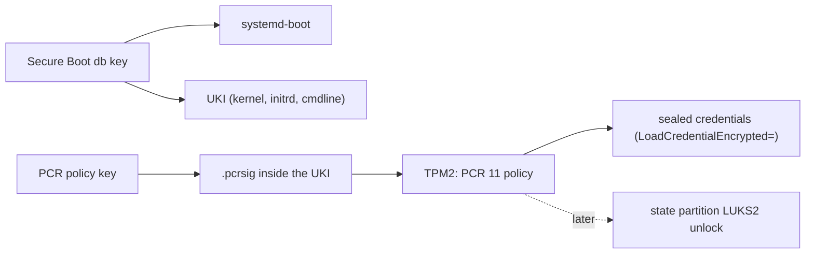
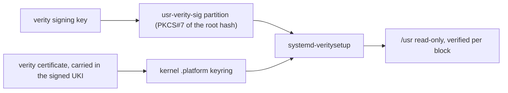
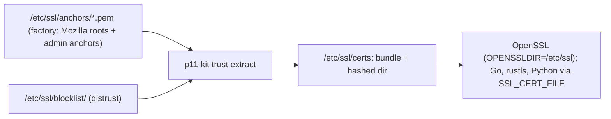

# Trust

*(Planned.)* This page describes the target trust model. Secure Boot, measured boot and TPM2
credential decryption are not implemented.

There are three trust roots on a Golconda machine. Each is one key hierarchy, and nothing ships its
own copy of any of them:

1. **Secure Boot and measured boot keys** decide *what runs*: the Secure Boot `db` key signs
   systemd-boot and every UKI; the PCR policy key signs the expected PCR 11 values and is what
   TPM2-sealed credentials are bound to.
1. **The verity signing key** decides *what is read*: it signs the root hash of every `/usr` image.
1. **The CA store** decides *whom the machine talks to*: one set of anchors for every TLS client.

### 1. Boot keys

### 2. Verity key

### 3. CA store

## One CA store *(planned)*

The source of truth is `/etc/ssl` as a p11-kit trust path: anchors in `/etc/ssl/anchors/*.pem` (the
Mozilla roots from the image plus administrator anchors) and distrust entries in
`/etc/ssl/blocklist/`. `p11-kit trust extract` derives from them the OpenSSL bundle and hashed
directory and honours the blocklist, which is the only root-level revocation that works across TLS
stacks. There is no Java in the image, so no keystore is generated. Every consumer points at the
same bundle: OpenSSL by `OPENSSLDIR=/etc/ssl`, everything else by `SSL_CERT_FILE` in systemd's
default environment. No package ships `certifi` or its own bundle.

Leaf revocation is not unified: OpenSSL, rustls and Go do not share a mechanism. Golconda's own PKI
uses short-lived certificates instead.

## Identity

Who may log in is decided outside the image. People hold short-lived OpenSSH certificates from a CA
that runs on another host *(planned: the CA itself)*; the image ships only the CA's public key
(`TrustedUserCAKeys`) and the allowed principals per user (`AuthorizedPrincipalsFile`). There are no
per-human accounts: an operator logs in as root, and the certificate principal and key id in sshd's
log (`LogLevel VERBOSE`) are the identity for audit. Bootstrap uses plain `authorizedKeys`.

Nothing in the image authenticates a password: sshd fixes `PasswordAuthentication no`,
`KbdInteractiveAuthentication no` and `ChallengeResponseAuthentication no`, and no option can turn
them on. PAM stays for account and session (`pam_systemd`), never for auth: the factory's
`/etc/pam.d/sshd` has account and session lines only, and `/etc/pam.d/other` denies every type, so
an auth request from any service falls through to a denial. The image carries no setuid binary:
linux-pam ships without `unix_chkpwd`, so a non-root process cannot verify a password at all. A
hardware second factor (FIDO2, `sk-ssh-ed25519`) is client-side policy: the certificate signs a
FIDO2 key and the server needs nothing extra.

The machine's own identity is its host key, a machine-local var, plus a host certificate and a key
revocation list, both admin-supplied vars (`sshd-host-cert`, `sshd-revoked-keys`); sshd reads them
from its credentials directory, never from the image. Options:
[reference/modules](../reference/modules/README.md#servicessshd).

No local login in v1: the serial console (`console=ttyS0`) is output only, with no getty. Recovery
is the other slot or a reflash.

## Verity and the kernel keyring

The `usr-verity-sig` partition holds a PKCS#7 signature of the root hash. systemd-veritysetup asks
the kernel to check it against the keys in the `.platform` or `.machine` keyring, so the verity
signing certificate is part of the UKI's signed payload.

## TPM2 credential decryption

UKIs are signed with `ukify --phases=enter-initrd:leave-initrd:sysinit:ready`. This lets TPM2-sealed
credentials unseal both in the initrd (for LUKS unlock) and at service time.

### Rollback weakness

Any image signed by the same PCR 11 key unseals credentials sealed for that key. An attacker who
obtains an older, vulnerable image can boot it and decrypt secrets.

Mitigations:

- **pcrlock** (systemd 256+): binds to the exact PCR values of one image. A rollback fails because
  the old image's PCRs do not match.
- **Key rotation:** re-seal credentials with a new key pair after a security-critical update.
- **policyref** (systemd 262+): embeds a reference so the TPM refuses policies signed for a
  different reference.
- **TPM NV monotonic counter:** a future mechanism; no comparable project implements it yet.

## Secrets and vars

Secrets never enter the image or the store. Services receive them with `LoadCredential=` and
`LoadCredentialEncrypted=` (`systemd-creds`, TPM2-bound, sealed with the PCR 11 signing key).

A **var** is a value the image names but never contains. Two classes:

- **Machine-local (local).** Generated on the machine at first boot (ssh host keys, wireguard keys).
  The generator runs in a oneshot unit, seals the result with `systemd-creds encrypt`, and exports
  only the public half.
- **Admin-supplied (admin).** Kept age-encrypted on the deploy host, pushed over ssh, sealed on the
  machine. Covers root password hashes and admin credentials.

Bootstrap credentials (hostname, locale) are not a var class: they come from the ESP or SMBIOS,
never from a generator or a push. See [Boot: Bootstrap credentials](boot.md#bootstrap-credentials).

### Rotation

To rotate an admin var: push a new value; the consumer service restarts and reads the new sealed
credential. The deploy tool *(planned)* handles the seal step.

See [reference/vars](../reference/modules/generated/vars.md) for the `var` helpers.
