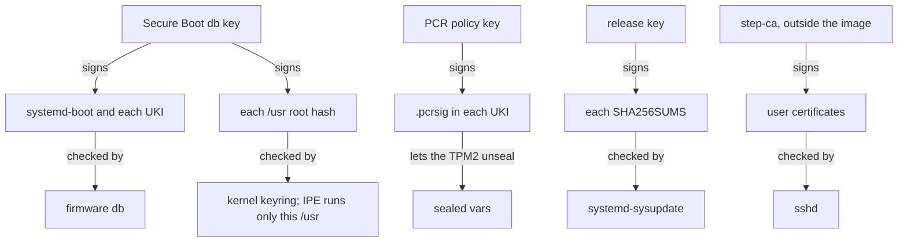
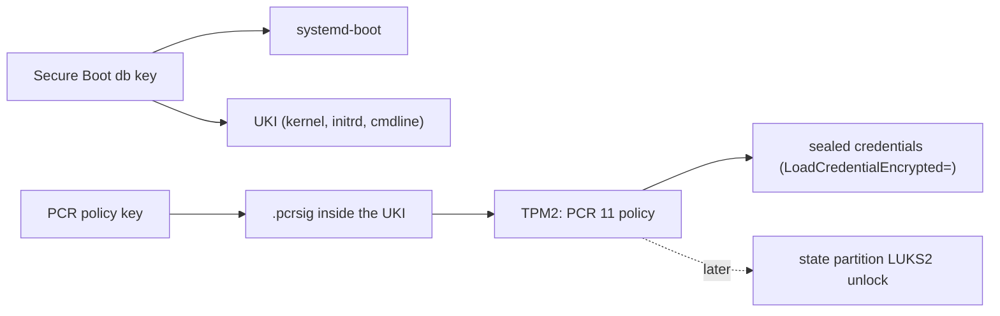
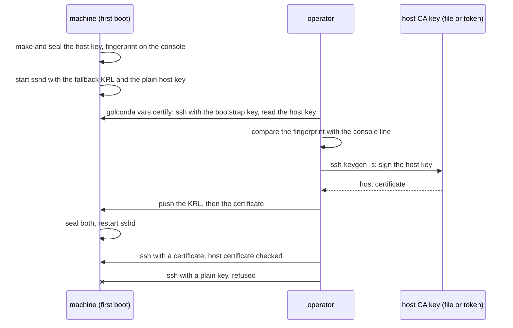

# Trust

A Golconda machine has three trust roots. Each is one key hierarchy, and no component ships its own
copy of a root:

1. **Secure Boot and measured boot keys** decide *what runs*. The Secure Boot `db` key signs
   systemd-boot and every UKI. The PCR policy key signs the expected PCR 11 values, and TPM2-sealed
   credentials are bound to it. The signer outside Nix signs with both (the test images use
   throwaway keys). A boot test with `--secure-boot` proves that firmware enforces Secure Boot
   (`secure-boot-enabled`) and refuses a loader whose key is in `dbx` (`old-loader-refused`). A
   machine in Setup Mode enrols the deployment's PK, KEK, `db` and `dbx` from the ESP on its first
   boot, with Microsoft's keys or without (`auto-enrolled`, `db-enrolled`, `dbx-enrolled`). A
   virtual machine proves this; on hardware it is **Unverified**
   ([Boot loader: Enrolment](bootloader.md#enrolment)).
1. **The verity signing key** decides *what is read*: it signs the root hash of every `/usr` image.
   It is the Secure Boot `db` key. At every boot the kernel checks the signature against the `db`
   certificate built into the kernel, never against the firmware `db`. This holds with or without
   Secure Boot ([Verity key](verity-key.md)).
1. **The CA store** decides *whom the machine talks to*: one bundle for every TLS client. The image
   build makes it from cacert's Mozilla roots, the operator's anchors and a distrust list
   ([CA store](ca-store.md)).

A fourth thing, who may log in, is decided outside the image ([Identity](#identity)).

The release key signs each release's index. sysupdate checks it when it downloads an update, on
every image. Every transfer has `Verify=yes`, with or without Secure Boot
([Updates: What an update authenticates](updates.md#what-an-update-authenticates)).

## Downstream packages

A downstream repository can replace any package by name, including the kernel, systemd, the loader
and the tools that sign the image. Such a replacement is trusted code. It can drop the IPE policy,
the verity key the kernel carries, or the boot checks. Golconda therefore takes a replacement only
when the document lists its name in `[golconda] replaces`, and refuses a name collision that the
list does not name. The list must be exact: a stale entry is an error, so it cannot silently allow a
later replacement. The SBOM records each replacement. Golconda does not check what a replacement
does; whoever lists it owns that review
([reference/config](../reference/config.md#your-own-packages)).

### 1. Boot keys

### 2. Verity key

The `db` key signs the root hash of every `/usr` image. The kernel checks the signature against the
`db` certificate built into it, never against the firmware `db`, so each key set builds its own
kernel. The design, its cost and the case without Secure Boot are in [Verity key](verity-key.md).

### 3. CA store

The image ships one CA bundle in `/usr`: cacert's Mozilla roots plus the `/trust` anchors, minus the
`/trust` distrust list, made when the image is built. Two tmpfiles links put it where OpenSSL and
libcurl read. The design is in [CA store](ca-store.md).

## Deployment keys

A release is signed with the deployment's keys, not the store's throwaways, and the signing happens
outside Nix ([Signing outside Nix](signing.md)). The procedure, from making the set to enrolling the
certificate, is in [Making a release](../reference/release.md). A key set is a directory of eight
key files and the enrolment files. The PK and KEK keys go to a directory beside it, `DIR.private/`,
for offline media (`scripts/make-keys`):

| file                  | used for                                                         | read by       |
| --------------------- | ---------------------------------------------------------------- | ------------- |
| `secureboot/db.key`   | signs the loader, the UKI and the verity root hash               | the signer    |
| `secureboot/db.crt`   | the certificate for those signatures; firmware `db` must hold it | `lib.mkImage` |
| `DIR.private/PK.key`  | signed `PK.auth` and `KEK.auth`; later, a new KEK                | `make-keys`   |
| `secureboot/PK.crt`   | the platform key's certificate, enrolled as `PK`                 | the signer    |
| `DIR.private/KEK.key` | signed `db.auth` and `dbx.auth`; later, `db` and `dbx` updates   | `make-keys`   |
| `secureboot/KEK.crt`  | the key exchange key's certificate, enrolled as `KEK`            | the signer    |
| `secureboot/auth/`    | `microsoft/{PK,KEK,db,dbx}.auth` and `golconda/{PK,KEK,db}.auth` | the signer    |
| `pcr/pcr.key`         | signs the PCR 11 policy of each boot phase (`.pcrsig`)           | the signer    |
| `pcr/pcr.pub`         | the public half, embedded in the UKI as `.pcrpkey`               | `lib.mkImage` |
| `release/index.key`   | signs each release's `SHA256SUMS` (OpenPGP Ed25519)              | the signer    |
| `release/index.pgp`   | the public half, the image's keyring for `Verify=yes`            | `lib.mkImage` |

`lib.mkImage` takes the directory as `publicKeys` and copies the three public files into the store,
each alone; it reads nothing else of the set. The signer reads the three private files where they
lie. Instead, a token can sign with the `db` and PCR keys that `secureboot/db.pkcs11` and
`pcr/pcr.pkcs11` name ([Signing: Keys on a token](signing.md#keys-on-a-token)). The PK and the KEK
sign only the Secure Boot variables that systemd-boot enrols in Setup Mode. `scripts/make-keys`
signs those once, into `secureboot/auth/` ([Boot loader: Enrolment](bootloader.md#enrolment)). So no
release needs the PK or KEK key. The signer copies the files and checks them against `PK.crt`,
`KEK.crt` and the image's `db` certificate, and `lib.mkImage` reads none of them. The PK and KEK
keys can stay offline until the next `db` rotation or `dbx` refresh. The `dbx` in the files is
Microsoft's list as pinned when the files were made. `scripts/make-keys --auth-only` with the PK and
KEK keys writes the files again with a newer list, for machines enrolled after that. A machine that
is already enrolled keeps its `dbx`: nothing on it writes a new one, and a `dbx` update there is
*(later)* ([Making a release: 1](../reference/release.md#1-make-the-key-set)). A `db` rotation keeps
the PCR key from the old set (`pcrPublicKeys` for `lib.mkImage`, `--pcr-keys` for the signer). The
new set holds the old set's release key, which cannot change yet
([Boot loader: Key rotation](bootloader.md#key-rotation),
[Releases: The signed index](releases.md#the-signed-index)).

The `db` key signs the UKI (`ukify --secureboot-private-key`, `lib/image/uki.nu`), the verity root
hash (`lib/image/verity.nu`) and the loader (`lib/image/loader.nu`). The kernel checks the root hash
signature against the `db` certificate built into it, not against the firmware's `db`
([Verity key](verity-key.md)). Before it signs, the signer checks each private key against the
public half that the image carries. Before it writes the disk, it checks the root hash signature
against the `db` certificate (`lib/image/sign.nu`, `lib/image/uki.nu`). So a mismatched key fails
the release, not the boot. A rotated `db` key needs new images: the UKI, the root hash signature and
the loader are all signed with it.

Nix builds every part of the image unsigned, and no private key enters the store. The signer signs
the parts on the release host, with key files or with the `db` and PCR keys on a PKCS#11 token.
[Signing outside Nix](signing.md) gives the steps, the token and the loader rotation.

## Identity

Who may log in is decided outside the image. People hold short-lived OpenSSH certificates from a CA
on another host. The image ships only the CA's public key and the allowed principals per user. The
CA is step-ca with an OIDC provisioner, out of the image. The server needs no agent, and the CA
pushes host certificates and the revocation list as admin vars. The alternative with a verifier on
the server (`AuthorizedKeysCommand` fetching the identity provider's keys at login) is acceptable
later for always-online hosts.

The image has no per-human accounts yet. An operator logs in as root, and the certificate principal
and key id in sshd's log (`LogLevel VERBOSE`) are the identity for audit. Plain `authorizedKeys`
exist for bootstrap. A hardware second factor (FIDO2, `sk-ssh-ed25519`) is client-side policy: the
certificate signs a FIDO2 key and the server needs nothing extra. No local login exists: no getty,
no password, no rescue shell ([Boot: Serial console](boot.md#serial-console)).

The image authenticates no password. sshd fixes the lines that turn off every password path, and no
option can turn them on ([reference: /services/sshd](../reference/modules/README.md#servicessshd)).
PAM stays for account and session (`pam_systemd`) and never for auth: the factory's
`/etc/pam.d/sshd` has no `auth` line, and `/etc/pam.d/other` denies every type. The image carries no
setuid binary. linux-pam ships without `unix_chkpwd`, so a non-root process cannot verify a password
at all. pam_unix is built with `pam_unix-try-getspnam`, so that root (sshd's account check) reads
`/etc/shadow` itself (repkgs `pkgs/li/linux-pam`).

The machine's own identity is its host key (a local var), a host certificate and a key revocation
list (both admin vars). sshd reads them from its credentials directory. Until the KRL is pushed, PID
1 puts a fallback there: the image's KRL, or a list that names the user CAs
([Revocation](#revocation)).

Operators as `/usr/lib/userdb/*.user` records, with `run0` gated by polkit on a few action ids (a
root-less image), are *(later)*. So is one CA for SSH and X.509 with TPM device attestation
(workload identity). Both are designed and not yet built.

### Host certificate

A new machine goes from its first boot to certificate login in one release, with `hostCertificate`
and `revokedKeys` on from the start. At first boot the machine makes and seals its host key and
writes the fingerprint to the journal and the console. Until the push, sshd presents the plain host
key. PID 1 gives sshd a fallback revocation list under the same credential id
([Revocation](#revocation)). With the image's KRL, certificates log in unless it names them; without
it, sshd refuses every certificate of the user CAs. Plain keys log in. `golconda vars certify HOST`
then checks the fingerprint against the console line and signs the host key with the host CA key. It
pushes the KRL and the host certificate
([Commands: golconda vars certify](../reference/cli.md#golconda-vars-certify)). The machine seals
both, and the push restarts sshd (`KillMode=process` keeps the push's own session). sshd then
presents the certificate, checks the KRL and refuses every plain key. After a new `sshd-hostkey`,
run `golconda vars certify HOST` again: until then clients see a plain host key
([Vars](../features/vars.md#how-it-works)).

**Plain keys stop with the host certificate.** With `hostCertificate` on, `sshd_config` begins with
`Include /run/golconda-sshd/*.conf`, before its `AuthorizedKeysFile` line; sshd takes the first
value it reads. `golconda-sshd-certified.service` runs before sshd, only when the sealed certificate
`/etc/credstore.encrypted/sshd-host-cert.cert` exists (`ConditionPathExists=`), and links
`/usr/lib/sshd/certified.conf`, which says `AuthorizedKeysFile none`, into its runtime directory. So
sshd reads no authorized-keys file at all: neither the image's `authorizedKeys` nor
`/root/.ssh/authorized_keys`, where `ssh.authorized_keys.root` and the cloud's keys go. The unit is
`PartOf=` sshd and sshd wants it, so the restart that the push makes runs it again. It starts when
the condition failed at boot, and it restarts when it ran. The decision comes at every start of
sshd, from a file on the state partition. It needs no second release. It holds after a reboot and
after an update to a release that has `hostCertificate` on.

Certificate login can break after the host certificate is sealed: the CA is lost, a KRL refuses
every certificate, or the host certificate does not unseal. Recovery is then the other slot or a
reflash. The other slot helps only when its release has `hostCertificate` off, and choosing it
without a login takes the boot menu at the console
([Boot loader: Recovery](bootloader.md#recovery)). A reflash rewrites the state partition, and with
it the sealed vars: the machine needs a new host certificate after its first boot. A plain key does
not open a way back in.

The CA must sign the machine's key and no other. Before the push the client cannot check the host.
There is no certificate yet, so a machine in the middle could hand over its own key for signing. The
console line is the check, on a channel that the network cannot change (the serial console, a
cloud's console). Without it, the first connection is trust on first use.

Bootstrap credentials are not the route for the host key. The certificate and the KRL are public,
but the certificate needs the host key, which exists only after the first boot. A key made elsewhere
would travel on the ESP or in user data, which carry no secret. An ESP credential is refused anyway
with Secure Boot and TPM2 together ([Bootstrap credentials](boot.md#bootstrap-credentials)).

sshd declares both admin vars whether or not the options are on. A release with the options off
accepts the push, and a later release that turns them on reads it. So a machine that runs without
certificates moves to them by a push and an update, in either order.

Proven by boot with `--certify` ([What is proven](../proven.md)).

The signer is `ssh-keygen`, with the host CA key in a file or on a token. A host certificate is
signed once per machine and per renewal, offline like the release keys, and needs no CA service. The
CLI tests sign with a real `ssh-keygen` from a key file and from a key on a SoftHSM token; no run
with a YubiKey has been done. Signing host certificates through step-ca's API is *(later)*.

### Revocation

Revocation is never off: with `revokedKeys` on, sshd always reads a list, the credential
`sshd-revoked-keys.krl` (`-o RevokedKeys=`). The pushed admin var wins. Until it is pushed, and
after a factory reset, which deletes it, PID 1 gives a fallback under the same id
(`SetCredential=`):

- With `imageRevokedKeys`, the image's KRL. A KRL belongs to the user CA, so it is the same for
  every machine, and the image carries the one of its build (base64 in the configuration, one `\xNN`
  escape a byte in `sshd.service`). Certificates log in unless it names them. A revocation newer
  than the image takes a push or a new release.
- Without it, a flat list that names the user CAs of `trustedUserCAKeys`: it refuses more than any
  real KRL could, every certificate of those CAs, because the machine cannot know which of them are
  revoked. What logs in then is what the release trusts without a CA: the plain keys of the image or
  of the provisioning credentials.

Proven by boot with `--certify` and `--certify --factory-reset` ([What is proven](../proven.md)). No
boot test boots an image that has `revokedKeys` on and no `imageRevokedKeys`; evaluation checks the
text of the list of the user CAs (`tests/eval/sshd.nix`).

## The ESP

The ESP is a FAT partition that no key protects. Where a signed file on it is used, it is checked
there. Firmware checks systemd-boot and each UKI (with Secure Boot), and the enrolment files in
Setup Mode. The UKI's cmdline and `usrhash=` are checked with the UKI. The rest is not signed:
`loader/loader.conf` (menu policy only, [Boot: Kernel command line](boot.md#kernel-command-line))
and the bootstrap credentials in `loader/credentials/` and a UKI's `.extra.d/`.

A bootstrap credential is encrypted with the null key, because the machine has no key of its own
before its first boot. PID 1 accepts such a credential when Secure Boot is off or no TPM2 is present
(`systemd.credentials_boot_policy=relaxed`); with both, it refuses it. So on a host without Secure
Boot, such as Hetzner Cloud, whoever can write the ESP can make the next boot apply a credential of
their choice as root. Examples are an `ssh.authorized_keys.root`, a `tmpfiles.extra` line and a
`network.*` file. Writing the ESP takes the disk in hand, the cloud's disk API, or root on the
running machine, which owns the machine already.

`golconda-esp-credentials.service` removes every ESP credential at every boot, once the units that
apply the first boot's credentials have run, and logs each one
([Boot: Bootstrap credentials](boot.md#bootstrap-credentials)). So the provisioning key does not
grant root again after a factory reset, nor on a machine whose configuration refuses plain keys. A
planted credential works for one boot and leaves a journal line, unless the planter also removes the
journal. Removal does not prevent the planting: on such a host the ESP's integrity is the integrity
of whoever holds the disk. With Secure Boot and a TPM2, use SMBIOS or fw_cfg for bootstrap values.
Whoever sets SMBIOS or fw_cfg is root on the machine, and the vars unseal
([Boot: Bootstrap credentials](boot.md#bootstrap-credentials)).

## TPM2 credential decryption

The image seals the sshd host key with the TPM2. `golconda-var-sshd-hostkey.service` runs
`/usr/lib/golconda/golconda-var-run`, which calls
`systemd-creds encrypt --with-key=auto --tpm2-public-key-pcrs=11 --tpm2-pcrs=7 --name=sshd-hostkey.key`
(without `--tpm2-pcrs=7` on an image with `/system.secureBoot = false`, see [PCR 7](#pcr-7)). It
writes `/etc/credstore.encrypted/sshd-hostkey.key`, and sshd loads it with
`LoadCredentialEncrypted=`. It is the only local var in the image. Not sealed: the state partition
(unencrypted for now, no LUKS), the machine-id (a plain file PID 1 writes), and operator credentials
for the machine itself. The admin vars are sealed once `golconda vars push` delivers them (see
[Secrets and vars](#secrets-and-vars)).

The state partition is not encrypted, and no check covers `/etc` or `/var`. So whoever writes the
partition offline, with the disk in hand or through a cloud's disk API, gets root at the next boot.
A unit in `/etc/systemd/system` runs as root, and IPE does not stop a script that the shell on
`/usr` reads. That boot is a signed boot with the expected PCR values, so the vars unseal in it. The
fix is LUKS2 bound to the TPM2 *(later)* ([Scope](scope.md#later)).

Proven by boot with `--secure-boot --tpm` ([What is proven](../proven.md)).

A phase path is the colon-separated chain of words that systemd has measured into PCR 11 up to one
boot state (`systemd-pcrphase.service(8)`). `systemd-measure --phase=` signs exactly one path, and
`ukify --phases=` takes a list. The UKI signs the four paths of systemd's default set, each as its
own signature in the `.pcrsig` section (`image/uki.nix`): `enter-initrd`,
`enter-initrd:leave-initrd`, `enter-initrd:leave-initrd:sysinit`, and
`enter-initrd:leave-initrd:sysinit:ready`. These are four signed states, not one. A single
`enter-initrd:leave-initrd:sysinit:ready` argument would permit unsealing only at `ready`, after
sshd has already tried to load its host key.

This lets TPM2-sealed credentials unseal both in the initrd (for a LUKS unlock, later) and at
service time. `sshd.service` is ordered after `systemd-pcrphase-sysinit.service`, so its host key is
unsealed when PCR 11 is at `enter-initrd:leave-initrd:sysinit` or, after a restart, at `...:ready`.
Both are signed. `lib/image/uki.nu` recomputes each path's PCR 11 policy digest with
`systemd-measure policy-digest` from the built image's own sections and compares it with the
`.pcrsig` section. The build fails if a path is missing.

### PCR 7

On an image with `/system.secureBoot` (the default) every var, local or admin, is also bound to the
value PCR 7 has when it is sealed. `/system` writes `/usr/lib/golconda/vars.d/tpm2-pcrs` (`7`), and
`golconda-var-run` passes it on as `--tpm2-pcrs=7`. systemd-creds makes one TPM2 policy of both. It
uses `PolicyAuthorize` for the signed PCR 11 values, then `PolicyPCR` for PCR 7's value
(`tpm2_calculate_sealing_policy`, systemd 262). The TPM releases the key only when both hold. An
image with `secureBoot = false` keeps the signed PCR 11 policy alone: its host has no Secure Boot to
bind to.

The signed policy alone does not need Secure Boot. With Secure Boot off, firmware starts any loader,
and that loader can extend PCR 11 with the values the signature expects and then unseal. PCR 7 is
written by the firmware before any loader runs, so no loader can fake it. Firmware measures into it
in this order (TCG PC Client firmware profile, as OVMF does it): the `SecureBoot` variable, `PK`,
`KEK`, `db` and `dbx`, and a separator. Then it measures each `db` entry that verified an image in
this boot, once per entry (`EV_EFI_VARIABLE_AUTHORITY`). With Golconda's enrolment that is the
deployment's `db` certificate, which verified systemd-boot and the UKI. So the vars do not unseal
when:

- Secure Boot is off, also with the same keys enrolled;
- `PK`, `KEK`, `db` or `dbx` change: a `db` rotation, a `dbx` update, a firmware update or a
  firmware reset that writes other keys;
- another `db` entry verifies an image. This happens for a release signed with a new `db` key, and
  on hardware for a card whose option ROM a Microsoft CA signed and that was not there at sealing
  time.

systemd's `os-separator` follows, which `systemd-pcrosseparator.service` extends in the initrd
before `sysinit.target`, so before any var is sealed or unsealed. The initrd refuses to boot with
Secure Boot off ([Boot: Secure Boot off](boot.md#secure-boot-off)); the seal holds for a boot that
the image does not control.

Two reseals wrap a planned change. `golconda-var-run --reseal --without-pcr7` seals every credential
of `/etc/credstore.encrypted` again with the signed PCR 11 policy alone. After the change, and a
boot with the new values, `golconda-var-run --reseal` binds them to the new PCR 7. The
[`db` rotation](bootloader.md#key-rotation) does this. Between the two, every new seal, such as a
push, leaves PCR 7 out too (the first leaves `.without-pcr7` in the store, the second removes it).
So the vars have the protection of an image without Secure Boot. An unplanned change, such as a
firmware update that brings a new `dbx`, leaves the host key, the host certificate and the KRL
sealed. Then sshd does not start, so no login works. Undoing the change unseals them again;
otherwise the way back is a reflash, and the machine needs a new host certificate.

Proven by boot with `--secure-boot --tpm`, `--rotate` and `--secure-boot-off`
([What is proven](../proven.md)). On hardware, which events firmware measures into PCR 7 is
**unverified**.

### Downgrade weakness

Any image signed by the same PCR 11 key unseals credentials sealed for that key. An attacker who
obtains an older, vulnerable image can boot it and decrypt secrets. Mitigations, all *(later)*:

- **pcrlock** (systemd 256+): binds to the exact PCR values of one image. A downgrade fails because
  the old image's PCRs do not match.
- **Key rotation:** re-seal credentials with a new key pair after a security-critical update.
- **policyref** (systemd 262+): embeds a reference so the TPM refuses policies signed for a
  different reference.
- **TPM NV monotonic counter:** a future mechanism; no comparable project implements it yet.

## Secrets and vars

Secrets never enter the image or the store. Services receive them with `LoadCredentialEncrypted=`
(`systemd-creds`, TPM2-bound, sealed with the PCR 11 signing key and, with Secure Boot, to PCR 7:
[PCR 7](#pcr-7)). Nothing reads a secret at evaluation time.

A **var** is a value the image names but never contains. Two classes:

- **local**: generated on the machine at first boot (ssh host keys, wireguard keys). A oneshot unit
  runs the generator, seals the result with `systemd-creds encrypt`, and exports only the public
  half.
- **admin**: kept age-encrypted on the deploy host, pushed over ssh, sealed on the machine (host
  certificates, revocation lists). The consumer's unit waits for the push.

Bootstrap credentials (the host name) are not vars: they are plain systemd credentials from the
firmware or the ESP ([Boot: Bootstrap credentials](boot.md#bootstrap-credentials)).

The deploy tool is `golconda vars` ([Commands](../reference/cli.md#golconda-vars)). It keeps each
value age-encrypted in the configuration repository (`vars/<host>/<var>/<file>.age`, to the keys in
`vars/recipients.txt`). It reads the machine's own manifests over ssh and pipes each value into
`golconda-var-run --admin`, which seals it only if the image declares that var and file. Then it
restarts the units that the manifest names as consumers. `age` and `ssh` are programs on the deploy
host; the machine needs neither.

**Rotation.** To rotate an admin var: `golconda vars set`, then `push`; the consumer restarts and
reads the new sealed credential. A local var is regenerated by removing its `done` marker and
rebooting.

## Execution policy

Phase 1 is IPE with `lockdown=integrity` and Yama, all fixed in the kernel config and the UKI
cmdline. IPE lets a program execute only from a dm-verity volume with a signed root hash, not a
particular one: the policy avoids per-image kernel rebuilds. IPE enforces (`ipe.enforce=1`). The
kernel verifies the `/usr` signature ([status](#2-verity-key)), so programs on `/usr` run. A program
copied to `/var` gets `Permission denied` with the audit record
`rule="DEFAULT op=EXECUTE action=DENY"`. The kernel must carry the signer's certificate
(`lib.mkImage` builds it in). A `/usr` signed by another key, also one that the firmware `db` holds,
is activated unsigned. PID 1's re-exec after switch-root is then denied, and the machine stops with
"Failed to execute /sbin/init". Phase 2 is the BPF LSM for `RestrictFileSystems=`. SELinux is
rejected.
