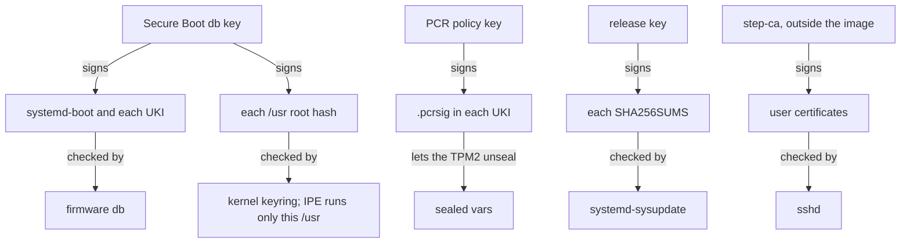
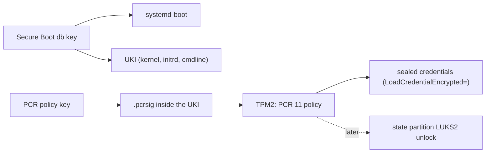
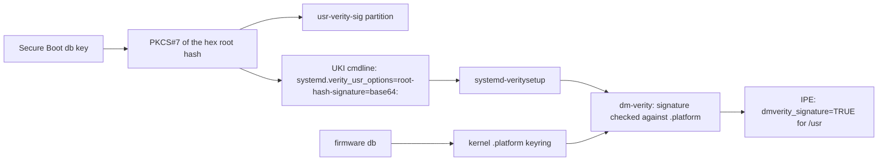
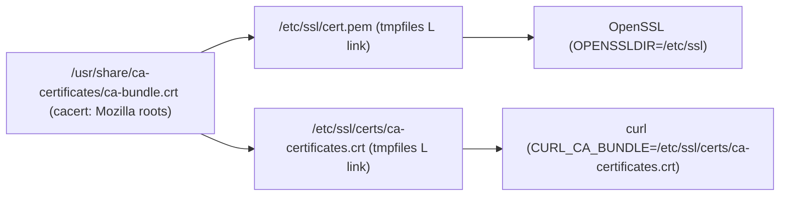

# Trust

There are three trust roots on a Golconda machine. Each is one key hierarchy, and nothing ships its
own copy of any of them:

1. **Secure Boot and measured boot keys** decide *what runs*: the Secure Boot `db` key signs
   systemd-boot and every UKI; the PCR policy key signs the expected PCR 11 values and is what
   TPM2-sealed credentials are bound to. Signed in the image chain today (the smoke uses throwaway
   keys) and proven in a boot test with `--secure-boot`, where firmware enforces Secure Boot
   (`secure-boot-enabled`) and refuses a loader whose key is in `dbx` (`old-loader-refused`);
   enrolment is manual and automatic enrolment is *(planned)* ([Deployment keys](#deployment-keys)).
1. **The verity signing key** decides *what is read*: it signs the root hash of every `/usr` image.
   In v1 it is the Secure Boot `db` key, and the kernel checks the signature against the firmware
   `db` at every boot ([status](#2-verity-key)).
1. **The CA store** decides *whom the machine talks to*: one bundle, cacert's Mozilla roots, for
   every TLS client ([status](#3-ca-store)).

A fourth thing, who may log in, is decided outside the image ([Identity](#identity)).



## Downstream packages

A downstream repository can replace any package by name, including the kernel, systemd, the loader
and the tools that sign the image. Such a replacement is trusted code. It can drop the IPE policy,
the verity key the kernel carries, or the boot checks. Golconda therefore takes a replacement only
when the document lists its name in `[golconda] replaces`, and refuses a name collision that the
list does not name. The list must be exact: a stale entry is an error, so it cannot silently allow a
later replacement. `modules.json` and the SBOM record each replacement. Golconda does not check what
a replacement does; whoever lists it owns that review
([reference/config](../reference/config.md#your-own-packages)).

### 1. Boot keys



### 2. Verity key



The image builder signs the hex root hash (the string the kernel gets in the verity table) with the
Secure Boot `db` key, as PKCS#7 without certificates (`lib/image/verity.nu`). The signature goes to
two places: the `usr-verity-sig` partition, systemd's JSON, for tools that dissect the disk; and the
UKI cmdline as `systemd.verity_usr_options=root-hash-signature=base64:<sig>` (`image/uki.nix`). The
generator passes the option to `systemd-veritysetup@usr.service`, which activates `/usr` with
`crypt_activate_by_signed_key`; dm-verity checks the signature against the secondary keyring and
then the platform keyring, which the kernel fills from the firmware `db` (`CONFIG_LOAD_UEFI_KEYS`,
`CONFIG_DM_VERITY_VERIFY_ROOTHASH_SIG_PLATFORM_KEYRING`). IPE's `dmverity_signature` is true only
for a volume whose signature the kernel verified.

Why the cmdline and not the partition: systemd reads the partition's signature only on the gpt-auto
path (`root-hash-signature=auto`, from the udev property `ID_DISSECT_PART_ROOTHASH_SIG` that the
`dissect_image` builtin sets on the boot disk). Golconda finds `/usr` by `usrhash=` through the
veritysetup generator, which takes no signature unless an option names one. The cmdline is in the
signed UKI and measured into PCR 11, so it is as trusted as `usrhash=` itself. The signature is
about 550 base64 characters; the cmdline is about 1250 bytes of the kernel's 2048
(`COMMAND_LINE_SIZE`), and `lib/image/uki.nu` fails the build at 2048.

Why the `db` key: the platform keyring holds the firmware `db` and nothing else, so no import step
is needed, and a second key would add nothing: whoever holds the `db` key can already sign a UKI
with any `usrhash=`. A rotated `db` key needs new images, as it does for the UKI
([Boot loader: Key rotation](bootloader.md#key-rotation)).

A signature that does not verify does not stop `systemd-veritysetup`: it logs "Unable to activate
verity device ... with root hash signature ..., retrying without" at info level and activates `/usr`
unsigned. The boot then stops at switch-root, where IPE denies PID 1's re-exec from `/usr`
([Execution policy](#execution-policy)). So `lib/image/uki.nu` checks the signature against the
UKI's own signing certificate at build time and fails on a mismatch. On the machine, the firmware
`db` must hold that certificate; the boot test enrols it only with `--secure-boot`.

**Without Secure Boot** (`/system.secureBoot = false`, for a host whose firmware has none, such as
Hetzner Cloud): no firmware fills the platform keyring, so the kernel carries the certificate
itself. `lib.mkImage` passes the `db` certificate of its keys to `mkSystem`. The kernel build copies
it to a fixed path in the kernel tree, `certs/golconda-verity.pem`, and `CONFIG_SYSTEM_TRUSTED_KEYS`
names that path (`packages/kernel/kbuild.nu`, `GOLCONDA_KERNEL_FILES`); the kernel loads it into
`.builtin_trusted_keys`, which the secondary keyring that dm-verity checks first includes. The
kernel of the set changes, so `/usr` and the UKI carry the same one, and each key set builds its own
kernel. What is lost is the check before the kernel: no firmware verifies the loader or the UKI, so
whoever can write the ESP can boot a kernel that trusts another key. IPE and the `/usr` signature
still hold against a changed `/usr`, and the vars still seal (to the host key alone, without a TPM).
The bootstrap credentials on the ESP are accepted there because Secure Boot is off
([Boot: Bootstrap credentials](boot.md#bootstrap-credentials)).

The certificate is an input of the kernel derivation, but not of its config: every key set has the
same config, so a new certificate compiles only the certificate object and the compressed kernel's
wrapper again, relinks, and takes the rest from jig's compile cache. A store path in the config
would change `include/generated/autoconf.h`, which every object includes. jig's cache does not see
an `.incbin` input (clang's depfile leaves it out): without more, a second certificate got the first
one's cached `certs/system_certificates.o`, and the kernel trusted the old key while its record
named the new one. So the build puts the digest of the certificate file on that object's command
line, and the digest of `vmlinux` on that of `arch/x86/boot/compressed/piggy.o`. jig itself now
refuses to cache a compile that names `.incbin` or `.include` (repkgs, llvm/llvm-project#54996); the
digests stay as a second guard, because a stale certificate object would be a trust failure, not a
slow build. A missing file fails the build (the copy, then make, which has no rule for it), and so
does an empty one (`extract-cert` needs at least one certificate): the keyring is never silently
empty. The kernel package installs the certificate as `lib/modules/<version>/trusted-keys.pem`, so
`/usr` records which key its kernel trusts; the config names only the path.

**Status.** Proven by boot with `--secure-boot`: the kernel loads the `db` certificate into the
platform keyring, and with `/sys/kernel/security/ipe/success_audit` on, IPE logs
`rule="op=EXECUTE dmverity_signature=TRUE action=ALLOW"` for files on `/usr` (`dm-0`). With
`ipe.enforce=1` the boot passes every check and logs no IPE denial; the same image without the `db`
enrolled stops at switch-root.

Without Secure Boot, proven by boot on OVMF with neither Secure Boot nor a TPM:
`image-smoke-test-nosb` logs `Secure boot disabled` and
`Loaded X.509 cert 'Golconda smoke Secure Boot db: …'`, reaches `multi-user.target` with
`ipe.enforce=1`, and passes the update test (`--next`, over HTTP). On the same firmware the default
image (`secureBoot = true`) stops at switch-root: IPE logs
`ipe_op=EXECUTE … comm="systemd" … dev="dm-0" … rule="DEFAULT op=EXECUTE action=DENY"` for PID 1's
re-exec from `/usr`. A kernel that holds another certificate refuses the signature: the same image
with the rotated throwaway certificate in its kernel (a manual run, not a `scripts/boot-test` mode)
logs `Loaded X.509 cert 'Golconda smoke Secure Boot db rotated: …'`, then
`verity: Root hash verification failed (-ENOKEY)`, and stops at switch-root with that IPE denial.

### 3. CA store



The image ships one CA file: cacert's Mozilla bundle, linked into `/usr` as
`/usr/share/ca-certificates/ca-bundle.crt` (`caBundleLinks` in `modules/base/parts/links.nix`). Two
tmpfiles lines make the paths the image's TLS clients read by default: `L /etc/ssl/cert.pem`, which
OpenSSL reads because `openssl version -d` says `OPENSSLDIR=/etc/ssl`, and
`L /etc/ssl/certs/ca-certificates.crt`, which libcurl reads because it is built with
`CURL_CA_BUNDLE` set to that path. Both are links to the one file in `/usr`, so an image update
replaces the roots and `/etc` holds no copy to go stale. No package ships `certifi` or its own
bundle; there is no Java, so no keystore.

**Status.** Proven by a boot: the image's OpenSSL, run from the store, validated `example.com` with
`Verification: OK` and no `CAfile` argument, and with the default paths disabled the same check
failed with error 20 ("unable to get local issuer certificate"), so the success came from these
paths and not from a file the test named. The image installs no TLS client binary; the check used
the store's `openssl` on the held machine.

The p11-kit design is the next step, not the current store: a factory `anchors`/`blocklist` pair, a
`trust extract` unit that rewrites a hashed `/etc/ssl/certs` directory, and root-level distrust that
works across TLS stacks. The factory today seeds only the empty directories (`ssl/anchors/.keep`,
`ssl/blocklist/.keep`, [reference: /factory](../reference/modules/README.md)), and no unit runs
`trust extract`. Until then the bundle is the whole store: Mozilla roots only, no administrator
anchors, no distrust list.

Leaf revocation is not unified: OpenSSL, rustls and Go do not share a mechanism. Golconda's own PKI
uses short-lived certificates instead.

## Deployment keys

A release is signed with the deployment's keys, not the store's throwaways. The procedure, from
making the set to enrolling the certificate, is in [Making a release](../reference/release.md). The
operator builds the image with `lib.mkImage`:

```nix
(import ./default.nix).lib.mkImage {
  config = ./server.toml;
  keys = "/srv/golconda-keys";
}
```

It returns the steps `erofs`, `verity`, `initrd`, `uki`, `loader` and `disk`, and `release`, the
directory sysupdate fetches ([Releases](releases.md#the-release-directory)). The chain reads six
files under `keys`, and nothing else:

| file                | used for                                                         |
| ------------------- | ---------------------------------------------------------------- |
| `secureboot/db.key` | signs the loader, the UKI and the verity root hash               |
| `secureboot/db.crt` | the certificate for those signatures; firmware `db` must hold it |
| `pcr/pcr.key`       | signs the PCR 11 policy of each boot phase (`.pcrsig`)           |
| `pcr/pcr.pub`       | the public half, embedded in the UKI as `.pcrpkey`               |
| `release/index.key` | signs each release's `SHA256SUMS` (OpenPGP Ed25519)              |
| `release/index.pgp` | the public half, the image's keyring for `Verify=yes`            |

The chain needs no `PK` or `KEK`: they are enrolled in firmware and sign nothing the build makes.
The optional `pcrKeys` and `indexKeys` name other directories in the same layout, read for `pcr/`
and `release/` only; a `db` rotation uses them to keep the PCR key and the release key
([Boot loader: Key rotation](bootloader.md#key-rotation),
[Releases: The signed index](releases.md#the-signed-index)).

The `db` key signs both the UKI (`ukify --secureboot-private-key`, `lib/image/uki.nu`) and the
verity root hash (`lib/image/verity.nu`), and the same key signs the loader
(`lib/image/loader.nix`). The kernel checks the root hash signature against the platform keyring,
which holds the firmware `db` ([Verity key](#2-verity-key)). The build checks the signature against
the UKI's own certificate before the disk is written (`lib/image/uki.nu`, `openssl cms -verify`), so
a mismatched key pair fails the build rather than the boot. A rotated `db` key needs new images: the
UKI, the root hash signature and the loader are all signed with it.

### How the private keys reach the build

The builders run in the Nix sandbox, which sees only the store and the paths the daemon adds. So the
private keys either enter the store or the daemon shows them to the sandbox. The type of `keys`
picks one:

- **A path** (`keys = ./keys;` or `/srv/golconda-keys` without quotes): Nix copies the directory
  into the store. The private keys are then in the build host's `/nix/store`, which every local user
  can read, and they stay there until a garbage collection removes them. With a remote builder, iets
  uploads them to it. Use this only on a build host that you alone use.
- **A string** (`keys = "/srv/golconda-keys";`): nothing is copied. The derivations name the path,
  and the builder reads the files there. The daemon must make the directory visible in the sandbox
  with `extra-sandbox-paths` in its own `nix.conf`, and the build users must be able to read it
  ([Build host](../reference/build-host.md#keys-in-the-sandbox)). This keeps the keys out of the
  store. It is unverified: no test builds an image this way yet. The derivations do not change when
  the files change, so a new key under the same path rebuilds nothing; put new keys under a new
  path.

Either way the private keys never enter the image or the machine; only the certificates are enrolled
in firmware. The smoke outputs (`packages.<system>.image-smoke*`) sign with throwaway keys made in
the store (`throwawayKeys`) and link them as `keys/`; `lib.mkImage` has no smoke output, so it never
links a deployment's keys anywhere.

Rotation and recovery:

- **The ESP loader**: a new `db` key reaches the ESP with the next release. On that release's first
  good boot, `golconda-loader-update.service` (`modules/base`) copies its signed systemd-boot and
  `loader.conf` from `/usr` to the ESP and keeps the old loader as the fallback copy. The unit runs
  only after `systemd-bless-boot.service`, so a release that fails its health gate installs nothing.
  Running `/usr/lib/golconda/golconda-loader-update` by hand puts a damaged loader back.
  `scripts/boot-test` checks all of this (`loader-update-ran`, `loader-matches-usr`,
  `loader-replaced`, `loader-reinstall`). The steps are in
  [Boot loader: Key rotation](bootloader.md#key-rotation) and [Recovery](bootloader.md#recovery).
- **An installed machine** with a rotated key: its next UKI and root hash signatures must come from
  the new key, and firmware must hold the new certificate, or Secure Boot and the verity check fail
  ([Execution policy](#execution-policy)). With no local console path, that enrolment is offline
  work on the variable store or a reinstall ([Recovery](recovery.md)).

## Identity

Who may log in is decided outside the image. People hold short-lived OpenSSH certificates from a CA
on another host, and the image ships only the CA's public key and the allowed principals per user.
In v1 the CA is step-ca with an OIDC provisioner, out of the image: the server needs no agent, and
the CA pushes host certificates and the revocation list as admin vars. The alternative with a
verifier on the server (`AuthorizedKeysCommand` fetching the identity provider's keys at login) is
acceptable later for always-online hosts.

There are no per-human accounts in v1: an operator logs in as root, and the certificate principal
and key id in sshd's log (`LogLevel VERBOSE`) are the identity for audit. Plain `authorizedKeys`
exist for bootstrap. A hardware second factor (FIDO2, `sk-ssh-ed25519`) is client-side policy: the
certificate signs a FIDO2 key and the server needs nothing extra. No local login exists: no getty,
no password, no rescue shell ([Boot: Serial console](boot.md#serial-console)).

Nothing in the image authenticates a password. sshd fixes the lines that turn off every password
path and no option can turn them on
([reference: /services/sshd](../reference/modules/README.md#servicessshd)); PAM stays for account
and session (`pam_systemd`), never for auth: the factory's `/etc/pam.d/sshd` has no `auth` line and
`/etc/pam.d/other` denies every type. The image carries no setuid binary: linux-pam ships without
`unix_chkpwd`, so a non-root process cannot verify a password at all, and pam_unix is built with
`pam_unix-try-getspnam` so that root (sshd's account check) reads `/etc/shadow` itself (repkgs
`pkgs/li/linux-pam`).

The machine's own identity is its host key, a local var, plus a host certificate and a key
revocation list, both admin vars; sshd reads them from its credentials directory, never from the
image.

A single deployment is possible if an independent provisioning path supplies the credentials before
sshd needs them. The revocation list has no dependency on the machine's host key. A host certificate
does: the machine first generates its key, then the CA signs its public half.

If SSH is the only delivery channel, bootstrap with plain `authorizedKeys` and leave
`hostCertificate` and `revokedKeys` off. Push the credentials, then enable those settings. This
avoids needing the SSH connection that the missing revocation list would prevent. It is a delivery
constraint, not a rule that every deployment needs 2 images. sshd declares both admin vars whether
or not the options are on, so the first release takes the push and the next one reads it; the boot
test runs exactly this (`admin-vars-pushed`, then `host-cert-presented` and `cert-revoked-refused`
after `--next`).

The ESP helper can supply named credentials before boot, but uses null-key encryption. That route is
unavailable with Secure Boot and TPM2 together
([Bootstrap credentials](boot.md#bootstrap-credentials)). An enrollment service ordered before sshd
could instead generate the host key, obtain its certificate and install the revocation list in one
first-boot flow. That service is not implemented. Do not make revocation checking optional to bypass
the delivery constraint.

After v1: operators as `/usr/lib/userdb/*.user` records with `run0` gated by polkit on a few action
ids (a root-less image), and one CA for SSH and X.509 with TPM device attestation (workload
identity). Both are designed, not built.

## TPM2 credential decryption

Sealed today: the sshd host key, and nothing else. `golconda-var-sshd-hostkey.service` runs
`/usr/lib/golconda/golconda-var-run`, which calls
`systemd-creds encrypt --with-key=auto --tpm2-public-key-pcrs=11 --name=sshd-hostkey.key` and writes
`/etc/credstore.encrypted/sshd-hostkey.key`; sshd loads it with `LoadCredentialEncrypted=`. It is
the only local var in the image. Not sealed: the state partition (unencrypted in v1, no LUKS), the
machine-id (a plain file PID 1 writes), the admin vars (the host certificate and the revocation list
are sealed once `golconda vars push` delivers them, see [Secrets and vars](#secrets-and-vars)), and
administrator credentials for the machine itself.

**Status.** A boot with `--secure-boot --tpm` prints
`sshd-hostkey.key sealed with: host key + TPM2 + signed PCR policy` (`scripts/boot-test` reads the
credential header); after a reboot in the same QEMU with the same swtpm state the key is unchanged,
so it was unsealed, not regenerated.

A phase path is the colon-separated chain of words systemd has measured into PCR 11 up to one boot
state (`systemd-pcrphase.service(8)`); `systemd-measure --phase=` signs exactly one path, and
`ukify --phases=` takes a list. The UKI signs the four paths of systemd's default set, each as its
own signature in the `.pcrsig` section (`image/uki.nix`): `enter-initrd`,
`enter-initrd:leave-initrd`, `enter-initrd:leave-initrd:sysinit`, and
`enter-initrd:leave-initrd:sysinit:ready`. These are four signed states, not one. A single
`enter-initrd:leave-initrd:sysinit:ready` argument would permit unsealing only at `ready`, after
sshd has already tried to load its host key.

This lets TPM2-sealed credentials unseal both in the initrd (for a LUKS unlock, later) and at
service time. `sshd.service` is ordered after `systemd-pcrphase-sysinit.service`, so its host key is
unsealed when PCR 11 is at `enter-initrd:leave-initrd:sysinit` or, after a restart, at `...:ready`;
both are signed. `lib/image/uki.nu` recomputes each path's PCR 11 policy digest with
`systemd-measure policy-digest` from the built image's own sections and compares it with the
`.pcrsig` section; the build fails if a path is missing.

### Rollback weakness

Any image signed by the same PCR 11 key unseals credentials sealed for that key. An attacker who
obtains an older, vulnerable image can boot it and decrypt secrets. Mitigations, all *(after v1)*:

- **pcrlock** (systemd 256+): binds to the exact PCR values of one image. A rollback fails because
  the old image's PCRs do not match.
- **Key rotation:** re-seal credentials with a new key pair after a security-critical update.
- **policyref** (systemd 262+): embeds a reference so the TPM refuses policies signed for a
  different reference.
- **TPM NV monotonic counter:** a future mechanism; no comparable project implements it yet.

## Secrets and vars

Secrets never enter the image or the store. Services receive them with `LoadCredentialEncrypted=`
(`systemd-creds`, TPM2-bound, sealed with the PCR 11 signing key). Nothing reads a secret at
evaluation time.

A **var** is a value the image names but never contains. Two classes:

- **local**: generated on the machine at first boot (ssh host keys, wireguard keys). A oneshot unit
  runs the generator, seals the result with `systemd-creds encrypt`, and exports only the public
  half.
- **admin**: kept age-encrypted on the deploy host, pushed over ssh, sealed on the machine (host
  certificates, revocation lists). The consumer's unit waits for the push.

Bootstrap credentials (the host name) are not vars: they are plain systemd credentials from the
firmware or the ESP ([Boot: Bootstrap credentials](boot.md#bootstrap-credentials)).

The deploy tool is the console's `golconda vars` ([console/README.md](../../console/README.md)). It
keeps each value age-encrypted in the configuration repository (`vars/<host>/<var>/<file>.age`, to
the keys in `vars/recipients.txt`), reads the machine's own manifests over ssh, pipes each value
into `golconda-var-run --admin`, which seals it only if the image declares that var and file, and
restarts the units the manifest names as consumers. `age` and `ssh` are programs on the deploy host;
the machine needs neither.

**Rotation.** To rotate an admin var: `golconda vars set`, then `push`; the consumer restarts and
reads the new sealed credential. A local var is regenerated by removing its `done` marker and
rebooting.

## Execution policy

Phase 1 is IPE (execute only from dm-verity volumes with a signed root hash, not a particular one:
the policy avoids per-image kernel rebuilds) with `lockdown=integrity` and Yama, all fixed in the
kernel config and the UKI cmdline. IPE enforces (`ipe.enforce=1`): the kernel verifies the `/usr`
signature ([status](#2-verity-key)), so programs on `/usr` run, and a program copied to `/var` gets
`Permission denied` with the audit record `rule="DEFAULT op=EXECUTE action=DENY"`. The firmware `db`
must hold the signer: without it `/usr` is activated unsigned, and PID 1's re-exec after switch-root
is denied, so the machine stops with "Failed to execute /sbin/init". The boot test therefore needs
`--secure-boot`, which enrols the `db`. Phase 2 is the BPF LSM for `RestrictFileSystems=`; phase 3
AppArmor profiles generated from the typed service. SELinux is rejected.
