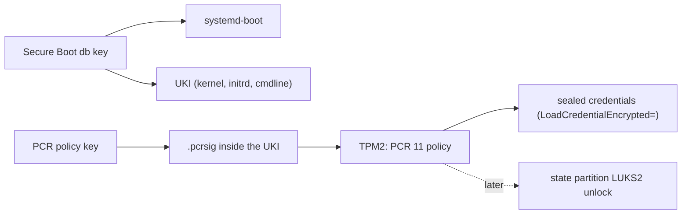
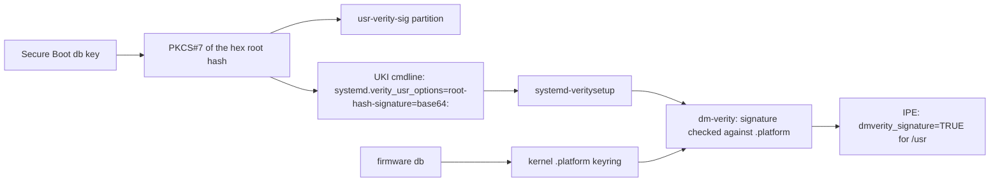

# Trust

There are three trust roots on a Golconda machine. Each is one key hierarchy, and nothing ships its
own copy of any of them:

1. **Secure Boot and measured boot keys** decide *what runs*: the Secure Boot `db` key signs
   systemd-boot and every UKI; the PCR policy key signs the expected PCR 11 values and is what
   TPM2-sealed credentials are bound to. Signed in the image chain today (the smoke uses throwaway
   keys); enrolment and enforcement are not proven *(planned)*.
1. **The verity signing key** decides *what is read*: it signs the root hash of every `/usr` image.
   In v1 it is the Secure Boot `db` key, and the kernel checks the signature against the firmware
   `db` at every boot ([status](#2-verity-key)).
1. **The CA store** decides *whom the machine talks to*: one set of anchors for every TLS client.
   *(planned)*

A fourth thing, who may log in, is decided outside the image ([Identity](#identity)).

### 1. Boot keys

### 2. Verity key

The image builder signs the hex root hash (the string the kernel gets in the verity table) with the
Secure Boot `db` key, as PKCS#7 without certificates (`lib/image/verity.nu`). The signature goes to
two places: the `usr-verity-sig` partition, systemd's JSON, for tools that dissect the disk; and the
UKI cmdline as `systemd.verity_usr_options=root-hash-signature=base64:<sig>` (`image/uki.nix`). The
generator passes the option to `systemd-veritysetup@usr.service`, which activates `/usr` with
`crypt_activate_by_signed_key`; dm-verity checks the signature against the secondary keyring and
then the platform keyring, which the kernel fills from the firmware `db` (`CONFIG_LOAD_UEFI_KEYS`,
`CONFIG_DM_VERITY_VERIFY_ROOTHASH_SIG_PLATFORM_KEYRING`). IPE's `dmverity_signature` is true only
for a volume whose signature the kernel verified.

Why the cmdline and not the partition: systemd reads the partition's signature only on the gpt-auto
path (`root-hash-signature=auto`, from the udev property `ID_DISSECT_PART_ROOTHASH_SIG` that the
`dissect_image` builtin sets on the boot disk). Golconda finds `/usr` by `usrhash=` through the
veritysetup generator, which takes no signature unless an option names one. The cmdline is in the
signed UKI and measured into PCR 11, so it is as trusted as `usrhash=` itself. The signature is
about 550 base64 characters; the cmdline is about 1250 bytes of the kernel's 2048
(`COMMAND_LINE_SIZE`), and `lib/image/uki.nu` fails the build at 2048.

Why the `db` key: the platform keyring holds the firmware `db` and nothing else, so no import step
is needed, and a second key would add nothing: whoever holds the `db` key can already sign a UKI
with any `usrhash=`. A rotated `db` key needs new images, as it does for the UKI.

A signature that does not verify does not stop `systemd-veritysetup`: it logs "Unable to activate
verity device ... with root hash signature ..., retrying without" at info level and activates `/usr`
unsigned. The boot then stops at switch-root, where IPE denies PID 1's re-exec from `/usr`
([Execution policy](#execution-policy)). So `lib/image/uki.nu` checks the signature against the
UKI's own signing certificate at build time and fails on a mismatch. On the machine, the firmware
`db` must hold that certificate; the boot test enrols it only with `--secure-boot`.

**Status.** Proven by boot with `--secure-boot`: the kernel loads the `db` certificate into the
platform keyring, and with `/sys/kernel/security/ipe/success_audit` on, IPE logs
`rule="op=EXECUTE dmverity_signature=TRUE action=ALLOW"` for files on `/usr` (`dm-0`). With
`ipe.enforce=1` the boot passes every check and logs no IPE denial; the same image without the `db`
enrolled stops at switch-root. The builder's own verity key pair (`lib/image/keys.nu`) is no longer
used.

### 3. CA store *(planned)*

The source of truth is `/etc/ssl` as a p11-kit trust path: anchors in `/etc/ssl/anchors/*.pem` and
distrust entries in `/etc/ssl/blocklist/`. `p11-kit trust extract` derives the OpenSSL bundle and
hashed directory from them and honours the blocklist, the only root-level revocation that works
across TLS stacks. Every consumer points at the same bundle: OpenSSL by `OPENSSLDIR=/etc/ssl`,
everything else by `SSL_CERT_FILE` in systemd's default environment. No package ships `certifi` or
its own bundle; there is no Java, so no keystore.

Today the factory seeds only the empty `anchors` and `blocklist` directories. Still to come: a
`ca-certificates` package with the Mozilla roots as anchors in the factory, and a unit
(`golconda-trust-extract.service`, a path unit on `/etc/ssl/anchors`) that runs `trust extract` into
`/etc/ssl/certs`, which is a directory of its own because the program rewrites it.

Leaf revocation is not unified: OpenSSL, rustls and Go do not share a mechanism. Golconda's own PKI
uses short-lived certificates instead.

## Identity

Who may log in is decided outside the image. People hold short-lived OpenSSH certificates from a CA
on another host, and the image ships only the CA's public key and the allowed principals per user.
In v1 the CA is step-ca with an OIDC provisioner, out of the image: the server needs no agent, and
the CA pushes host certificates and the revocation list as admin vars. The alternative with a
verifier on the server (`AuthorizedKeysCommand` fetching the identity provider's keys at login) is
acceptable later for always-online hosts.

There are no per-human accounts in v1: an operator logs in as root, and the certificate principal
and key id in sshd's log (`LogLevel VERBOSE`) are the identity for audit. Plain `authorizedKeys`
exist for bootstrap. A hardware second factor (FIDO2, `sk-ssh-ed25519`) is client-side policy: the
certificate signs a FIDO2 key and the server needs nothing extra. No local login exists: no getty,
no password, no rescue shell ([Boot: Serial console](boot.md#serial-console)).

Nothing in the image authenticates a password. sshd fixes the lines that turn off every password
path and no option can turn them on
([reference: /services/sshd](../reference/modules/README.md#servicessshd)); PAM stays for account
and session (`pam_systemd`), never for auth: the factory's `/etc/pam.d/sshd` has no `auth` line and
`/etc/pam.d/other` denies every type. The image carries no setuid binary: linux-pam ships without
`unix_chkpwd`, so a non-root process cannot verify a password at all, and pam_unix is built with
`pam_unix-try-getspnam` so that root (sshd's account check) reads `/etc/shadow` itself (repkgs
`pkgs/li/linux-pam`).

The machine's own identity is its host key, a local var, plus a host certificate and a key
revocation list, both admin vars; sshd reads them from its credentials directory, never from the
image.

After v1: operators as `/usr/lib/userdb/*.user` records with `run0` gated by polkit on a few action
ids (a root-less image), and one CA for SSH and X.509 with TPM device attestation (workload
identity). Both are designed, not built.

## TPM2 credential decryption *(planned)*

A phase path is the colon-separated chain of words systemd has measured into PCR 11 up to one boot
state (`systemd-pcrphase.service(8)`); `systemd-measure --phase=` signs exactly one path, and
`ukify --phases=` takes a list. The UKI signs the four paths of systemd's default set, each as its
own signature in the `.pcrsig` section (`image/uki.nix`): `enter-initrd`,
`enter-initrd:leave-initrd`, `enter-initrd:leave-initrd:sysinit`, and
`enter-initrd:leave-initrd:sysinit:ready`. These are four signed states, not one. A single
`enter-initrd:leave-initrd:sysinit:ready` argument would permit unsealing only at `ready`, after
sshd has already tried to load its host key.

This lets TPM2-sealed credentials unseal both in the initrd (for a LUKS unlock, later) and at
service time. `sshd.service` is ordered after `systemd-pcrphase-sysinit.service`, so its host key is
unsealed when PCR 11 is at `enter-initrd:leave-initrd:sysinit` or, after a restart, at `...:ready`;
both are signed. `lib/image/uki.nu` recomputes each path's PCR 11 policy digest with
`systemd-measure policy-digest` from the built image's own sections and compares it with the
`.pcrsig` section; the build fails if a path is missing.

### Rollback weakness

Any image signed by the same PCR 11 key unseals credentials sealed for that key. An attacker who
obtains an older, vulnerable image can boot it and decrypt secrets. Mitigations, all *(after v1)*:

- **pcrlock** (systemd 256+): binds to the exact PCR values of one image. A rollback fails because
  the old image's PCRs do not match.
- **Key rotation:** re-seal credentials with a new key pair after a security-critical update.
- **policyref** (systemd 262+): embeds a reference so the TPM refuses policies signed for a
  different reference.
- **TPM NV monotonic counter:** a future mechanism; no comparable project implements it yet.

## Secrets and vars

Secrets never enter the image or the store. Services receive them with `LoadCredentialEncrypted=`
(`systemd-creds`, TPM2-bound, sealed with the PCR 11 signing key). Nothing reads a secret at
evaluation time.

A **var** is a value the image names but never contains. Two classes:

- **local**: generated on the machine at first boot (ssh host keys, wireguard keys). A oneshot unit
  runs the generator, seals the result with `systemd-creds encrypt`, and exports only the public
  half.
- **admin**: kept age-encrypted on the deploy host, pushed over ssh, sealed on the machine (host
  certificates, revocation lists). The consumer's unit waits for the push.

Bootstrap credentials (the host name) are not vars: they are plain systemd credentials from the
firmware or the ESP ([Boot: Bootstrap credentials](boot.md#bootstrap-credentials)).

**Rotation.** To rotate an admin var: push a new value; the consumer restarts and reads the new
sealed credential. A local var is regenerated by removing its `done` marker and rebooting. The
deploy tool that pushes and seals is *(planned)*; the on-machine side (the runner, the manifests,
the credential ids) exists: [reference: /vars](../reference/modules/generated/vars.md).

## Execution policy

Phase 1 is IPE (execute only from dm-verity volumes with a signed root hash, not a particular one:
the policy avoids per-image kernel rebuilds) with `lockdown=integrity` and Yama, all fixed in the
kernel config and the UKI cmdline. IPE enforces (`ipe.enforce=1`): the kernel verifies the `/usr`
signature ([status](#2-verity-key)), so programs on `/usr` run, and a program copied to `/var` gets
`Permission denied` with the audit record `rule="DEFAULT op=EXECUTE action=DENY"`. The firmware `db`
must hold the signer: without it `/usr` is activated unsigned, and PID 1's re-exec after switch-root
is denied, so the machine stops with "Failed to execute /sbin/init". The boot test therefore needs
`--secure-boot`, which enrols the `db`. Phase 2 is the BPF LSM for `RestrictFileSystems=`; phase 3
AppArmor profiles generated from the typed service. SELinux is rejected.
