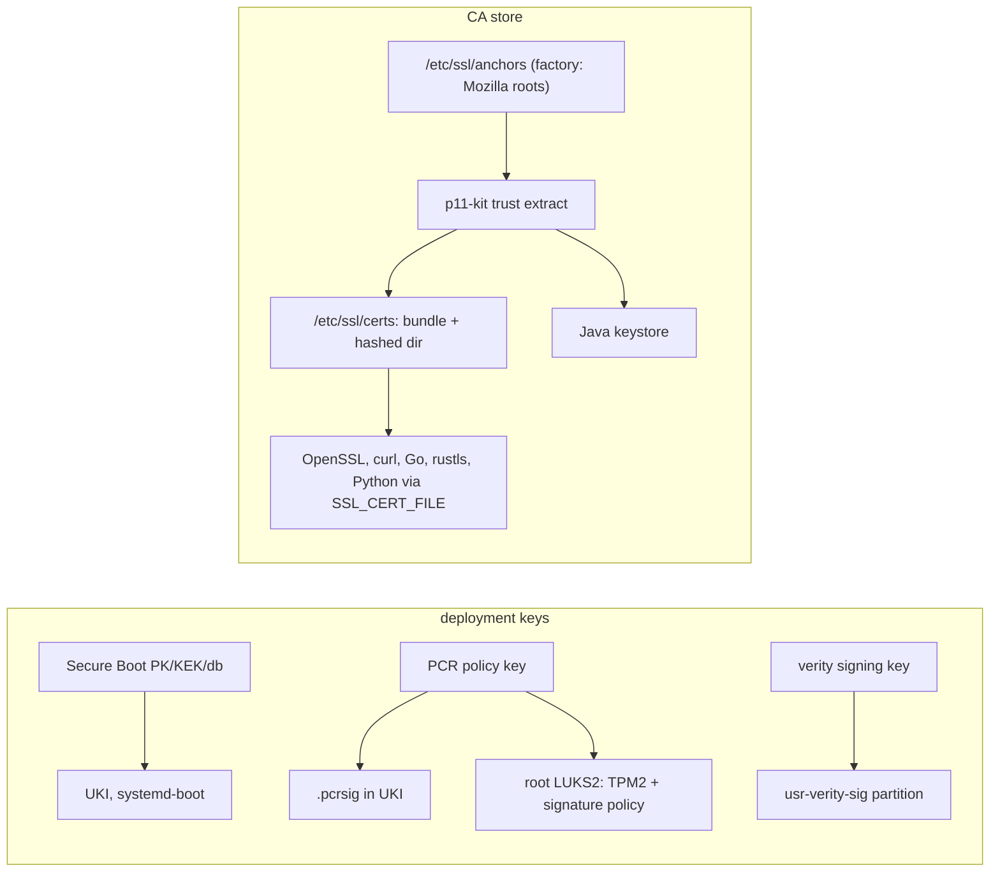

# Trust

There are three trust roots on a Golconda machine and each is one key hierarchy: Secure Boot keys
for what runs, the verity signing key for what is read, and the CA store for whom the machine talks
to. Nothing ships its own copy of any of them.

## One CA store

The source of truth is `/etc/ssl/anchors`: the Mozilla roots from the image plus administrator
anchors. `p11-kit trust extract` derives from it the OpenSSL bundle and hashed directory, the Java
keystore, and honours its distrust list, which is the only root-level revocation that works across
TLS stacks. Every consumer points at the same bundle: OpenSSL by `OPENSSLDIR=/etc/ssl`, everything
else by `SSL_CERT_FILE` in systemd's default environment. No package ships `certifi` or its own
bundle.

Leaf revocation is not unified: OpenSSL, rustls and Go do not share a mechanism. Golconda's own PKI
uses short-lived certificates instead.

## Verity and the kernel keyring

The `usr-verity-sig` partition holds a PKCS#7 signature of the root hash. systemd-veritysetup asks
the kernel to check it against the keys in the `.platform` or `.machine` keyring, so the verity
signing certificate is part of the UKI's signed payload.

## Secrets

Secrets never enter the image or the store. Services receive them with `LoadCredential=` and
`LoadCredentialEncrypted=` (`systemd-creds`, TPM2-bound).
