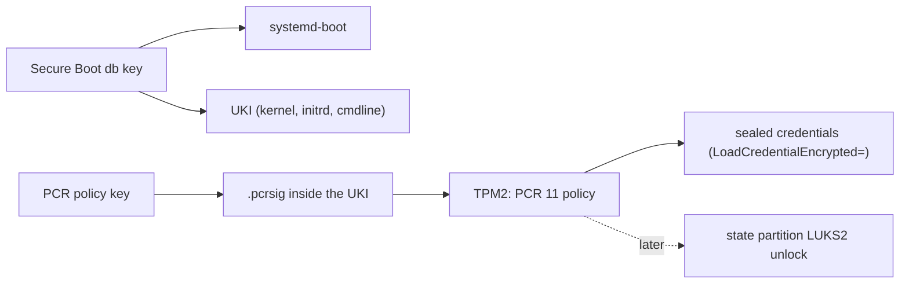
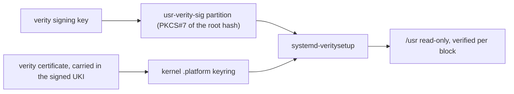

# Trust

There are three trust roots on a Golconda machine. Each is one key hierarchy, and nothing ships its
own copy of any of them:

1. **Secure Boot and measured boot keys** decide *what runs*: the Secure Boot `db` key signs
   systemd-boot and every UKI; the PCR policy key signs the expected PCR 11 values and is what
   TPM2-sealed credentials are bound to. *(planned)*
1. **The verity signing key** decides *what is read*: it signs the root hash of every `/usr` image.
   *(being built)*
1. **The CA store** decides *whom the machine talks to*: one set of anchors for every TLS client.
   *(planned)*

A fourth thing, who may log in, is decided outside the image ([Identity](#identity)).

### 1. Boot keys

### 2. Verity key

The `usr-verity-sig` partition holds a PKCS#7 signature of the root hash. systemd-veritysetup asks
the kernel to check it against the keys in the `.platform` or `.machine` keyring, so the verity
signing certificate is part of the UKI's signed payload.

### 3. CA store *(planned)*

The source of truth is `/etc/ssl` as a p11-kit trust path: anchors in `/etc/ssl/anchors/*.pem` and
distrust entries in `/etc/ssl/blocklist/`. `p11-kit trust extract` derives the OpenSSL bundle and
hashed directory from them and honours the blocklist, the only root-level revocation that works
across TLS stacks. Every consumer points at the same bundle: OpenSSL by `OPENSSLDIR=/etc/ssl`,
everything else by `SSL_CERT_FILE` in systemd's default environment. No package ships `certifi` or
its own bundle; there is no Java, so no keystore.

Today the factory seeds only the empty `anchors` and `blocklist` directories. Still to come: a
`ca-certificates` package with the Mozilla roots as anchors in the factory, and a unit
(`golconda-trust-extract.service`, a path unit on `/etc/ssl/anchors`) that runs `trust extract` into
`/etc/ssl/certs`, which is a directory of its own because the program rewrites it.

Leaf revocation is not unified: OpenSSL, rustls and Go do not share a mechanism. Golconda's own PKI
uses short-lived certificates instead.

## Identity

Who may log in is decided outside the image. People hold short-lived OpenSSH certificates from a CA
on another host, and the image ships only the CA's public key and the allowed principals per user.
In v1 the CA is step-ca with an OIDC provisioner, out of the image: the server needs no agent, and
the CA pushes host certificates and the revocation list as admin vars. The alternative with a
verifier on the server (`AuthorizedKeysCommand` fetching the identity provider's keys at login) is
acceptable later for always-online hosts.

There are no per-human accounts in v1: an operator logs in as root, and the certificate principal
and key id in sshd's log (`LogLevel VERBOSE`) are the identity for audit. Plain `authorizedKeys`
exist for bootstrap. A hardware second factor (FIDO2, `sk-ssh-ed25519`) is client-side policy: the
certificate signs a FIDO2 key and the server needs nothing extra. No local login exists: no getty,
no password, no rescue shell ([Boot: Serial console](boot.md#serial-console)).

Nothing in the image authenticates a password. sshd fixes the lines that turn off every password
path and no option can turn them on
([reference: /services/sshd](../reference/modules/README.md#servicessshd)); PAM stays for account
and session (`pam_systemd`), never for auth: the factory's `/etc/pam.d/sshd` has no `auth` line and
`/etc/pam.d/other` denies every type. The image carries no setuid binary: linux-pam ships without
`unix_chkpwd`, so a non-root process cannot verify a password at all.

The machine's own identity is its host key, a local var, plus a host certificate and a key
revocation list, both admin vars; sshd reads them from its credentials directory, never from the
image.

After v1: operators as `/usr/lib/userdb/*.user` records with `run0` gated by polkit on a few action
ids (a root-less image), and one CA for SSH and X.509 with TPM device attestation (workload
identity). Both are designed, not built.

## TPM2 credential decryption *(planned)*

UKIs are signed with `ukify --phases=enter-initrd:leave-initrd:sysinit:ready`. This lets TPM2-sealed
credentials unseal both in the initrd (for a LUKS unlock, later) and at service time.

### Rollback weakness

Any image signed by the same PCR 11 key unseals credentials sealed for that key. An attacker who
obtains an older, vulnerable image can boot it and decrypt secrets. Mitigations, all *(after v1)*:

- **pcrlock** (systemd 256+): binds to the exact PCR values of one image. A rollback fails because
  the old image's PCRs do not match.
- **Key rotation:** re-seal credentials with a new key pair after a security-critical update.
- **policyref** (systemd 262+): embeds a reference so the TPM refuses policies signed for a
  different reference.
- **TPM NV monotonic counter:** a future mechanism; no comparable project implements it yet.

## Secrets and vars

Secrets never enter the image or the store. Services receive them with `LoadCredentialEncrypted=`
(`systemd-creds`, TPM2-bound, sealed with the PCR 11 signing key). Nothing reads a secret at
evaluation time.

A **var** is a value the image names but never contains. Two classes:

- **local**: generated on the machine at first boot (ssh host keys, wireguard keys). A oneshot unit
  runs the generator, seals the result with `systemd-creds encrypt`, and exports only the public
  half.
- **admin**: kept age-encrypted on the deploy host, pushed over ssh, sealed on the machine (host
  certificates, revocation lists). The consumer's unit waits for the push.

Bootstrap credentials (the host name) are not vars: they are plain systemd credentials from the
firmware or the ESP ([Boot: Bootstrap credentials](boot.md#bootstrap-credentials)).

**Rotation.** To rotate an admin var: push a new value; the consumer restarts and reads the new
sealed credential. A local var is regenerated by removing its `done` marker and rebooting. The
deploy tool that pushes and seals is *(planned)*; the on-machine side (the runner, the manifests,
the credential ids) exists: [reference: /vars](../reference/modules/generated/vars.md).

## Execution policy *(after v1)*

Phase 1 is IPE (execute only from dm-verity volumes with the image's root hash) with
`lockdown=integrity` and Yama, all fixed in the kernel config and the UKI cmdline; phase 2 the BPF
LSM for `RestrictFileSystems=`; phase 3 AppArmor profiles generated from the typed service. SELinux
is rejected.
