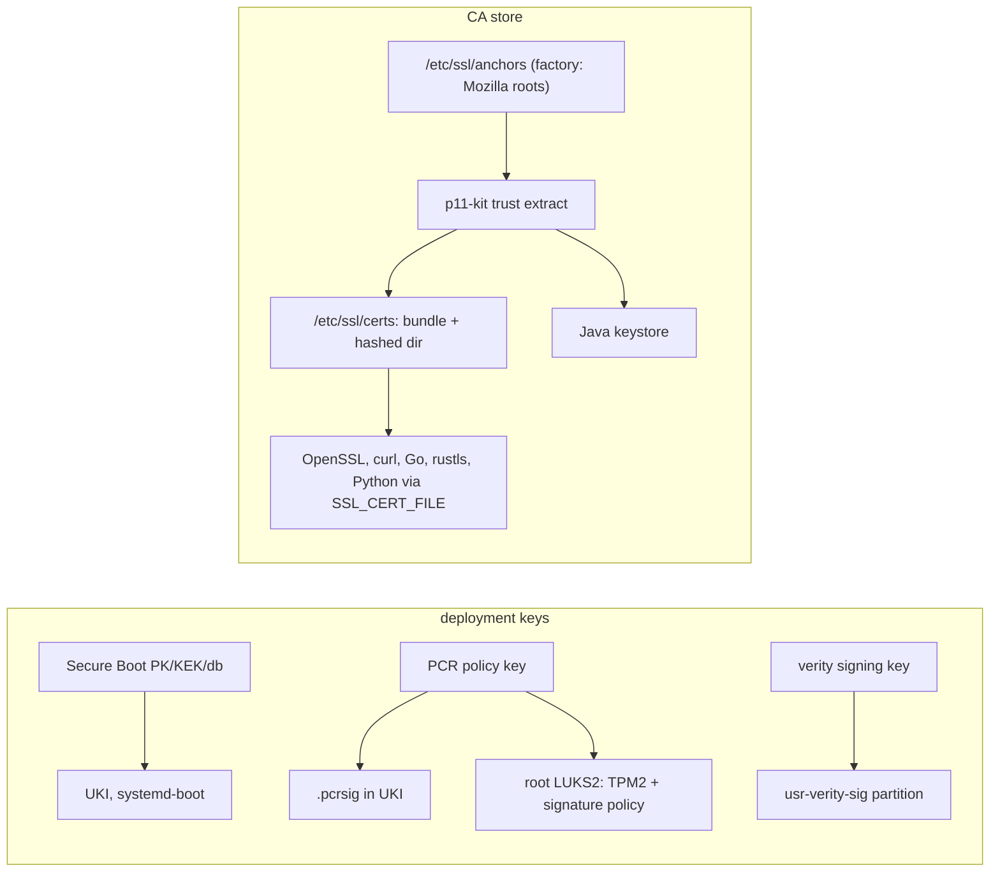

# Trust

*(Planned.)* This page describes the target trust model. Secure Boot, measured boot and TPM2
credential decryption are not implemented.

There are three trust roots on a Golconda machine and each is one key hierarchy: Secure Boot keys
for what runs, the verity signing key for what is read, and the CA store for whom the machine talks
to. Nothing ships its own copy of any of them.

## One CA store

The source of truth is `/etc/ssl/anchors`: the Mozilla roots from the image plus administrator
anchors. `p11-kit trust extract` derives from it the OpenSSL bundle and hashed directory, the Java
keystore, and honours its distrust list, which is the only root-level revocation that works across
TLS stacks. Every consumer points at the same bundle: OpenSSL by `OPENSSLDIR=/etc/ssl`, everything
else by `SSL_CERT_FILE` in systemd's default environment. No package ships `certifi` or its own
bundle.

Leaf revocation is not unified: OpenSSL, rustls and Go do not share a mechanism. Golconda's own PKI
uses short-lived certificates instead.

## Verity and the kernel keyring

The `usr-verity-sig` partition holds a PKCS#7 signature of the root hash. systemd-veritysetup asks
the kernel to check it against the keys in the `.platform` or `.machine` keyring, so the verity
signing certificate is part of the UKI's signed payload.

## TPM2 credential decryption

UKIs are signed with `ukify --phases=enter-initrd:leave-initrd:sysinit:ready`. This lets TPM2-sealed
credentials unseal both in the initrd (for LUKS unlock) and at service time.

### Rollback weakness

Any image signed by the same PCR 11 key unseals credentials sealed for that key. An attacker who
obtains an older, vulnerable image can boot it and decrypt secrets.

Mitigations:

- **pcrlock** (systemd 256+): binds to the exact PCR values of one image. A rollback fails because
  the old image's PCRs do not match.
- **Key rotation:** re-seal credentials with a new key pair after a security-critical update.
- **policyref** (systemd 262+): embeds a reference so the TPM refuses policies signed for a
  different reference.
- **TPM NV monotonic counter:** a future mechanism; no comparable project implements it yet.

## Secrets and vars

Secrets never enter the image or the store. Services receive them with `LoadCredential=` and
`LoadCredentialEncrypted=` (`systemd-creds`, TPM2-bound, sealed with the PCR 11 signing key).

A **var** is a generator that produces credentials. The image declares vars; the machine or the
deploy host generates them. Values are never read at evaluation time.

Three classes:

- **Machine-local.** Generated on the machine at first boot (ssh host keys, wireguard keys). The
  generator runs in a oneshot unit, seals the result with `systemd-creds encrypt`, and exports only
  the public half.
- **Admin-supplied.** Kept age-encrypted on the deploy host, pushed over ssh, sealed on the machine.
  Covers root password hashes and admin credentials.
- **Bootstrap.** A few ESP or SMBIOS credentials plus `systemd-firstboot` (`firstboot.hostname`,
  `passwd.hashed-password.root`). Never put real secrets in a null-key credential: the ESP is not
  encrypted.

See [reference/vars](../reference/modules/vars.md) for the `var` helper. *(planned)*
