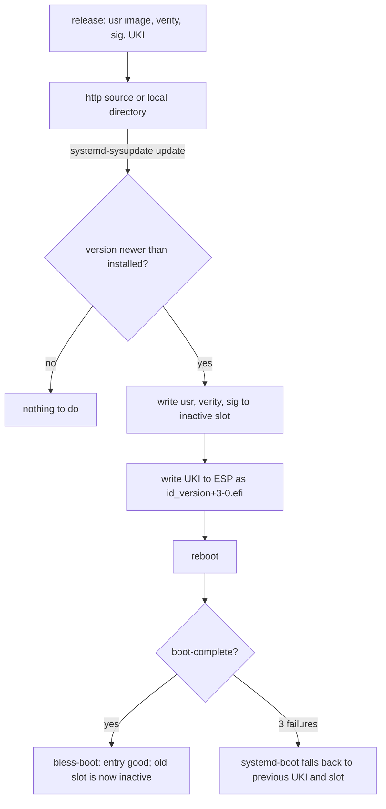

# Updates

*(Planned.)* The sysupdate definitions exist in `image/sysupdate.nix`; the image builder is not
implemented.

An update is a new version of three artifacts, written to the inactive slot by systemd-sysupdate,
and a reboot. Rollback is the previous slot, chosen by boot counting or by hand.

## Transfers

Four `sysupdate.d` definitions, one per artifact: `usr` (partition, type usr), `usr-verity`,
`usr-verity-sig`, and the UKI (regular file on the ESP). `InstancesMax=2` keeps exactly two of each.
The definitions are generated from the image name and are listed in
[reference/image](../reference/image.md).

## Versions

Version format: `YYYYMMDD.N` (date plus a revision counter within the day). Examples: `20261031.1`,
`20261101.2`. sysupdate orders versions with `strverscmp`; this format sorts correctly. The
`/system.version` type enforces the regex.

The image builder derives a unique, increasing timestamp from the version (`mkfs.erofs -T`), so
`ConditionNeedsUpdate=` fires exactly once per new image while the image stays reproducible.

## Update source

The `/system.updateSource` option (a URL string) is rendered into `/usr/lib/sysupdate.d/*.conf`.
When `updateSource` is null (the default), sysupdate has no transfer definitions and no update runs.

## Factory reset

`systemd-repart` with `FactoryReset=yes` clears the root partition and regenerates it from the
factory on the next boot. The data is gone; what stays is the ESP and the `/usr` slots.

## Sizes

| partition | min size  |
| --------- | --------- |
| ESP       | 512 MiB   |
| usr-a/b   | 10 GiB    |
| root      | 512 MiB + |

The usr slots are sized large so an update of a grown image has room; the erofs image itself stays
small.
