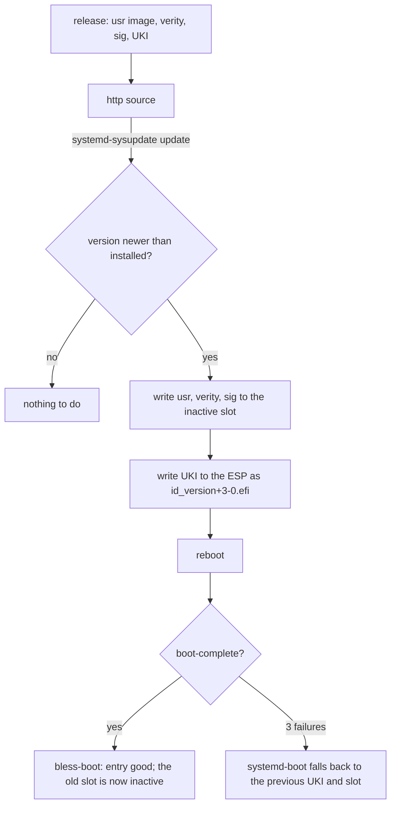

# Updates

An update is a new version of four artifacts, written to the inactive slot by systemd-sysupdate, and
a reboot. Rollback is the previous slot, chosen by boot counting or by hand. The transfer
definitions are rendered (`/system.updateSource`); the artifacts come from the image builder
([Image artifacts](../reference/image.md)). No update has run on a machine yet.

## Transfers

Four `sysupdate.d` definitions, one per artifact: `usr` (partition, type `usr`), `usr-verity`,
`usr-verity-sig`, and the UKI (a regular file on the ESP). `InstancesMax=2` keeps exactly two of
each and `ProtectVersion=%A` never overwrites the running one. The definitions are generated from
the image name and the update source; artifact names are in
[reference/image](../reference/image.md).

## Update source

`/system.updateSource` is the URL of the release directory. The composer renders it as `Path=` into
`/usr/lib/sysupdate.d/*.conf`, so the source is part of the image and never a per-machine file in
`/etc`. When it is null (the default) no transfer definition exists and no update runs. In v1 the
transfers carry `Verify=no` (rendered: `image/sysupdate.nix`), so sysupdate checks no manifest. The
design relies on the verity signature and Secure Boot instead; today neither is enforced (see
[Trust](trust.md#2-verity-key)), so an update is unauthenticated end to end until they are. A signed
`SHA256SUMS` manifest is *(after v1)*.

## Versions

A version is `YYYYMMDD.N`: the date and a counter within the day (`20261031.1`, `20261101.2`). The
`/system.version` type enforces the format; sysupdate orders versions with `strverscmp`, which this
format sorts correctly. The machine refuses to go backwards: sysupdate installs only a version newer
than the ones it has. The composer cannot check that (evaluation does not know the previous
release); a release script *(planned)* will refuse a non-increasing version on the builder.

The version also sets the mtime of every file in the image (`mkfs.erofs -T`, the epoch of the date
plus `N`). systemd's `ConditionNeedsUpdate=` compares `/usr`'s mtime with `/etc/.updated`, so
sysusers, tmpfiles and the other first-boot units run exactly once per new image while the image
itself stays reproducible. Other downgrades than the boot-counting fall-back are unsupported.

## Factory reset

The root partition is defined with `FactoryReset=yes`: a factory reset
(`systemd-repart --factory-reset=yes`, or the EFI variable) removes it on the next boot and first
boot runs again. The state is gone; the ESP and the `/usr` slots stay.

## Rollback protection *(after v1)*

Nothing stops an attacker with an older image signed by the same key from booting it; see
[Trust: Rollback weakness](trust.md#rollback-weakness).
