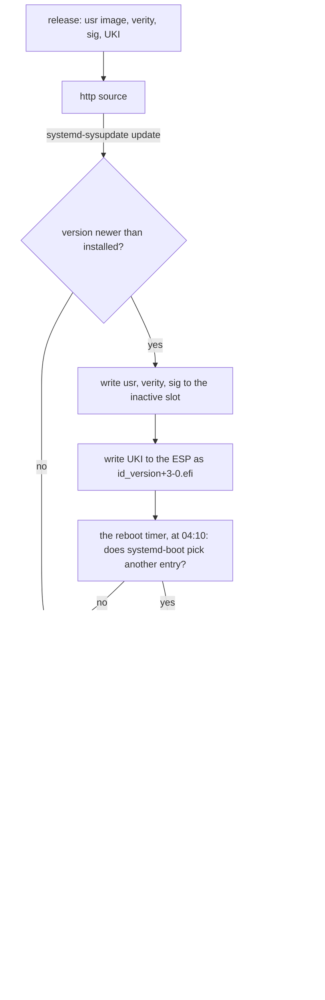

# Updates

An update is a new version of four artifacts, written to the inactive slot by systemd-sysupdate, and
a reboot, which systemd's reboot timer starts in a nightly window ([Activation](#activation)). The
fallback is the previous slot, chosen by boot counting or by hand. The transfer definitions are
rendered (`/system.updateSource`); the artifacts come from the image builder
([Image artifacts](../reference/image.md)).

## Transfers

Four `sysupdate.d` definitions, one per artifact: `usr` (partition, type `usr`), `usr-verity`,
`usr-verity-sig`, and the UKI (a regular file on the ESP). They are installed as
`/usr/lib/sysupdate.d/10-usr.transfer` and so on: systemd 257 and later read the `.transfer` suffix,
and `.conf` still loads with a warning. `InstancesMax=2` keeps exactly two of each and
`ProtectVersion=%A` never overwrites the running one. The definitions are generated from the image
name and the update source; artifact names are in [reference/image](../reference/image.md).

The image enables the update timer with a static link,
`/usr/lib/systemd/system/timers.target.wants/systemd-sysupdate-update.timer` →
`../systemd-sysupdate-update.timer` (`modules/system/default.nix`). `systemd-sysupdate.timer` is an
alias of it, and the service is `systemd-sysupdate-update.service`.

## Activation

An installed update runs only after a reboot. The image enables systemd's own
`systemd-sysupdate-reboot.timer` with a static link, in the window `/system.updateReboot` names: an
`OnCalendar=` value, by default `04:10`, systemd's. The timer keeps systemd's
`RandomizedDelaySec=30min`, so the machines of one window do not all reboot at once. Its service
runs `systemd-sysupdate reboot`, which reboots when a newer version is installed than the one that
runs. With `updateReboot = null` the image installs updates and waits for the operator's reboot.

After a fallback the release that failed its three tries is still installed, and it is newer, so
`systemd-sysupdate reboot` alone would reboot into it every night. The service therefore has an
`ExecCondition=`, `/usr/lib/golconda/golconda-update-pending`, which passes only when systemd-boot
would start another entry than the running one: `bootctl list` marks the entry systemd-boot picks as
`(default)` (an entry with no try left sorts last) and the running one as `(selected)`. After a
fallback both are the old release, and nothing reboots. After an install the new entry, `+3-0`, is
the default, and the machine reboots into its first try, a [trial boot](boot.md#trial-boot). An
operator who wants another window writes a drop-in for the timer in `/etc`; the boot test does so to
activate within seconds. An operator who runs `bootctl set-oneshot` or `set-default` changes what
systemd-boot picks, and the condition follows it.

`--next` and `--next --fail-health` prove both cases in QEMU, with the window moved to every 10 s
([What is proven](../proven.md)).

## Update source

`/system.updateSource` is the URL of the release directory. The composer renders it as `Path=` into
`/usr/lib/sysupdate.d/*.transfer`, so the source is part of the image and never a per-machine file
in `/etc`. When it is null (the default) no transfer definition, timer link or update runs. The
transfers carry `Verify=yes` (rendered: `image/sysupdate.nix`): sysupdate checks the release's
signed index before it writes a payload
([Releases: The signed index](releases.md#the-signed-index)).

## What an update authenticates

Every image has `Verify=yes` on every transfer, with or without Secure Boot: `image/sysupdate.nix`
sets it unconditionally and no option turns it off (`tests/eval/index.nix` checks each transfer). No
image and no release uses `Verify=no`. So an update is authenticated by the release key when it is
downloaded, also on a host that has no Secure Boot enrolled. What Secure Boot adds is a second check
at every boot.

Root, and whoever writes the state partition, can change what an update trusts. `systemd-pull` also
trusts the keys in `/etc/systemd/import-pubring.pgp`, and a file in `/etc/sysupdate.d` replaces the
transfer of the same name in `/usr`, also with `Verify=no`. The image ships neither file.

| what                                                                                  | checked against                                                                                                   | when                                    | without Secure Boot |
| ------------------------------------------------------------------------------------- | ----------------------------------------------------------------------------------------------------------------- | --------------------------------------- | ------------------- |
| `SHA256SUMS`                                                                          | its signature `SHA256SUMS.gpg`, by `gpg` against the release key the running image carries (`import-pubring.pgp`) | download, before any payload is written | the same            |
| each payload: `/usr`, its hash tree, its signature, the UKI                           | its digest in the signed `SHA256SUMS`                                                                             | download                                | the same            |
| the UKI (kernel, initrd, and the cmdline with `usrhash=` and the root hash signature) | the firmware `db`                                                                                                 | every boot, before it runs              | nothing checks it   |
| the `/usr` root hash signature                                                        | the `db` certificate built into the kernel (`CONFIG_SYSTEM_TRUSTED_KEYS`), never the firmware `db`                | every boot, when `/usr` is activated    | the same            |
| each block of `/usr`                                                                  | the root hash (dm-verity); IPE runs programs only from a volume whose signature the kernel verified               | every read, every exec                  | the same            |

So without Secure Boot an update is not unauthenticated: the signed index stops a payload that the
release key did not sign, and a `/usr` that the `db` key did not sign does not run (IPE stops the
boot at switch-root). What is lost is the boot-time check of the UKI. After an install, whoever can
write the ESP can replace the UKI, and with it the kernel that holds the trusted key
([Trust: Verity key](trust.md#2-verity-key)). With Secure Boot, firmware also refuses such a UKI.

The clock must be after the creation of the release key: `gpg` refuses a key from the future.
timesyncd sets the clock from the network. Without it, PID 1 moves a clock that is behind the
release's date forward to that date (the mtime of the empty `/usr/lib/clock-epoch`) *(being built)*.
A release key made later than 00:00 UTC of that date is still ahead of that clock.

Proven: `index-signed` and `sysupdate-installed` (`--next`), and `sysupdate-refused` with
`boots-old` for a changed index (`--next --tamper-index`); the no-Secure-Boot image passed
`--ssh-test --next`, and its update on Hetzner Cloud logged `Good signature`
([What is proven](../proven.md)).

## Versions

A version is `YYYYMMDD.N`: the date and a counter within the day (`20261031.1`, `20261101.2`). The
`/system.version` type enforces the format; sysupdate orders versions with `strverscmp`, which this
format sorts correctly. The machine refuses to go backwards: sysupdate installs only a version newer
than the ones it has. The composer cannot check that (evaluation does not know the previous
release); `golconda release build` and `publish` refuse a version that does not increase on the
builder, and a version published again with other files
([Making a release](../reference/release.md)).

The version also sets the mtime of every file in the image (`mkfs.erofs -T`, the epoch of the date
plus `N`). systemd's `ConditionNeedsUpdate=` compares `/usr`'s mtime with `/etc/.updated`, so
sysusers, tmpfiles and the other first-boot units run exactly once per new image while the image
itself stays reproducible. Other downgrades than the boot-counting fall-back are unsupported.

## State across releases

After a fallback, the older release runs on the `/etc` and `/var` that the newer release wrote. So a
release must not change the state in a way that the release before it cannot read. The known cases:

- A factory file that only the newer release ships leaves its tmpfiles `L` link in `/etc`. Under the
  older release the link dangles, and nothing removes it.
- A user or group that the newer release's sysusers adds stays in `/etc/passwd` and `/etc/group`.
  The older release does not run sysusers again: its `/usr` is older than `/etc/.updated`, so
  `ConditionNeedsUpdate=` is false.
- A service that writes its data under `/var/lib` in a new format: the older release cannot read it.
  Ship a release that reads both formats before the release that writes the new one.

## Factory reset

The state partition is defined with `FactoryReset=yes`. `systemctl start factory-reset.target` asks
for a reset: it sets the `FactoryResetRequest` EFI variable and reboots, and the next boot has
systemd-repart delete the partitions marked `FactoryReset=` and create them again empty
(systemd-factory-reset(8)). First boot then runs again. The state is gone; the ESP and the `/usr`
slots stay. Do not run `systemd-repart --factory-reset=yes` for this: it deletes the partition at
once, on the running machine.

## Enable links and systemd's store path

The image enables its units with static links in `/usr`, and its first boot writes no link under
`/etc/systemd/system` (`00-golconda.preset`, [Layout](layout.md#unit-enablement)). So an update
finds no enable link of the image's own in `/etc`, and nothing rewrites links there.

`systemctl enable` on the machine writes a link with an absolute target,
`/usr/nix/store/<hash>-systemd/lib/systemd/system/<unit>`: the unit files in `/usr` are links into
the store. A release that changes that package's store path leaves the link dangling, and the unit
does not start. To enable a unit by hand so that it survives updates, link the stable path:
`mkdir -p /etc/systemd/system/<target>.wants`, then
`ln -s /usr/lib/systemd/system/<unit> /etc/systemd/system/<target>.wants/<unit>`.

## Downgrade protection *(later)*

Nothing stops an attacker with an older image signed by the same key from booting it; see
[Trust: Downgrade weakness](trust.md#downgrade-weakness).
