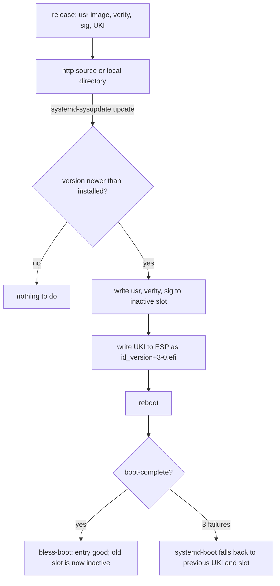

# Updates

*(Planned.)* The sysupdate definitions exist in `image/sysupdate.nix`; the image builder is not
implemented.

An update is a new version of three artifacts, written to the inactive slot by systemd-sysupdate,
and a reboot. Rollback is the previous slot, chosen by boot counting or by hand.

## Transfers

Four `sysupdate.d` definitions, one per artifact: `usr` (partition, type usr), `usr-verity`,
`usr-verity-sig`, and the UKI (regular file on the ESP). `InstancesMax=2` keeps exactly two of each.
The definitions are generated from the image name and are listed in
[reference/image](../reference/image.md).

## Versions

sysupdate orders versions with `strverscmp`. A version is therefore a counter or a date, never a
hash, and the composer refuses an image whose version does not sort above the one it replaces.

## `/etc` traps

Two systemd features do not work as expected for `/etc` updates:

- **`tmpfiles C+`** fills an existing directory but does not replace existing files. A changed
  vendor file in `/usr/share/factory/etc` stays hidden by the old copy in `/etc`.
- **`ConditionNeedsUpdate=/etc`** compares the `/usr` mtime with `/etc/.updated`. A naïve
  reproducible build that uses a fixed timestamp stops the condition from firing.

The image builder sets the erofs timestamp from the image version (`mkfs.erofs -T`), so
`ConditionNeedsUpdate=` fires exactly once per new image while the image stays reproducible.

The planned `etc-sync` tool sidesteps the `C+` trap by using the `etc.manifest` hash and syncing
changed vendor files into `/etc` when they were not modified by the admin.
