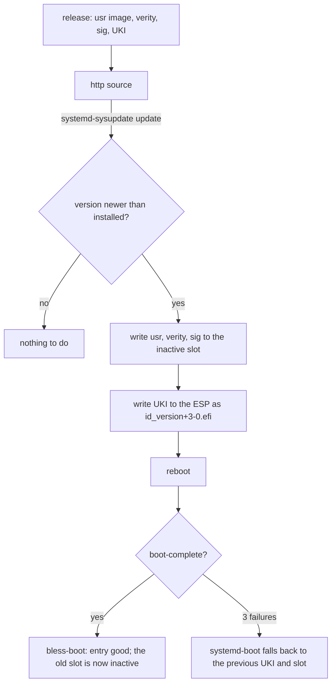

# Updates

An update is a new version of four artifacts, written to the inactive slot by systemd-sysupdate, and
a reboot. Rollback is the previous slot, chosen by boot counting or by hand. The transfer
definitions are rendered (`/system.updateSource`); the artifacts come from the image builder
([Image artifacts](../reference/image.md)). No update has run on a machine yet.

## Transfers

Four `sysupdate.d` definitions, one per artifact: `usr` (partition, type `usr`), `usr-verity`,
`usr-verity-sig`, and the UKI (a regular file on the ESP). They are installed as
`/usr/lib/sysupdate.d/10-usr.transfer` and so on: systemd 257 and later read the `.transfer` suffix,
and `.conf` still loads with a warning. `InstancesMax=2` keeps exactly two of each and
`ProtectVersion=%A` never overwrites the running one. The definitions are generated from the image
name and the update source; artifact names are in [reference/image](../reference/image.md).

The image enables the timer with a static link,
`/usr/lib/systemd/system/timers.target.wants/systemd-sysupdate-update.timer` →
`../systemd-sysupdate-update.timer` (`modules/system/default.nix`). systemd 262 renamed
`systemd-sysupdate.timer` to `systemd-sysupdate-update.timer` and keeps the old name as an alias;
the service is `systemd-sysupdate-update.service`.

## Update source

`/system.updateSource` is the URL of the release directory. The composer renders it as `Path=` into
`/usr/lib/sysupdate.d/*.transfer`, so the source is part of the image and never a per-machine file
in `/etc`. When it is null (the default) no transfer definition, timer link or update runs. In v1
the transfers carry `Verify=no` (rendered: `image/sysupdate.nix`), so sysupdate checks no manifest.
What authenticates the bytes instead is the signature: firmware checks each new UKI, and the kernel
checks its verity signature when the `db` certificate is in the platform keyring
([Trust: Verity key](trust.md#2-verity-key)). Both depend on an enrolled deployment key, which is
manual today, so an update is unauthenticated on a machine without it. A signed `SHA256SUMS`
manifest is *(after v1)*.

The test image sets `updateSource = "http://10.0.2.2:8074/"`. The A/B proof is 20261031.1 to
20261031.2: the new entry is blessed when both health units pass, and a failed candidate falls back
to 20261031.1 after three tries ([Boot: Boot health](boot.md#boot-health),
[Image artifacts: the update test](../reference/image.md#the-update-test)).

## Versions

A version is `YYYYMMDD.N`: the date and a counter within the day (`20261031.1`, `20261101.2`). The
`/system.version` type enforces the format; sysupdate orders versions with `strverscmp`, which this
format sorts correctly. The machine refuses to go backwards: sysupdate installs only a version newer
than the ones it has. The composer cannot check that (evaluation does not know the previous
release); a release script *(planned)* will refuse a non-increasing version on the builder.

The version also sets the mtime of every file in the image (`mkfs.erofs -T`, the epoch of the date
plus `N`). systemd's `ConditionNeedsUpdate=` compares `/usr`'s mtime with `/etc/.updated`, so
sysusers, tmpfiles and the other first-boot units run exactly once per new image while the image
itself stays reproducible. Other downgrades than the boot-counting fall-back are unsupported.

## Factory reset

The root partition is defined with `FactoryReset=yes`: a factory reset
(`systemd-repart --factory-reset=yes`, or the EFI variable) removes it on the next boot and first
boot runs again. The state is gone; the ESP and the `/usr` slots stay.

## Enable links and systemd's store path

PID 1 runs `preset-all` when `/etc` is empty (the first boot). It writes enable links under
`/etc/systemd/system` with an absolute target,
`/usr/nix/store/<hash>-systemd/lib/systemd/system/<unit>`. A release that changes systemd's own
store path would leave those links dangling, and the units they enable would not load.

The unit `golconda-etc-links.service` runs `/usr/libexec/golconda-etc-links /sysroot` in the initrd,
after `/sysroot/usr` is mounted and before switch-root. It rewrites each link whose target is an
absolute store path to `/usr/lib/systemd/system/<unit>`: a stable path that exists in every release.
Masks, links inside `/etc` and relative links stay as they are, so an administrator's unit is not
bypassed.

The unit is wanted by `initrd-switch-root.target`, not `initrd.target`: only then is it in the same
job transaction as `initrd-switch-root.service`, and `Before=` makes switch-root wait for it. A unit
pulled by `initrd.target` is stopped when switch-root cleans up, possibly before it rewrites the
links. The service environment may have no `PATH`, so the script uses `/usr/bin/readlink` and
`/usr/bin/ln` and the shell's parameter expansion for the target's name.

The A/B test from 20261031.1 to 20261031.2 with a changed systemd store path shows the second boot
reaches multi-user.target with no failed units, and every `/etc/systemd/system` link resolves. The
second image changes systemd's package hash with one extra file, which is a test-only change.

The unit does not remove an enable link for a unit that the new release no longer ships; such a link
stays and is ignored by PID 1. Cleaning those links is not designed.

## Rollback protection *(after v1)*

Nothing stops an attacker with an older image signed by the same key from booting it; see
[Trust: Rollback weakness](trust.md#rollback-weakness).
