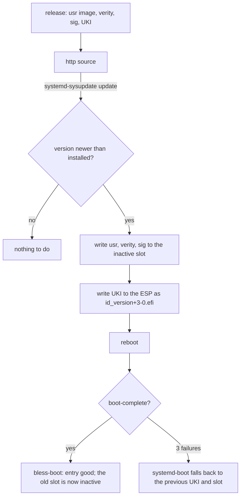

# Updates

An update is a new version of four artifacts, written to the inactive slot by systemd-sysupdate, and
a reboot. Rollback is the previous slot, chosen by boot counting or by hand. The transfer
definitions are rendered (`/system.updateSource`); the artifacts come from the image builder
([Image artifacts](../reference/image.md)).

## Transfers

Four `sysupdate.d` definitions, one per artifact: `usr` (partition, type `usr`), `usr-verity`,
`usr-verity-sig`, and the UKI (a regular file on the ESP). They are installed as
`/usr/lib/sysupdate.d/10-usr.transfer` and so on: systemd 257 and later read the `.transfer` suffix,
and `.conf` still loads with a warning. `InstancesMax=2` keeps exactly two of each and
`ProtectVersion=%A` never overwrites the running one. The definitions are generated from the image
name and the update source; artifact names are in [reference/image](../reference/image.md).

The image enables the timer with a static link,
`/usr/lib/systemd/system/timers.target.wants/systemd-sysupdate-update.timer` →
`../systemd-sysupdate-update.timer` (`modules/system/default.nix`). systemd 262 renamed
`systemd-sysupdate.timer` to `systemd-sysupdate-update.timer` and keeps the old name as an alias;
the service is `systemd-sysupdate-update.service`.

## Update source

`/system.updateSource` is the URL of the release directory. The composer renders it as `Path=` into
`/usr/lib/sysupdate.d/*.transfer`, so the source is part of the image and never a per-machine file
in `/etc`. When it is null (the default) no transfer definition, timer link or update runs. The
transfers carry `Verify=yes` (rendered: `image/sysupdate.nix`): sysupdate checks the release's
signed index before it writes a payload
([Releases: The signed index](releases.md#the-signed-index)).

## What an update authenticates

Every image has `Verify=yes` on every transfer, with or without Secure Boot: `image/sysupdate.nix`
sets it unconditionally and no option turns it off (`tests/eval/index.nix` checks each transfer). No
image and no release uses `Verify=no`. So an update is authenticated by the release key when it is
downloaded, also on a host that has no Secure Boot enrolled. What Secure Boot adds is a second check
at every boot.

| what                                                                                  | checked against                                                                                                   | when                                    | without Secure Boot                                                        |
| ------------------------------------------------------------------------------------- | ----------------------------------------------------------------------------------------------------------------- | --------------------------------------- | -------------------------------------------------------------------------- |
| `SHA256SUMS`                                                                          | its signature `SHA256SUMS.gpg`, by `gpg` against the release key the running image carries (`import-pubring.pgp`) | download, before any payload is written | the same                                                                   |
| each payload: `/usr`, its hash tree, its signature, the UKI                           | its digest in the signed `SHA256SUMS`                                                                             | download                                | the same                                                                   |
| the UKI (kernel, initrd, and the cmdline with `usrhash=` and the root hash signature) | the firmware `db`                                                                                                 | every boot, before it runs              | nothing checks it                                                          |
| the `/usr` root hash signature                                                        | the `db` certificate in the kernel's keyring: the platform keyring, which firmware fills from `db`                | every boot, when `/usr` is activated    | the same certificate, built into the kernel (`CONFIG_SYSTEM_TRUSTED_KEYS`) |
| each block of `/usr`                                                                  | the root hash (dm-verity); IPE runs programs only from a volume whose signature the kernel verified               | every read, every exec                  | the same                                                                   |

So without Secure Boot an update is not unauthenticated: the signed index stops a payload that the
release key did not sign, and a `/usr` that the `db` key did not sign does not run (IPE stops the
boot at switch-root). What is lost is the boot-time check of the UKI. After an install, whoever can
write the ESP can replace the UKI, and with it the kernel that holds the trusted key
([Trust: Verity key](trust.md#2-verity-key)). With Secure Boot, firmware also refuses such a UKI.

Proven: `index-signed` and `sysupdate-installed` (`--next`), and `sysupdate-refused` with
`boots-old` for a changed index (`--next --tamper-index`); the no-Secure-Boot image passed
`--ssh-test --next`, and its update on Hetzner Cloud logged `Good signature`
([What is proven](../proven.md)).

## Versions

A version is `YYYYMMDD.N`: the date and a counter within the day (`20261031.1`, `20261101.2`). The
`/system.version` type enforces the format; sysupdate orders versions with `strverscmp`, which this
format sorts correctly. The machine refuses to go backwards: sysupdate installs only a version newer
than the ones it has. The composer cannot check that (evaluation does not know the previous
release); `golconda release build` and `publish` refuse a version that does not increase on the
builder, and a version published again with other files
([Making a release](../reference/release.md)).

The version also sets the mtime of every file in the image (`mkfs.erofs -T`, the epoch of the date
plus `N`). systemd's `ConditionNeedsUpdate=` compares `/usr`'s mtime with `/etc/.updated`, so
sysusers, tmpfiles and the other first-boot units run exactly once per new image while the image
itself stays reproducible. Other downgrades than the boot-counting fall-back are unsupported.

## Factory reset

The root partition is defined with `FactoryReset=yes`. `systemctl start factory-reset.target` asks
for a reset: it sets the `FactoryResetRequest` EFI variable and reboots, and the next boot has
systemd-repart delete the partitions marked `FactoryReset=` and create them again empty
(systemd-factory-reset(8)). First boot then runs again. The state is gone; the ESP and the `/usr`
slots stay. Do not run `systemd-repart --factory-reset=yes` for this: it deletes the partition at
once, on the running machine.

## Enable links and systemd's store path

`systemctl enable` writes enable links under `/etc/systemd/system` with an absolute target,
`/usr/nix/store/<hash>-systemd/lib/systemd/system/<unit>`: the unit files in `/usr` are links into
the store. The first boot writes none (`00-golconda.preset`, [Layout](layout.md#unit-enablement)),
but an administrator's `systemctl enable` does, and so did the first boot of a release before that
preset. A release that changes systemd's own store path would leave those links dangling, and the
units they enable would not load.

The unit `golconda-etc-links.service` runs `/usr/libexec/golconda-etc-links /sysroot` in the initrd,
after `/sysroot/usr` is mounted and before switch-root. It rewrites each link whose target is an
absolute store path to `/usr/lib/systemd/system/<unit>`: a stable path that exists in every release.
Masks, links inside `/etc` and relative links stay as they are, so an administrator's unit is not
bypassed. The script exits 1 and names the link when it cannot rewrite one, so the unit fails. The
unit is pulled in by `Wants=`, so switch-root still goes on, and the failed unit is what tells the
operator.

The unit is wanted by `initrd-switch-root.target`, not `initrd.target`: only then is it in the same
job transaction as `initrd-switch-root.service`, and `Before=` makes switch-root wait for it. A unit
pulled by `initrd.target` is stopped when switch-root cleans up, possibly before it rewrites the
links. The service environment may have no `PATH`, so the script uses `/usr/bin/readlink` and
`/usr/bin/ln` and the shell's parameter expansion for the target's name.

The unit does not remove an enable link for a unit that the new release no longer ships; such a link
stays and is ignored by PID 1. Cleaning those links is not designed.

## Rollback protection *(later)*

Nothing stops an attacker with an older image signed by the same key from booting it; see
[Trust: Rollback weakness](trust.md#rollback-weakness).
