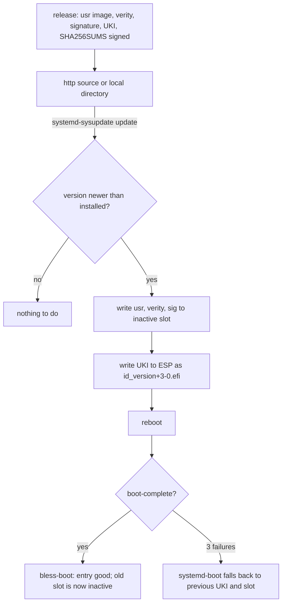

# Updates

An update is a new version of three artifacts, written to the inactive slot by systemd-sysupdate,
and a reboot. Rollback is the previous slot, chosen by boot counting or by hand.

## Transfers

Four `sysupdate.d` definitions, one per artifact: `usr` (partition, type usr), `usr-verity`,
`usr-verity-sig`, and the UKI (regular file on the ESP). `InstancesMax=2` keeps exactly two of each.
The definitions are generated from the image name and are listed in
[reference/image](../reference/image.md).

## Versions

sysupdate orders versions with `strverscmp`. A version is therefore a counter or a date, never a
hash, and the composer refuses an image whose version does not sort above the one it replaces.
