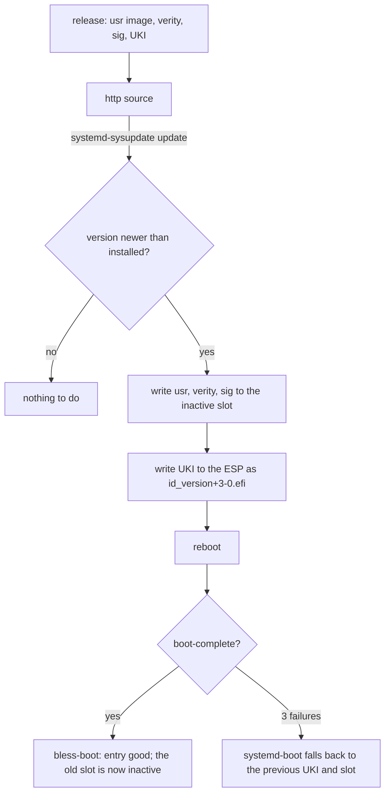

# Updates

An update is a new version of four artifacts, written to the inactive slot by systemd-sysupdate, and
a reboot. Rollback is the previous slot, chosen by boot counting or by hand. The transfer
definitions are rendered (`/system.updateSource`); the artifacts come from the image builder
([Image artifacts](../reference/image.md)).

## Transfers

Four `sysupdate.d` definitions, one per artifact: `usr` (partition, type `usr`), `usr-verity`,
`usr-verity-sig`, and the UKI (a regular file on the ESP). They are installed as
`/usr/lib/sysupdate.d/10-usr.transfer` and so on: systemd 257 and later read the `.transfer` suffix,
and `.conf` still loads with a warning. `InstancesMax=2` keeps exactly two of each and
`ProtectVersion=%A` never overwrites the running one. The definitions are generated from the image
name and the update source; artifact names are in [reference/image](../reference/image.md).

The image enables the timer with a static link,
`/usr/lib/systemd/system/timers.target.wants/systemd-sysupdate-update.timer` →
`../systemd-sysupdate-update.timer` (`modules/system/default.nix`). systemd 262 renamed
`systemd-sysupdate.timer` to `systemd-sysupdate-update.timer` and keeps the old name as an alias;
the service is `systemd-sysupdate-update.service`.

## Update source

`/system.updateSource` is the URL of the release directory. The composer renders it as `Path=` into
`/usr/lib/sysupdate.d/*.transfer`, so the source is part of the image and never a per-machine file
in `/etc`. When it is null (the default) no transfer definition, timer link or update runs. The
transfers carry `Verify=yes` (rendered: `image/sysupdate.nix`): sysupdate checks the release's
signed index before it writes a payload
([Releases: The signed index](releases.md#the-signed-index)). After that, firmware checks each new
UKI, and the kernel checks its verity signature against the `db` certificate
([Trust: Verity key](trust.md#2-verity-key)).

## Versions

A version is `YYYYMMDD.N`: the date and a counter within the day (`20261031.1`, `20261101.2`). The
`/system.version` type enforces the format; sysupdate orders versions with `strverscmp`, which this
format sorts correctly. The machine refuses to go backwards: sysupdate installs only a version newer
than the ones it has. The composer cannot check that (evaluation does not know the previous
release); a release script *(planned)* will refuse a non-increasing version on the builder.

The version also sets the mtime of every file in the image (`mkfs.erofs -T`, the epoch of the date
plus `N`). systemd's `ConditionNeedsUpdate=/var` compares `/usr`'s mtime with `/var/.updated`, so
units with that condition (the journal catalog) run once per new image while the image itself stays
reproducible. `/etc/.updated` can never be written, so `ConditionNeedsUpdate=/etc` is true at every
boot; the three units that use it do nothing harmful: `systemd-sysusers` is skipped by
`ConditionPathIsReadWrite=/etc`, `systemd-hwdb-update` by its own conditions (`hwdb.bin` is in
`/usr`, there is no `/etc/udev`), and `systemd-update-done` ignores `EROFS`. `/etc` is read-only and
comes with the image: sysusers and the `/etc` lines of tmpfiles ran at build time
([Layout: The read-only /etc](layout.md#the-read-only-etc)). Other downgrades than the boot-counting
fall-back are unsupported.

## Factory reset

The root partition is defined with `FactoryReset=yes`. `systemctl start factory-reset.target` asks
for a reset: it sets the `FactoryResetRequest` EFI variable and reboots, and the next boot has
systemd-repart delete the partitions marked `FactoryReset=` and create them again empty
(systemd-factory-reset(8)). The var units then run again and make new keys. The state is gone; the
ESP, the `/usr` slots and `/etc`, which is part of the image, stay. The machine id stays too: it
comes from the SMBIOS UUID or a credential, not from the state. Do not run
`systemd-repart --factory-reset=yes` for this: it deletes the partition at once, on the running
machine.

## Enable links and systemd's store path

`/etc` is read-only and no boot is a first boot
([Layout: The read-only /etc](layout.md#the-read-only-etc)), so PID 1 never runs `preset-all` and
`/etc/systemd/system` has no enable links. A change of systemd's store path in an update can leave
no dangling link. The `etc-follows-update` marker checks that `/etc` is the running release's
confext and holds no enable links, after an update and after a fallback.

Before, PID 1 ran `preset-all` when `/etc` was empty and wrote links with an absolute target,
`/usr/nix/store/<hash>-systemd/lib/systemd/system/<unit>`. The unit `golconda-etc-links.service`
still runs `/usr/libexec/golconda-etc-links /sysroot` in the initrd, after `/sysroot/usr` is mounted
and before switch-root. It rewrites each link whose target is an absolute store path to
`/usr/lib/systemd/system/<unit>`, and now finds nothing. The script exits 1 and names the link when
it cannot rewrite one, so the unit fails. The unit is pulled in by `Wants=`, so switch-root still
goes on, and the failed unit is what tells the operator.

The unit is wanted by `initrd-switch-root.target`, not `initrd.target`: only then is it in the same
job transaction as `initrd-switch-root.service`, and `Before=` makes switch-root wait for it. A unit
pulled by `initrd.target` is stopped when switch-root cleans up, possibly before it rewrites the
links. The service environment may have no `PATH`, so the script uses `/usr/bin/readlink` and
`/usr/bin/ln` and the shell's parameter expansion for the target's name.

## Rollback protection *(after v1)*

Nothing stops an attacker with an older image signed by the same key from booting it; see
[Trust: Rollback weakness](trust.md#rollback-weakness).
