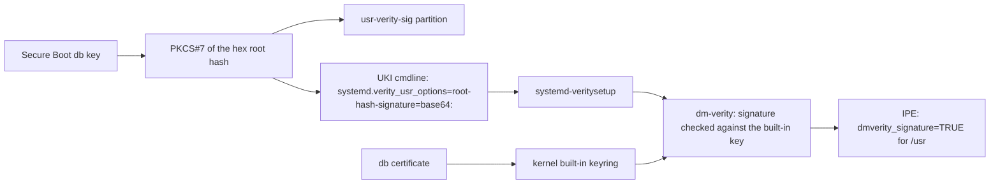

# Verity key

The verity key signs the root hash of every `/usr` image, and the kernel checks that signature at
every boot. It is one of the three trust roots ([Trust](trust.md)).

The image builder signs the hex root hash (the string the kernel gets in the verity table) with the
Secure Boot `db` key, as PKCS#7 without certificates (`lib/image/verity.nu`). The signature goes to
two places: the `usr-verity-sig` partition, systemd's JSON, for tools that dissect the disk; and the
UKI cmdline as `systemd.verity_usr_options=root-hash-signature=base64:<sig>` (`image/uki.nix`). The
generator passes the option to `systemd-veritysetup@usr.service`, which activates `/usr` with
`crypt_activate_by_signed_key`; dm-verity checks the signature against the secondary keyring
(`CONFIG_DM_VERITY_VERIFY_ROOTHASH_SIG_SECONDARY_KEYRING`), which holds the keys built into the
kernel: the `db` certificate of the image's key set, and nothing else. IPE's `dmverity_signature` is
true only for a volume whose signature the kernel verified, and an IPE policy update must be signed
by a key of the same keyring (`CONFIG_IPE_POLICY_SIG_SECONDARY_KEYRING`).

Why the cmdline and not the partition: systemd reads the partition's signature only on the gpt-auto
path (`root-hash-signature=auto`, from the udev property `ID_DISSECT_PART_ROOTHASH_SIG` that the
`dissect_image` builtin sets on the boot disk). Golconda finds `/usr` by `usrhash=` through the
veritysetup generator, which takes no signature unless an option names one. The cmdline is in the
signed UKI and measured into PCR 11, so it is as trusted as `usrhash=` itself. The signature is
about 550 base64 characters; the cmdline is about 1250 bytes of the kernel's 2048
(`COMMAND_LINE_SIZE`), and `lib/image/uki.nu` fails the build at 2048.

Why the `db` key: a second key would add nothing, because whoever holds the `db` key can already
sign a UKI with any `usrhash=`. A rotated `db` key needs new images, as it does for the UKI
([Boot loader: Key rotation](bootloader.md#key-rotation)).

Why not the firmware's `db`: `db` is not Golconda's alone. With `secureBootMicrosoftKeys = true`,
the default, it also holds Microsoft's UEFI CAs. The kernel accepts a PKCS#7 signature whose signer
certificate chains to any key in the keyring it checks (`crypto/asymmetric_keys/pkcs7_trust.c`, with
no key usage check for dm-verity). If dm-verity trusted the `.platform` keyring, which the kernel
fills from `db` (`CONFIG_LOAD_UEFI_KEYS`), a root hash signed by a certificate that Microsoft's CA
issued would activate `/usr` as signed, and IPE would run it. So Golconda turns off
`CONFIG_DM_VERITY_VERIFY_ROOTHASH_SIG_PLATFORM_KEYRING` and
`CONFIG_IPE_POLICY_SIG_PLATFORM_KEYRING`, and the kernel trusts only the `db` certificate built into
it. The kernel still loads `db` into `.platform` and logs each certificate, but nothing checks a
signature against that keyring.

What this costs: each key set builds its own kernel, with the same config (below). A `db` rotation
needs no other step: the next release's kernel carries the new certificate, its `/usr` is signed
with the new key, and the UKI pairs them (`usrhash=`). The running kernel does not trust the new
key, even while `db` holds both certificates. It does not need to: it never activates the next
release's `/usr`.

A signature that does not verify does not stop `systemd-veritysetup`: it logs "Unable to activate
verity device ... with root hash signature ..., retrying without" at info level and activates `/usr`
unsigned. The boot then stops at switch-root, where IPE denies PID 1's re-exec from `/usr`
([Execution policy](trust.md#execution-policy)). So `lib/image/uki.nu` checks the signature against
the UKI's own signing certificate at build time and fails on a mismatch. On the machine, the
firmware `db` must hold that certificate to start the UKI; the boot test enrols it only with
`--secure-boot`.

**The built-in certificate.** `lib.mkImage` passes the `db` certificate of its `publicKeys` to
`mkSystem`. The kernel build copies it to a fixed path in the kernel tree,
`certs/golconda-verity.pem`, and `CONFIG_SYSTEM_TRUSTED_KEYS` names that path
(`packages/kernel/kbuild.nu`, `GOLCONDA_KERNEL_FILES`); the kernel loads it into
`.builtin_trusted_keys`, which the secondary keyring includes. The kernel of the set changes, so
`/usr` and the UKI carry the same one. A system that no image signs (`lib.mkSystem` alone, for a
`/usr` tree) has no certificate, and its kernel verifies no `/usr`.

**Without Secure Boot** (`/system.secureBoot = false`, for a host whose firmware has none, such as
Hetzner Cloud): the kernel trusts the same built-in certificate, and `mkSystem` without the image's
keys is an error. What is lost is the check before the kernel: no firmware verifies the loader or
the UKI, so whoever can write the ESP can boot a kernel that trusts another key. IPE and the `/usr`
signature still hold against a changed `/usr`, and the vars still seal (to the host key alone,
without a TPM). The bootstrap credentials on the ESP are accepted there because Secure Boot is off
([Boot: Bootstrap credentials](boot.md#bootstrap-credentials)); they hold for one boot, and whoever
can write the ESP can plant one ([The ESP](trust.md#the-esp)).

The certificate is an input of the kernel derivation, but not of its config: every key set has the
same config, so a new certificate compiles only the certificate object and the compressed kernel's
wrapper again, relinks, and takes the rest from jig's compile cache. A store path in the config
would change `include/generated/autoconf.h`, which every object includes. clang's depfile leaves out
an `.incbin` input, so jig refuses to cache a compile that names `.incbin` or `.include` (repkgs,
llvm/llvm-project#54996). The build also puts the digest of the certificate file on the command line
of `certs/system_certificates.o`, and the digest of `vmlinux` on that of
`arch/x86/boot/compressed/piggy.o`: a stale certificate object would be a trust failure. A missing
file fails the build (the copy, then make, which has no rule for it), and so does an empty one
(`extract-cert` needs at least one certificate): the keyring is never silently empty. The kernel
package installs the certificate as `lib/modules/<version>/trusted-keys.pem`, so `/usr` records
which key its kernel trusts; the config names only the path.

Proven by boot, with and without Secure Boot ([What is proven](../proven.md)).
