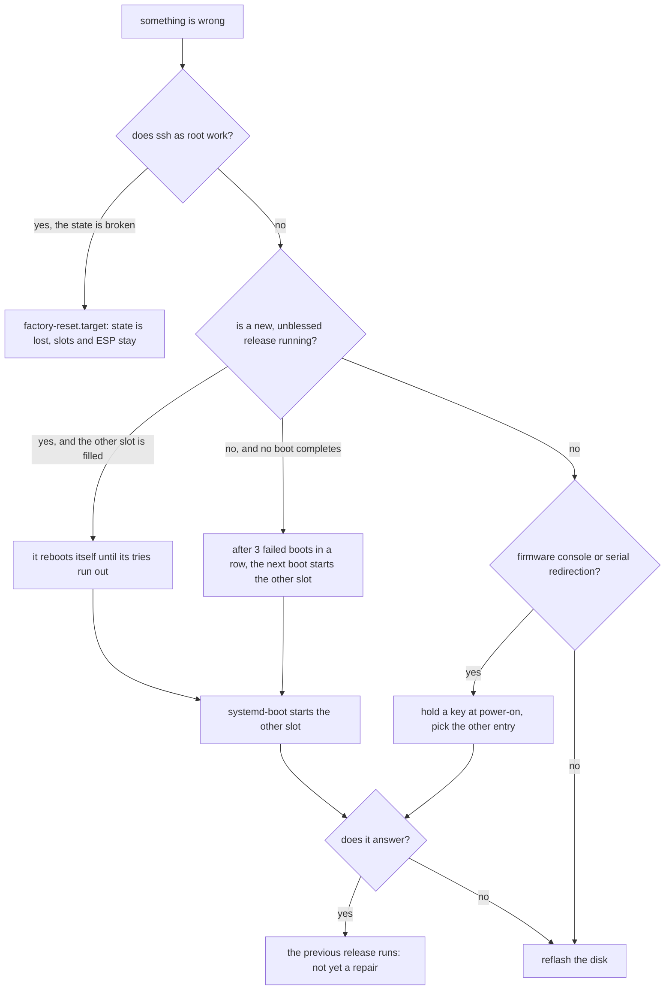

# Factory reset and recovery

You can wipe a machine's state and boot it fresh, or fall back to the older version of the OS. A
state reset needs a working ssh login. A fallback needs none: boot counting or the failed-boot count
does it by itself, or you pick the entry in the boot menu. The last resort is a reflash. This page
lists the five ways back and what each one costs.

## How it works

`image/repart.nix` marks the state partition (`/etc`, `/var`, `/home`, `/root`) with
`FactoryReset=yes`. The ESP (EFI System Partition) and both `/usr` slots stay. Run
`systemctl start factory-reset.target`. It sets the `FactoryResetRequest` EFI variable and reboots.
On the next boot `systemd-repart` deletes the state partition and makes it again, empty. First boot
then runs again: new machine id, new host key, no state.

Do not run `systemd-repart --factory-reset=yes` for this. It deletes the partition at once, on the
running machine.



The five paths, in the order to try them:

1. **Boot counting.** A new version that fails its health units is not blessed. After three tries
   systemd-boot starts the other slot ([A/B updates](updates.md)).
1. **The failed-boot fallback.** `/base` counts each boot that does not complete, also of a blessed
   release. After 3 such boots in a row, the next boot starts the other slot. When that boot
   completes, the failed release sorts last, so later boots keep to the release that works. After 6
   such boots in a row, a failed boot does not reboot: the machine stops, and the console keeps the
   last messages until someone resets it ([Boot: Failed boots](../design/boot.md#failed-boots)).
1. **The systemd-boot menu.** `loader.conf` sets `timeout 0`, but the menu opens when a key is held
   at firmware start. It lists the UKIs under `EFI/Linux`. Pick the older one by hand.
1. **State reset.** The command above. It repairs a broken state partition, not a broken image.
1. **Reflash.** Write a fresh disk image. It replaces the ESP, both slots and the state.

From a running machine, `bootctl set-oneshot <id>_<version>.efi` boots the other slot once, and
`bootctl set-default` keeps it until cleared.

## Using it

```sh
ssh root@web1 systemctl start factory-reset.target
```

The machine reboots and comes back with new state. The ESP holds no credentials from
[provisioning](provisioning.md): the first boot removed them. So the reset machine boots with the
fallback host name and no plain root key. Log in with a certificate, or provision it again (SMBIOS,
`/imds`, or `scripts/provision-esp` on the disk).

## Certify again after a reset

To its deploy host, a reset machine is a new machine. The reset boot made a new host key and wrote
its fingerprint on the console, as a first boot does:
`golconda: ssh host key 256 SHA256:… root@HOST (ED25519)`. The host certificate and the KRL were on
the state partition and are gone, so sshd presents the plain host key. What logs in depends on the
image's `/services/sshd`:

- `revokedKeys` off: a user certificate of a CA in `trustedUserCAKeys` logs in. The CA is in the
  image, so no state is needed.
- `revokedKeys` on: until a KRL is pushed, the image's fallback list refuses every certificate of
  those CAs ([Trust: Host certificate](../design/trust.md#host-certificate)). A plain key logs in:
  the image's `authorizedKeys`, or a bootstrap key provisioned again (SMBIOS, `/imds`,
  `scripts/provision-esp`). An image with neither has no login after a reset, and the way back is a
  reflash with provisioning.

Then certify it as a new machine:

1. `ssh root@HOST systemctl start factory-reset.target`, and wait for the reset boot.
1. Read the new fingerprint on the console (serial or the cloud's console).
1. `golconda vars certify HOST --ca-key … --krl … --fingerprint SHA256:…` with that fingerprint. It
   refuses a fingerprint that is not the key's, such as the old one. It signs the new key with the
   host CA, pushes the KRL and the certificate, and restarts sshd; with `hostCertificate` on, plain
   keys stop again ([Commands: golconda vars certify](../reference/cli.md#golconda-vars-certify)).
1. Push the other admin vars again: `golconda vars push HOST`.

A client that trusts the host CA (`@cert-authority`) needs nothing. A client that kept the old plain
host key in `known_hosts` must remove it.

## Status

Proven: the rows of [What is proven](../proven.md) that name `state-gone`, `cert-login-after-reset`,
`recertify-after-reset`, `set-oneshot-other-slot`, `fallback-to-old-slot`, `failed-boots-fallback`
and `failed-boots-halt`. The limits are below.

## Limits

- No local login and no rescue shell. A machine without working ssh has no console session.
- No remote recovery channel. A failed boot reboots by itself in the cases that
  [Boot: Trial boot](../design/boot.md#trial-boot) lists.
- The reset test ran on the test image: one `/usr` slot, QEMU. A reset after an update, the TPM
  clear and sealed credentials, real firmware, and the case where ssh is down are manual steps.
- The boot test does not exercise the menu. A headless machine needs serial redirection in its
  firmware to use it.
- A loader that no longer starts needs the firmware menu at a console or a reflash. The lost-ESP and
  lost-`db`-key cases have no marker.
- No LUKS recovery: the state partition is not encrypted yet.
- No installer and no network install. Reflash writes the disk image to the disk.

## More

- [Recovery](../design/recovery.md), with [What is missing](../design/recovery.md#what-is-missing).
- [Boot loader: Recovery](../design/bootloader.md#recovery) and
  [What is not possible](../design/bootloader.md#what-is-not-possible).
- [Updates: Factory reset](../design/updates.md#factory-reset).
- [The factory reset test](../reference/image.md#the-factory-reset-test).
