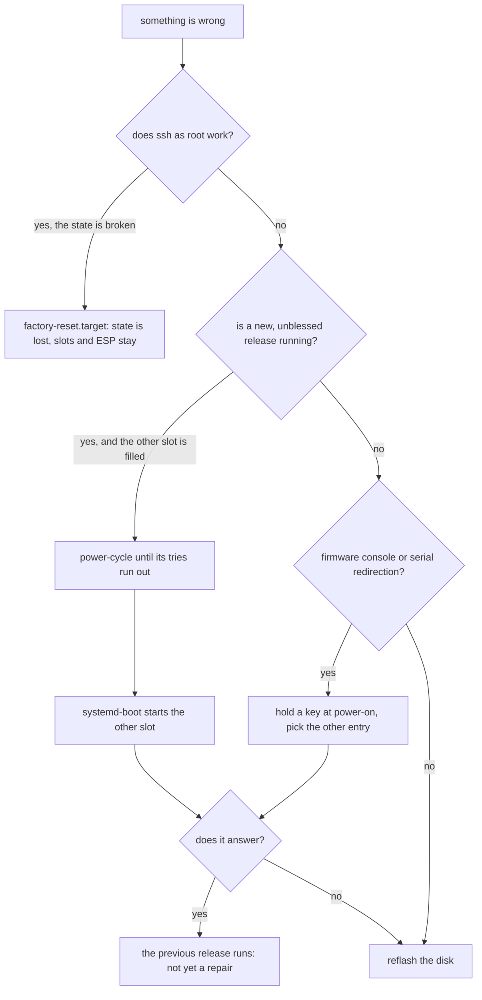

# Factory reset and recovery

You can wipe a machine's state and boot it fresh, or fall back to the older version of the OS. A
state reset needs a working ssh login. A fallback needs none: boot counting does it by itself, or
you pick the entry in the boot menu. The last resort is a reflash. This page lists the four ways
back and what each one costs.

## How it works

`image/repart.nix` marks the root partition (`/etc`, `/var`, `/home`, `/root`) with
`FactoryReset=yes`. The ESP (EFI System Partition) and both `/usr` slots stay. Run
`systemctl start factory-reset.target`. It sets the `FactoryResetRequest` EFI variable and reboots.
On the next boot `systemd-repart` deletes the root partition and makes it again, empty. First boot
then runs again: new machine id, new host key, no state.

Do not run `systemd-repart --factory-reset=yes` for this. It deletes the partition at once, on the
running machine.



The four paths, in the order to try them:

1. **Boot counting.** A new version that fails its health units is not blessed. After three tries
   systemd-boot starts the other slot ([A/B updates](updates.md)).
1. **The systemd-boot menu.** `loader.conf` sets `timeout 0`, but the menu opens when a key is held
   at firmware start. It lists the UKIs under `EFI/Linux`. Pick the older one by hand.
1. **State reset.** The command above. It repairs a broken state partition, not a broken image.
1. **Reflash.** Write a fresh disk image. It replaces the ESP, both slots and the state.

From a running machine, `bootctl set-oneshot <id>_<version>.efi` boots the other slot once, and
`bootctl set-default` keeps it until cleared.

## Using it

```sh
ssh root@web1 systemctl start factory-reset.target
```

The machine reboots and comes back with new state. Credentials on the ESP stay, so the host name and
the root key from [provisioning](provisioning.md) apply again on the new first boot.

## Status

The boot test proves this in QEMU ([What is proven](../proven.md)), with
`--factory-reset --ssh-test`: `state-gone`, `machine-id-new`, `first-boot-rerun`,
`multi-user-after-reset` and `slots-kept`. With `--next`: `loader-reinstall`,
`set-oneshot-other-slot`, `set-default-other-slot` and `reboot-to-firmware`. Fallback by boot
counting has markers too (`fallback-to-old-slot`).

## Limits

- No local login and no rescue shell. A machine without working ssh has no console session.
- No automatic reboot of a failed candidate, and no remote recovery channel.
- The reset test ran on the test image: one `/usr` slot, QEMU. A reset after an update, the TPM
  clear and sealed credentials, real firmware, and the case where ssh is down are manual steps.
- The boot test does not exercise the menu. A headless machine needs serial redirection in its
  firmware to use it.
- A loader that no longer starts needs the firmware menu at a console or a reflash. The lost-ESP and
  lost-`db`-key cases have no marker.
- No LUKS recovery: the state partition is not encrypted yet.
- No installer and no network install. Reflash writes the disk image to the disk.

## More

- [Recovery](../design/recovery.md), with [What is missing](../design/recovery.md#what-is-missing).
- [Boot loader: Recovery](../design/bootloader.md#recovery) and
  [What is not possible](../design/bootloader.md#what-is-not-possible).
- [Updates: Factory reset](../design/updates.md#factory-reset).
- [The factory reset test](../reference/image.md#the-factory-reset-test).
