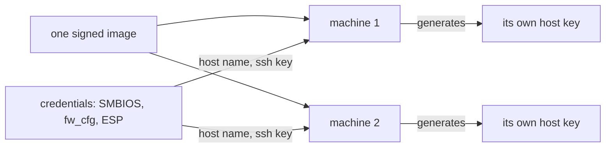

# One image for every machine

Golconda builds one signed image and boots it on every machine of its kind. You do not build per
host, and you do not put a host name, key or password in the image. Each machine gets its own values
at first boot, as systemd credentials, or makes them itself. The machine runs no Nix.



## How it works

- **No per-machine value in the image.** A host name, key, certificate or password hash is one of
  three things: a bootstrap credential, a var generated on the machine, or a value the administrator
  pushes. A bootstrap credential arrives by SMBIOS, qemu fw_cfg or a file on the ESP (the EFI system
  partition). PID 1 reads `system.hostname`. A var is a value the image names but never contains.
  The ssh host key is a local var: `golconda-var-sshd-hostkey.service` makes it on first boot and
  seals it.
- **A type error guards the rule.** An `app` file that holds `%d/`, `$CREDENTIALS_DIRECTORY`,
  `/etc/credstore`, `-----BEGIN` or `PRIVATE KEY` fails to evaluate and the error names the file
  (`modules/lib/app.nix`).
- **No Nix on the machine.** repkgs builds every output so that it names no store path of its own.
  Libraries are found by `$ORIGIN`. The loader is found relative to the binary. So the store can sit
  at `/usr/nix/store` inside the read-only image. `/usr/bin`, `/usr/lib` and `/usr/share` are links
  into it. The store is a build-time artifact: a configuration change is a new image.
- **The build checks the tree.** `scripts/lint` rejects a `/nix/store` literal in `modules/` and
  `lib/`. The `/usr` tree builder refuses an absolute symlink target, a setuid bit and an unknown
  top-level directory.
- **The same inputs give the same image.** The version sets the erofs timestamp, the verity salt and
  the filesystem UUID. A rebuild is byte-identical.

## Using it

Leave per-machine values out of the TOML document. Pass them when you boot or write the disk:

```sh
# qemu: the host name as an SMBIOS credential
-smbios type=11,value=io.systemd.credential:system.hostname=web1

# any disk: host name and root's ssh key on the ESP
scripts/provision-esp disk.raw --hostname web1 --authorized-keys admin.pub
```

`ssh.authorized_keys.root` is the second credential. The first boot reads both. The
[Hetzner page](../reference/hetzner-cloud.md) uses the ESP route. The
[Walkthrough](../reference/walkthrough.md) goes from `examples/server.toml` to a booted machine.

## Status

Proven in QEMU by `hostname`, `ssh-login` (host name from the SMBIOS credential),
`var-sshd-hostkey`, `no-firstboot-prompt` and `esp-authorized-keys` (host name and key from the
ESP). `hostkey-sealed-with-tpm2` checks the sealed host key. See [What is proven](../proven.md).

## Limits

- A bootstrap credential carries no secret. SMBIOS strings are readable by every process, and the
  ESP is not encrypted.
- ESP credentials use the null key. With Secure Boot and a TPM2 together, PID 1 refuses them. Use
  SMBIOS or fw_cfg there.
- `authorizedKeys` in the document goes into the image for every machine. Leave it out when machines
  must differ.
- Nix on the machine, for debugging, is *(later)* as a separate debug image.
- Only x86_64 under QEMU has run.

## More

- [Principles: the image holds no per-machine value](../design/principles.md#the-image-holds-no-per-machine-value)
- [Boot: bootstrap credentials](../design/boot.md#bootstrap-credentials)
- [Trust: secrets and vars](../design/trust.md#secrets-and-vars)
- [Layout: `/usr`](../design/layout.md#usr) and
  [Architecture](../design/architecture.md#how-the-parts-fit)
- [Provisioning](provisioning.md) and [Vars](vars.md)
