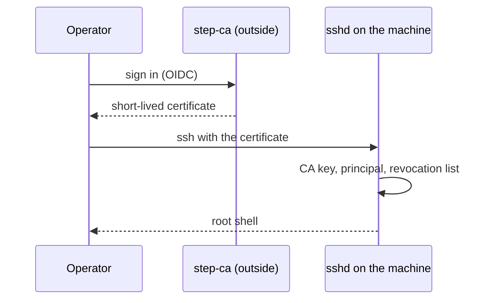

# Certificate login, no local login

Nobody logs in at the console, and no password works anywhere. An operator logs in over ssh with a
short-lived OpenSSH certificate that a certificate authority (CA) outside the image signed. The
image holds only the CA's public key and the list of allowed names. That keeps a login secret off
the machine and gives a revocation path.

## How it works

- **The CA is outside the image.** It is step-ca with an OIDC provisioner (login through an identity
  provider). The server runs no agent.
- **The image carries two public things.** `TrustedUserCAKeys` points at `/usr/lib/sshd/ca.pub`.
  `AuthorizedPrincipalsFile` points at `/usr/lib/sshd/principals/%u`, the names a certificate may
  carry to log in as that user.
- **The machine's identity** is its host key, a local var, plus an optional host certificate and key
  revocation list. Both are admin vars (the CA pushes them). sshd reads them from its credentials
  directory, never from the image ([Secrets as vars](vars.md)).
- **No password path exists.** The generated `sshd_config` fixes `PasswordAuthentication no`,
  `KbdInteractiveAuthentication no`, `ChallengeResponseAuthentication no` and
  `PermitRootLogin prohibit-password`. No option turns them on.
- **PAM does account and session only.** `/etc/pam.d/sshd` has no `auth` line, and
  `/etc/pam.d/other` denies every type. linux-pam ships without `unix_chkpwd`, and the image has no
  setuid binary (the build checks this). A non-root process cannot verify a password at all.
- **Root only, for now.** There are no per-human accounts. `LogLevel VERBOSE` writes the certificate
  principal and key id to the log, and that is the audit trail.
- **One ssh server.** `sshd.service` with the generated `sshd_config` is the only one. systemd's ssh
  generator is not in the image: it would start a second sshd, with `sshd_config`'s defaults and an
  `AuthorizedKeysFile` of its own, on an `AF_UNIX` socket, on `AF_VSOCK` and on any address an
  `ssh.listen` credential names. The kernel has no vsock either.
- **No local login.** No getty, no password, no rescue shell. The serial console (`console=ttyS0`)
  is output only. `golconda-health-sshd.service` fails unless sshd is active, so the machine never
  blesses a boot whose sshd is down.



## Using it

```toml
["/services/sshd"]
trustedUserCAKeys = ["ssh-ed25519 AAAA... user-ca"]
revokedKeys = true       # the admin var sshd-revoked-keys (file krl); until it is pushed, certificates are refused
hostCertificate = true   # the admin var sshd-host-cert (file cert); until it is pushed, the plain host key
["/services/sshd".principals]
root = ["alice@example.com"]
```

`authorizedKeys` lists plain public keys for root. Use it to bootstrap: with `hostCertificate` on,
plain keys work only until the host certificate is enrolled. `revokedKeys` and `hostCertificate`
default to `false`.

A new machine enrols in its first release. Turn both options on, boot, and run one command from the
deploy host. It needs a plain key that logs in (`authorizedKeys`, or the provisioning credential
`ssh.authorized_keys.root`), the host CA's key, and the deployment's current KRL:

```console
$ golconda vars enrol -i ~/.age/key.txt web1 --ca-key host_ca --krl fleet.krl
web1's host key: 256 SHA256:… root@web1 (ED25519)
Is this the fingerprint on web1's console or journal (golconda: ssh host key …)? Type yes to sign it: yes
```

Compare the fingerprint with the line `golconda: ssh host key …` that the first boot wrote on the
console; `--fingerprint SHA256:…` compares without the question. Then the command does the six steps
that were once typed by hand: it read the host key (`golconda vars pub web1 sshd-hostkey key.pub`)
and checked its fingerprint (`ssh-keygen -lf`); it signs it as a host certificate
(`ssh-keygen -s host_ca -h -I web1 -n web1`), stores the certificate and the KRL
(`golconda vars set web1 sshd-host-cert cert`, `golconda vars set web1 sshd-revoked-keys krl`), and
pushes both, the KRL first (`golconda vars push web1`). `--principal` names what clients reach the
machine by (default: the name given), `--validity` how long the certificate holds (default a year).
A CA key on a PKCS#11 token, such as the YubiKey that holds the release keys, is
`--ca-key host_ca.pub --pkcs11-module "$(ykcs11-module)"`: ssh-keygen signs with the token's key
that matches the public key file
([Commands: golconda vars enrol](../reference/cli.md#golconda-vars-enrol)). It refuses with no KRL
at all, and stops before anything is signed when the fingerprint is not confirmed.

The push restarts sshd, which then presents the host certificate, checks the KRL and refuses every
plain key: the image's `authorizedKeys`, `ssh.authorized_keys.root` and a cloud's keys. From then on
only certificates log in, after reboots and updates too
([Trust: Enrolment](../design/trust.md#enrolment)). The signer is `ssh-keygen`, with the CA key in a
file or on a token. Signing through step-ca's API is *(later)*: step-ca signs user certificates.

## Status

With `--ssh-test`, `sshd-active` and `ssh-login` show sshd up and root reachable,
`sshd-golconda-only` shows no other ssh unit or socket, and `no-failed-units` shows a clean boot.
The test image trusts a test user CA: `cert-login` logs in with a certificate for the allowed
principal, and `cert-wrong-principal-refused` is refused. With `--esp-creds`, `esp-authorized-keys`
shows a key that only the ESP holds. With `--next` the harness pushes the host certificate and a
revocation list, and the next release, which turns both on, passes `host-cert-presented`,
`cert-revoked-refused` and, after a second push, `krl-rotated`. With `--enrol` one release does all
of it in its first boot: certificates are refused until `golconda vars enrol`
(`cert-refused-before-enrol`), which refuses a fingerprint that is not the console's
(`enrol-wrong-fingerprint-refused`) and enrols with the console's; then the same boot presents the
host certificate and refuses both plain keys, which the KRL does not name
(`bootstrap-key-refused-after-enrol`, and after a reboot `bootstrap-key-refused-after-reboot`). See
[What is proven](../proven.md).

## Limits

- **Before the push** only plain keys log in, and no list checks them; the host is checked only by
  the console's fingerprint, not by a certificate.
- **After the push** no plain key logs in. When certificate login breaks (the CA is lost, a KRL
  refuses every certificate), recovery is the other slot, if its release has `hostCertificate` off
  and someone chooses it at the console's boot menu, or a reflash, which wipes the sealed vars, so
  the machine enrols again ([Boot loader: Recovery](../design/bootloader.md#recovery)).
- The host certificate needs the host key first: the machine makes its key, then the CA signs it.
  Renewal is `golconda vars enrol` again before the certificate expires; nothing on the machine
  renews it.
- `golconda vars enrol` with a CA key on a token is tested with SoftHSM, not with a YubiKey
  ([Making a release: A YubiKey](../reference/release.md#a-yubikey-being-built)).
- A password-less root is the only account. Per-operator records with `run0` and polkit are
  *(later)*.
- A hardware second factor (FIDO2) is client policy: the CA signs a FIDO2 key.

## More

- [Trust: Identity](../design/trust.md#identity)
- [Boot: Serial console](../design/boot.md#serial-console)
- [Reference: configuration](../reference/config.md#document-format)
- [Secrets as vars](vars.md), [Provisioning](provisioning.md)
