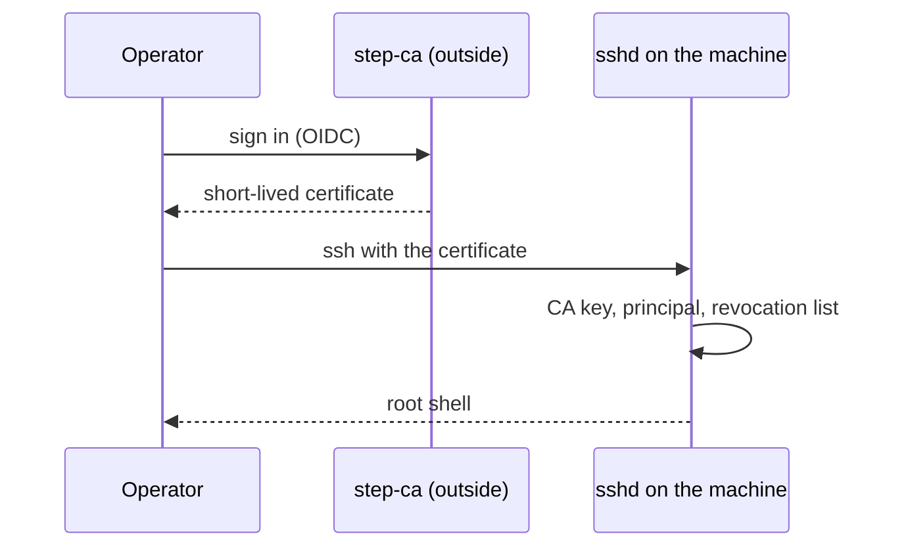

# Certificate login, no local login

Nobody logs in at the console, and no password works anywhere. An operator logs in over ssh with a
short-lived OpenSSH certificate that a certificate authority (CA) outside the image signed. The
image holds only the CA's public key and the list of allowed names. That keeps a login secret off
the machine and gives a revocation path.

## How it works

- **The CA is outside the image.** In v1 it is step-ca with an OIDC provisioner (login through an
  identity provider). The server runs no agent.
- **The image carries two public things.** `TrustedUserCAKeys` points at `/usr/lib/sshd/ca.pub`.
  `AuthorizedPrincipalsFile` points at `/usr/lib/sshd/principals/%u`, the names a certificate may
  carry to log in as that user.
- **The machine's identity** is its host key, a local var, plus an optional host certificate and key
  revocation list. Both are admin vars (the CA pushes them). sshd reads them from its credentials
  directory, never from the image ([Secrets as vars](vars.md)).
- **No password path exists.** The generated `sshd_config` fixes `PasswordAuthentication no`,
  `KbdInteractiveAuthentication no`, `ChallengeResponseAuthentication no` and
  `PermitRootLogin prohibit-password`. No option turns them on.
- **PAM does account and session only.** `/etc/pam.d/sshd` has no `auth` line, and
  `/etc/pam.d/other` denies every type. linux-pam ships without `unix_chkpwd`, and the image has no
  setuid binary (the build checks this). A non-root process cannot verify a password at all.
- **Root only in v1.** There are no per-human accounts. `LogLevel VERBOSE` writes the certificate
  principal and key id to the log, and that is the audit trail.
- **No local login.** No getty, no password, no rescue shell. The serial console (`console=ttyS0`)
  is output only. `golconda-health-sshd.service` fails unless sshd is active, so the machine never
  blesses a boot whose sshd is down.



## Using it

```toml
["/services/sshd"]
trustedUserCAKeys = ["ssh-ed25519 AAAA... user-ca"]
revokedKeys = true       # needs the admin var sshd-revoked-keys (file krl)
hostCertificate = true   # needs the admin var sshd-host-cert (file cert)
["/services/sshd".principals]
root = ["alice@example.com"]
```

`authorizedKeys` lists plain public keys for root. Use it to bootstrap. `revokedKeys` and
`hostCertificate` default to `false`.

## Status

With `--ssh-test`, `sshd-active` and `ssh-login` show sshd up and root reachable, and
`no-failed-units` shows a clean boot. The test image trusts a test user CA: `cert-login` logs in
with a certificate for the allowed principal, and `cert-wrong-principal-refused` is refused. With
`--esp-creds`, `esp-authorized-keys` shows a key that only the ESP holds. With `--next` the harness
pushes the host certificate and a revocation list, and the next release, which turns both on, passes
`host-cert-presented`, `cert-revoked-refused` and, after a second push, `krl-rotated`. See
[What is proven](../proven.md).

## Limits

- **Delivery order.** `revokedKeys` and `hostCertificate` need the pushed credentials. If ssh is the
  only channel, start with `authorizedKeys`, push the credentials with `golconda vars push`, then
  enable both options in the next release.
- The host certificate needs the host key first: the machine makes its key, then the CA signs it. An
  enrolment service that does both at first boot is not built.
- A password-less root is the only account. Per-operator records with `run0` and polkit are *(after
  v1)*.
- A hardware second factor (FIDO2) is client policy: the CA signs a FIDO2 key.

## More

- [Trust: Identity](../design/trust.md#identity)
- [Boot: Serial console](../design/boot.md#serial-console)
- [Reference: configuration](../reference/config.md#document-format)
- [Secrets as vars](vars.md), [Provisioning](provisioning.md)
