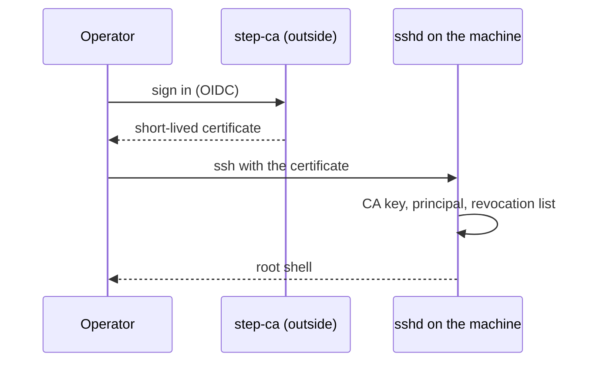

# Certificate login, no local login

Nobody logs in at the console, and no password works anywhere. An operator logs in over ssh with a
short-lived OpenSSH certificate that a certificate authority (CA) outside the image signed. The
image holds only the CA's public key and the list of allowed names. That keeps a login secret off
the machine and gives a revocation path.

## How it works

- **The CA is outside the image.** It is step-ca with an OIDC provisioner (login through an identity
  provider). The server runs no agent.
- **The image carries two public things.** `TrustedUserCAKeys` points at `/usr/lib/sshd/ca.pub`.
  `AuthorizedPrincipalsFile` points at `/usr/lib/sshd/principals/%u`, the names a certificate may
  carry to log in as that user.
- **The machine's identity** is its host key, a local var, plus an optional host certificate and key
  revocation list. Both are admin vars (the CA pushes them). sshd reads them from its credentials
  directory ([Secrets as vars](vars.md)).
- **No password path exists.** The generated `sshd_config` fixes `PasswordAuthentication no`,
  `KbdInteractiveAuthentication no`, `ChallengeResponseAuthentication no` and
  `PermitRootLogin prohibit-password`. No option turns them on.
- **PAM does account and session only.** `/etc/pam.d/sshd` has no `auth` line, and
  `/etc/pam.d/other` denies every type. linux-pam ships without `unix_chkpwd`, and the image has no
  setuid binary (Nix refuses the bit). A non-root process cannot verify a password at all.
- **Root only, for now.** There are no per-human accounts. `LogLevel VERBOSE` writes the certificate
  principal and key id to the log, and that is the audit trail.
- **One ssh server.** `sshd.service` with the generated `sshd_config` is the only one. systemd's ssh
  generator is not in the image. It would start a second sshd, with `sshd_config`'s defaults and an
  `AuthorizedKeysFile` of its own, on an `AF_UNIX` socket, on `AF_VSOCK` and on any address an
  `ssh.listen` credential names. The kernel has no vsock either.
- **No local login.** No getty, no password, no rescue shell. The serial console (`console=ttyS0`)
  is output only. `golconda-health-sshd.service` fails unless sshd is active, so the machine never
  blesses a boot whose sshd is down.



## Using it

```toml
["/services/sshd"]
trustedUserCAKeys = ["ssh-ed25519 AAAA... user-ca"]
revokedKeys = true       # the admin var sshd-revoked-keys (file krl)
imageRevokedKeys = "U1NIS1JMCgA..."  # base64 -w0 fleet.krl: sshd's KRL until the push
hostCertificate = true   # the admin var sshd-host-cert (file cert); until it is pushed, the plain host key
["/services/sshd".principals]
root = ["alice@example.com"]
```

`authorizedKeys` lists plain public keys for root. Use it to bootstrap: with `hostCertificate` on,
plain keys work only until the host certificate is sealed. `revokedKeys` and `hostCertificate`
default to `false`. `hostCertificate` and `principals` need `trustedUserCAKeys`: without a user CA,
the build fails. Until the KRL is pushed, and after a factory reset, sshd reads the CA's KRL that
the image carries (`imageRevokedKeys`), so certificates log in unless it names them. Without
`imageRevokedKeys` it reads a list that refuses every certificate of the user CAs
([Trust: Revocation](../design/trust.md#revocation)).

A new machine gets its host certificate in its first release. Turn both options on, boot, and run
one command from the deploy host. It needs a plain key that logs in (`authorizedKeys`, or the
provisioning credential `ssh.authorized_keys.root`), the host CA's key, and the deployment's current
KRL:

```console
$ golconda vars certify -i ~/.config/age/key.txt web1 --ca-key host_ca --krl fleet.krl
web1's host key: 256 SHA256:… root@web1 (ED25519)
Is this the fingerprint on web1's console or journal (golconda: ssh host key …)? Type yes to sign it: yes
```

Compare the fingerprint with the line `golconda: ssh host key …` that the first boot wrote on the
console; `--fingerprint SHA256:…` compares without the question. The command then signs the host key
with the CA, stores the certificate and the KRL, and pushes both.
[Commands: golconda vars certify](../reference/cli.md#golconda-vars-certify) has the steps and the
options.

The push restarts sshd, which then presents the host certificate, checks the KRL and refuses every
plain key: the image's `authorizedKeys`, `ssh.authorized_keys.root` and a cloud's keys. From then on
only certificates log in, after reboots and updates too
([Trust: Host certificate](../design/trust.md#host-certificate)). The signer is `ssh-keygen`, with
the CA key in a file or on a token. Signing through step-ca's API is *(later)*, a part of workload
identity ([Scope: Later](../design/scope.md#later)): step-ca signs user certificates.

## Status

Proven: the rows of [What is proven](../proven.md) that name `ssh-login`, `cert-login`,
`sshd-golconda-only`, `host-cert-presented`, `cert-revoked-refused-before-certify` and
`certify-one-release`. The limits are below.

## Limits

- **Before the push** sshd checks keys against the image's KRL, which is as current as the image, or
  without `imageRevokedKeys` refuses every certificate; the host is checked only by the console's
  fingerprint, not by a certificate.
- **After the push** no plain key logs in. Certificate login can break (the CA is lost, a KRL
  refuses every certificate). Recovery is then the other slot, if its release has `hostCertificate`
  off and someone chooses it at the console's boot menu. The other way is a reflash, which wipes the
  sealed vars, so the machine is certified again
  ([Boot loader: Recovery](../design/bootloader.md#recovery)).
- The host certificate needs the host key first: the machine makes its key, then the CA signs it.
  Renewal is `golconda vars certify` again before the certificate expires; nothing on the machine
  renews it.
- `golconda vars certify` with a CA key on a token is tested with SoftHSM, not with a YubiKey
  ([Making a release: A YubiKey](../reference/release.md#a-yubikey)).
- A password-less root is the only account. Per-operator records with `run0` and polkit are
  *(later)*.
- A hardware second factor (FIDO2) is client policy: the CA signs a FIDO2 key.

## More

- [Trust: Identity](../design/trust.md#identity)
- [Boot: Serial console](../design/boot.md#serial-console)
- [Reference: configuration](../reference/config.md#document-format)
- [Secrets as vars](vars.md), [Provisioning](provisioning.md)
