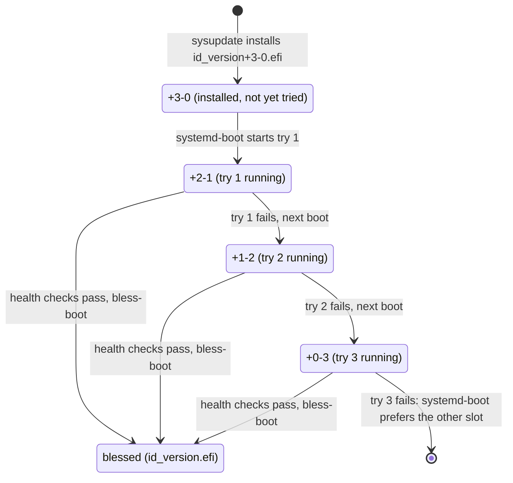

# A/B updates with health-checked rollback

An update writes a new version to the inactive copy of `/usr` and installs its boot image beside the
old one. The machine boots the new version on trial. If the trial fails three times, the boot loader
starts the previous version again. You keep a working machine without a console and without a script
on the host.

## How it works

The image holds two slots, A and B. A slot is three partitions: `/usr`, its verity hash tree and the
verity signature. Each slot also has a UKI (Unified Kernel Image, a signed boot file) on the ESP
(EFI System Partition). `systemd-sysupdate` fills the inactive slot with four transfers: `10-usr`,
`20-usr-verity`, `30-usr-verity-sig` and `40-uki`, each a `.transfer` file in
`/usr/lib/sysupdate.d`. Each transfer keeps two versions (`InstancesMax=2`) and never overwrites the
running one (`ProtectVersion=%A`). Every transfer has `Verify=yes`, with or without Secure Boot:
sysupdate checks the signed index before it writes ([Signed releases](signed-releases.md),
[Updates: What an update authenticates](../design/updates.md#what-an-update-authenticates)).

The UKI lands on the ESP as `EFI/Linux/<id>_<version>+3-0.efi`. The suffix is the boot counter:
three tries left, none done. systemd-boot counts down on each attempt.



A boot is good only if it reaches `boot-complete.target`. Two health units gate it:

- `golconda-health-network.service` needs a routable link within 60 seconds.
- `golconda-health-sshd.service` needs `sshd.service` active.

When both pass, `systemd-bless-boot` removes the suffix. When one fails, or the target is not
reached within 15 minutes, the machine reboots by itself and the next try starts; a kernel panic, a
PID 1 crash and an initrd failure reboot it too ([Boot: Trial boot](../design/boot.md#trial-boot)).
After a good boot, `golconda-loader-update.service` copies this release's signed systemd-boot to the
ESP. A release that fails its health gate never touches the loader.

## Using it

Set the source in the system table. It becomes part of the image.

```toml
["/system"]
name = "web"
version = "20261101.1"
updateSource = "https://updates.example.com/web/"
```

Serve the `release/` directory of the build at that URL. The image enables
`systemd-sysupdate-update.timer`, which installs, and `systemd-sysupdate-reboot.timer`, which
reboots into an installed release at 04:10 (plus up to 30 random minutes). systemd's install timer
runs 15 minutes after boot, then 2 hours after each run and on each Saturday, each time with up to 4
hours of random delay (`OnBootSec=15min`, `OnUnitActiveSec=2h`, `OnCalendar=Sat`,
`RandomizedDelaySec=4h`). To install at once, run
`systemctl start --wait systemd-sysupdate-update.service` on the machine. Set another window, or
`null` to reboot by hand:

```toml
["/system"]
updateReboot = "Sat 03:00"
```

The reboot happens only when the boot loader would start the new release: after a fallback, the
failed release stays installed and the machine stays on the old one
([Updates: Activation](../design/updates.md#activation)). With `updateSource` unset, the image has
no transfers and no update runs. Read the counters with `bootctl list`.

## Status

Proven: the rows of [What is proven](../proven.md) that name `sysupdate-installed`,
`update-activated`, `fallback-to-old-slot`, `initrd-fail-rebooted`, `fail-panic-rebooted` and
`loader-update-ran`. The limits are below.

## Limits

- A fresh disk has one slot. There the loader still boots the exhausted entry, so after three
  reboots the machine stays up and unblessed until you fill the other slot.
- An initrd that hangs has no test of its own, and a kernel that hangs needs a hardware watchdog
  ([Boot: Trial boot](../design/boot.md#trial-boot)).
- The machine goes back to an older release only by a fallback: boot counting, or the failed-boot
  count ([Boot: Failed boots](../design/boot.md#failed-boots)). `golconda release` refuses a version
  that does not increase before it is built or published.
- Nothing stops an older image signed by the same key from booting. Rollback protection is
  *(later)*.
- The tests use plain HTTP in QEMU. HTTPS from a real update server ran by hand on Hetzner Cloud
  ([What is proven](../proven.md#not-proven)); it has no marker. The timer and real hardware have
  none either. The 04:10 window itself is not waited for: the test moves it.

## More

- [Updates](../design/updates.md): transfers, update source, versions.
- [Boot](../design/boot.md#boot-counting-and-ab) and [Boot health](../design/boot.md#boot-health):
  the counter and the two units.
- [Boot loader](../design/bootloader.md#the-loader-on-a-running-machine): the loader update.
- [Image artifacts](../reference/image.md#a-release) and [Releases](../design/releases.md).
- [Factory reset and recovery](factory-reset.md).
