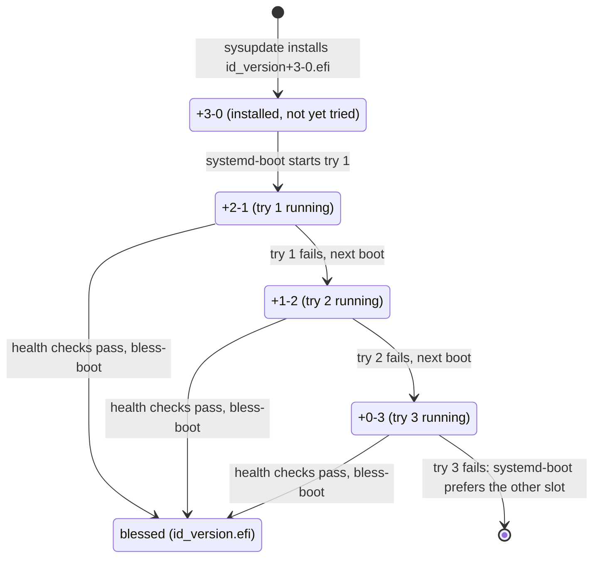

# A/B updates with health-checked rollback

An update writes a new version to the inactive copy of `/usr` and installs its boot image beside the
old one. The machine boots the new version on trial. If the trial fails three times, the boot loader
starts the previous version again. You keep a working machine without a console and without a script
on the host.

## How it works

The image holds two slots, A and B. A slot is three partitions: `/usr`, its verity hash tree and the
verity signature. Each slot also has a UKI (Unified Kernel Image, a signed boot file) on the ESP
(EFI System Partition). `systemd-sysupdate` fills the inactive slot with four transfers: `10-usr`,
`20-usr-verity`, `30-usr-verity-sig` and `40-uki`, each a `.transfer` file in
`/usr/lib/sysupdate.d`. Each transfer keeps two versions (`InstancesMax=2`) and never overwrites the
running one (`ProtectVersion=%A`). Every transfer has `Verify=yes`: sysupdate checks the signed
index before it writes ([Signed releases](signed-releases.md)).

The UKI lands on the ESP as `EFI/Linux/<id>_<version>+3-0.efi`. The suffix is the boot counter:
three tries left, none done. systemd-boot counts down on each attempt.



A boot is good only if it reaches `boot-complete.target`. Two health units gate it:

- `golconda-health-network.service` needs a routable link within 60 seconds.
- `golconda-health-sshd.service` needs `sshd.service` active.

When both pass, `systemd-bless-boot` removes the suffix. After a good boot,
`golconda-loader-update.service` copies this release's signed systemd-boot to the ESP. A release
that fails its health gate never touches the loader.

## Using it

Set the source in the system table. It becomes part of the image.

```toml
["/system"]
name = "web"
version = "20261101.1"
updateSource = "https://updates.example.com/web/"
```

Serve the `release/` directory of the build at that URL. The image enables
`systemd-sysupdate-update.timer`. With `updateSource` unset, the image has no transfers and no
update runs. Read the counters with `bootctl list`.

## Status

The boot test proves this in QEMU with OVMF ([What is proven](../proven.md)):

- `release-index`, `sysupdate-installed`, `boots-next`, `etc-follows-update`,
  `hostkey-unsealed-after-update` and `no-failed-units-after-update`: the update installs, the new
  version boots with its own `/etc` and opens the old host key (`--next`).
- `http-source`, `http-fetch`, `index-signed`: the guest fetches over HTTP with its own definition.
- `health-check-broken`, `attempt-[1-3]-unblessed`, `fallback-to-old-slot`, `counter-exhausted`,
  `old-slot-selected`, `etc-follows-update`: a failed health check costs one try each, and the old
  release boots after the third, with its own `/etc` (`--next --fail-health`).
- `loader-update-ran` and `loader-update-not-run`: the loader updates after a good boot only.

## Limits

- A failed health check does not reboot the machine. The counter falls at the next boot, which the
  operator starts.
- A fresh disk has one slot. There the loader still boots the exhausted entry, so the machine stays
  up and unblessed until you fill the other slot.
- The machine supports no downgrade except the boot-counting fallback. A release script that refuses
  a version that does not increase is *(planned)*.
- Nothing stops an older image signed by the same key from booting. Rollback protection is *(after
  v1)*.
- The tests use plain HTTP in QEMU. HTTPS, a real update server, the timer and real hardware have no
  marker.

## More

- [Updates](../design/updates.md): transfers, update source, versions.
- [Boot](../design/boot.md#boot-counting-and-ab) and [Boot health](../design/boot.md#boot-health):
  the counter and the two units.
- [Boot loader](../design/bootloader.md#the-loader-on-a-running-machine): the loader update.
- [Image artifacts](../reference/image.md#a-release) and [Releases](../design/releases.md).
- [Factory reset and recovery](factory-reset.md).
