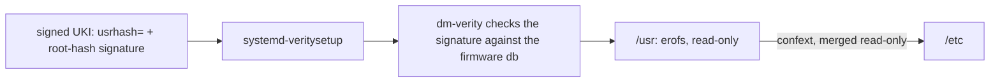

# A read-only, verified /usr

The operating system is one read-only filesystem, and the kernel checks every block against a signed
hash. A changed file in `/usr` does not run. `/etc` comes from `/usr` too, read-only. All state
lives in one place, `/var` on the state partition, so you know what an update replaces and what it
keeps.



## How it works

- **erofs under dm-verity.** `/usr` is an erofs image (`mkfs.erofs -zlz4hc`). A verity hash tree
  protects it. The builder signs the root hash with the Secure Boot `db` key as PKCS#7
  (`lib/image/verity.nu`).
- **The signature rides in the UKI.** The kernel command line (in the signed UKI, a unified kernel
  image) holds `usrhash=` and `systemd.verity_usr_options=root-hash-signature=base64:<sig>`.
  `usrhash=` names the two partitions by UUID, so no root partition is needed to find `/usr`. The
  kernel checks the signature against the firmware `db`. The build fails if the signature does not
  match the UKI's certificate.
- **A/B slots.** The disk has `usr-a` and `usr-b`, each with a verity and a signature partition (10
  GiB, 128 MiB, 16 KiB). An update writes the inactive slot and its UKI. systemd-boot counts boots
  and falls back after three failures.
- **`/etc` is read-only.** `lib/etc.nix` runs sysusers and the `/etc` lines of tmpfiles at build
  time and puts the result in `/usr/lib/confexts/golconda`. The initrd merges it onto `/etc` with
  overlayfs, read-only, with no upper layer. `/factory` seeds `/usr/share/factory/etc`, and
  `L /etc/<path> - - - - /usr/share/factory/etc/<path>` lines link each file. `/etc/machine-id` is
  empty: PID 1 mounts the id from the SMBIOS UUID or a credential over it. Nothing writes
  `hostname`. See [Layout: The read-only /etc](../design/layout.md#the-read-only-etc).
- **`/var` is state.** Services use `StateDirectory=` and so `/var/lib/<app>`. Vars sit under
  `/var/lib/golconda/vars`. `/home` and `/root` are on the same partition. `/tmp` and `/run` are
  tmpfs.
- **Only declared paths exist.** A fragment's `files` must be under `/usr`. A path under `/etc` is a
  type error outside `/factory`.

## Using it

You cannot change `/etc` on the machine. A change is a new image:

```sh
touch /etc/x                   # Read-only file system
systemctl mask --runtime foo   # only --runtime works, until the next boot
```

An update brings its own `/etc` with its `/usr`. A program that rewrites a file in place needs a
directory of its own under `/var`.

## Status

Proven in QEMU: `multi-user-reached` and `boot-complete` with `ipe.enforce=1`, so the kernel accepts
the signature. `etc-read-only` shows the read-only `/etc` and the machine id from the SMBIOS UUID.
`sysupdate-installed`, `boots-next` and `etc-follows-update` cover the A/B update.
`fallback-to-old-slot` and `counter-exhausted` cover the rollback. `state-gone` and `slots-kept`
cover the factory reset. See [What is proven](../proven.md).

## Limits

- The state partition is unencrypted in v1. LUKS2 with TPM2 is *(after v1)*.
- A signature that does not verify does not stop `systemd-veritysetup`. It logs at info level and
  activates `/usr` unsigned. IPE then denies PID 1's re-exec and the boot stops at switch-root.
- Both slots are fixed at 10 GiB, and each must hold any release.
- A rotated `db` key needs new images.
- Nothing checks `/var`.
- An administrator cannot change `/etc` at all. Signed confexts in `/var/lib/confexts` could allow
  it; this is not designed.
- `/etc/shadow` is world-readable: the Nix store makes every file 0444. It holds no password.
- Hardware and real-firmware enrolment have not run.

## More

- [Layout](../design/layout.md#the-read-only-etc) and [reference/layout](../reference/layout.md)
- [Trust: verity key](../design/trust.md#2-verity-key)
- [Boot](../design/boot.md#boot-counting-and-ab) and [Updates](../design/updates.md)
- [Principles: immutable by default](../design/principles.md#immutable-by-default)
- [Only signed code runs](execution-policy.md) and [Factory reset](factory-reset.md)
